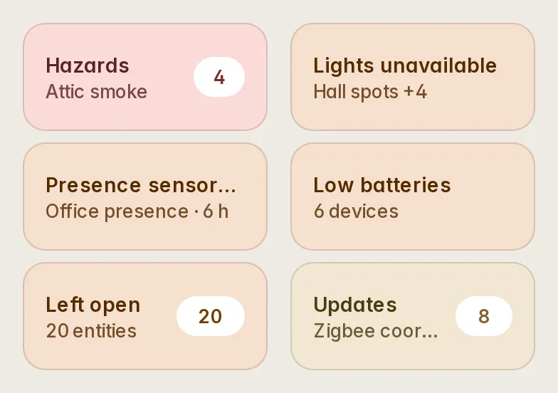

<!-- Generated by `pnpm docs:cards` from the card’s editor and its example in tools/docs/src/gallery.ts: change those, not this page. -->

# Alerts

`custom:fluvy-alerts-card` · [All cards](../cards.md#everyday) · [Try it live](https://acosta290.github.io/fluvy/?card=alerts)

What needs a look — low batteries, devices gone, doors left open, leaks, updates, repairs — each from one line, as tiles, chips, rows or a banner, hidden while all is clear.

<picture><source media="(prefers-color-scheme: dark)" srcset="../images/cards/alerts-dark.webp"></picture>

```yaml
type: custom:fluvy-alerts-card
alerts:
  - preset: hazards
    id: hazards
  - preset: unavailable
    domain: light
    name: Lights unavailable
    id: lights
  - preset: unavailable
    device_class:
      - occupancy
      - presence
      - motion
    name: Presence sensors offline
    id: presence
  - preset: low_battery
    id: batteries
  - preset: open
    for:
      minutes: 5
    id: open
  - preset: updates
    id: updates
```

The picture is this configuration on the demo house, whose names and figures are made up: put your own entities in place of its. [Try it in the live demo](https://acosta290.github.io/fluvy/?card=alerts), where it answers a tap as it would at home, with each of its layouts and the YAML of each.

More about it in the guide: [Alerts](../cards.md#alerts).

## Layouts

`variant` chooses the layout. The picture is `tiles`, the one the card has when the key is left out; each of the others is the example plus these lines.

| `variant` | Add to the example | Live |
| --- | --- | --- |
| `mini` | `variant: mini` | [Try it](https://acosta290.github.io/fluvy/?card=alerts&layout=mini) |
| `chips` | `variant: chips` | [Try it](https://acosta290.github.io/fluvy/?card=alerts&layout=chips) |
| `rows` | `variant: rows` | [Try it](https://acosta290.github.io/fluvy/?card=alerts&layout=rows) |
| `banner` | `variant: banner` | [Try it](https://acosta290.github.io/fluvy/?card=alerts&layout=banner) |

## Options

Every key the card’s editor shows: the editor’s word for it in italics, then what it does. *Default* is what the card does when the key is left out, as the editor shows it on a new card; the editor never writes a default into the configuration.

| Key | What it does | Type | Default | Values |
| --- | --- | --- | --- | --- |
| `title` | *Title*. The title at the top of the card. | text |  |  |
| `subtitle` | *Subtitle*. The line under the title. | text |  |  |
| `variant` | *Style*. The card’s layout. | choice | `tiles` | `tiles`, `mini`, `chips`, `rows`, `banner` |
| `columns` | *Columns*. How many tiles stand in a row. | choice | `2` | `1`, `2`, `3`, `4`, `auto` (Automatic) |
| `icon` | *Icon*. The card’s icon, in place of the entity’s own. | icon |  |  |
| `show_icon` | *Show the icon*. Shows the icon, hides it, or lets the card decide. | choice | `auto` | `auto` (Automatic), `always`, `never` |
| `name_lines` | *Lines for the name*. Lets the name in the card’s head take two balanced lines where one would cut it; the head is a line taller whatever the name. | choice | `1` | `1`, `2` |
| `show_count` | *Show how many are on*. Shows how many each alert matches. | boolean | `true` |  |
| `show_culprit` | *Who it is*. Names what each alert is about ("Hall sensor, Porch +1"). | boolean | `true` |  |
| `show_duration` | *How long*. Says how long each alert has held ("Front door · 6 min"). | boolean | `true` |  |
| `compact` | *Compact rows*. Draws shorter rows that leave out who is at fault. | boolean | `false` |  |
| `order` | *Order*. Orders the alerts by severity, or as they are listed. | choice | `severity` | `severity` (By severity), `config` (As listed) |
| `rotate` | *Seconds per alert*. How many seconds the banner shows an alert before it turns to the next. | number | `6` | 0 to 60 |
| `snooze` | *Snoozes kept for*. Where snoozed alerts are remembered: each person’s, this device’s, the house’s, or nowhere. | choice | `user` | `user` (Each person), `device` (This device), `house` (The whole house), `off` |
| `max_alerts` | *At most*. The most alerts shown at once; the rest fold into a "+N". | number |  | 1 to 30 |
| `empty_text` | *Text when empty*. What the card says while it has nothing to show. | text |  |  |
| `hide_empty` | *Hide when empty*. Hides the whole card while it has nothing to show. | boolean | `true` |  |
| `tone` | *Tone*. The card’s colour from the palette’s tones; left out, the tone of what it shows. | choice | the card’s own | `accent`, `light`, `heat`, `cool`, `dry`, `fan`, `water`, `solar`, `grid`, `media`, `presence`, `armed`, `battery`, `house`, `gas`, `vehicle` (Car), `neutral`, `ok` (Good), `warning`, `danger` |
| `color` | *Colour*. The card’s colour: its circle, its accents and its tints wear it. Left out, the colour of what it shows. | colour |  |  |
| `card_color` | *Card colour*. Paints the card’s surface in a colour of your own. | colour |  |  |
| `card_opacity` | *Card opacity*. How see-through the card’s surface is, in percent. Untouched: every card’s, from Fluvy’s settings. | number | `100` | 0 % to 100 %, in steps of 5 |
| `card_border` | *Card border*. Draws the card’s hairline border, or leaves it out. Untouched: every card’s, from Fluvy’s settings. | boolean | `true` |  |
| `unavailable` | *When unavailable*. How the card looks while its entity is unavailable: dashed, or quiet. Untouched: every card’s, from Fluvy’s settings. | choice | `dashed` | `dashed`, `quiet` (As when off) |
| `alerts` | *Alerts*. The alerts, each a ready-made one or your own, by what it matches. | list ([its items](#alerts)) |  |  |

**Interactions**

| Key | What it does | Type | Default | Values |
| --- | --- | --- | --- | --- |
| `tap_action` | *Tap action*. What a tap on the card does. | action | the card’s own |  |
| `hold_action` | *Hold action*. What a long press on the card does. | action | the card’s own |  |
| `double_tap_action` | *Double tap action*. What two taps on the card do. A tap waits a moment to tell it from a double tap. | action | `none` |  |

## Lists

### `alerts`

*Alerts*. The alerts, each a ready-made one or your own, by what it matches. An item is a map with `preset` and any of these keys.

| Key | What it does | Type | Values |
| --- | --- | --- | --- |
| `preset` | *Alert*. A ready-made alert, or one of your own. | choice | `low_battery` (Low batteries), `unavailable`, `open` (Left open), `unlocked`, `hazards`, `errors`, `updates`, `lights_on`, `ha_alerts` (Home Assistant alerts), `repairs`, `custom` |
| `name` | *Name*. The alert’s name. Your own words, or each entity’s: attribute:title, or a template such as {{ state_attr(entity, 'title') }}. | text |  |
| `icon` | *Icon*. The item’s own icon, in place of the one the card would give it. Or each entity’s: attribute:icon, or a template. | icon |  |
| `secondary` | *Message*. The message under the alert’s name. Your own words, or each entity’s: attribute:title, or a template such as {{ state_attr(entity, 'title') }}. | text |  |
| `severity` | *Severity*. How grave the alert is: critical, a warning, or information. Or each entity’s: attribute:severity (error, warning, info, success…) | choice or text | `critical`, `warning`, `info` |
| `tone` | *Tone*. The item’s colour from the palette’s tones. | choice | `accent`, `light`, `heat`, `cool`, `dry`, `fan`, `water`, `solar`, `grid`, `media`, `presence`, `armed`, `battery`, `house`, `gas`, `vehicle` (Car), `neutral`, `ok` (Good), `warning`, `danger` |
| `color` | *Colour*. The item’s colour, in place of the one the card gives it. Empty: the colour the card gives it. | colour |  |
| `entity` | *Entities*. Counts only these entities. | entities |  |
| `domain` | *Domains*. Counts only the entities of these domains. | choices or text |  |
| `device_class` | *Device classes*. Counts only the entities of these device classes. | choices or text |  |
| `entity_id` | *Ids like (sensor.*_battery)*. Counts the entities whose ids match these patterns. | text |  |
| `integration` | *Integrations*. Counts only the entities of these integrations. | choices or text |  |
| `state` | *State is*. Counts an entity whose state is one of these. | choices or text |  |
| `not_state` | *State is not*. Counts an entity whose state is none of these. | choices or text |  |
| `above` | *Above*. Counts an entity whose state, or the attribute named, is above this number. | number | -100000 to 100000, in steps of 0.1 |
| `below` | *Below*. Counts an entity whose state, or the attribute named, is below this number. | number | -100000 to 100000, in steps of 0.1 |
| `attribute` | *Attribute*. The attribute that is compared, in place of the state. | text |  |
| `attributes` | *Attributes are*. Attributes each entity must have, with the values they may hold. Each one’s value, or a list of values: severity: [error, warning]. | object |  |
| `phones` | *Phones too*. Counts phones’ batteries too. | boolean |  |
| `acknowledged` | *Acknowledged ones too*. Counts Home Assistant’s alerts that were acknowledged too. | boolean |  |
| `area` | *Area*. Counts only the entities of this area. | area |  |
| `floor` | *Floors*. Counts only the entities of these floors. | floor |  |
| `label` | *Label*. Counts only the entities with this label. | label |  |
| `device` | *Devices*. Counts only the entities of these devices. | device |  |
| `exclude` | *Never these*. Never counts these entities. | entities |  |
| `for` | *For at least*. Counts an entity only once it has matched for this long. | duration |  |
| `unchanged_for` | *Unchanged for*. Counts an entity whose state has not changed for this long. | duration |  |
| `since` | *Waiting since*. Where the time the alert began is read from. Each entity’s attribute:start_date (a time, or Unix time); else when it last changed. | text |  |
| `include_unavailable` | *Unavailable ones count*. Counts unavailable and unknown entities too. | boolean |  |
| `hidden` | *Hidden entities too*. Counts hidden entities too. | boolean |  |
| `diagnostic` | *Diagnostic entities too*. Counts diagnostic entities too. | boolean |  |
| `count_by` | *Count*. Counts the entities, or the devices they belong to. | choice | `entity`, `device` |
| `min_count` | *Shows from*. Shows the alert from this many matches up. | number | 1 to 100 |
| `name_by` | *Rows named by*. What each row is named by: the entity, its device, its area, or an attribute. Or an attribute of each entity: attribute:title. | choice or text | `entity`, `device`, `area` |
| `sort_rows` | *Rows in order of*. The order of the alert’s rows. | choice | `duration` (Longest first), `value` (Lowest first), `name`, `area` |
| `split` | *One per entity*. Makes an alert of each entity it matches. | boolean |  |
| `snooze` | *May be snoozed*. Lets the alert be snoozed. | boolean |  |
| `admin_only` | *Administrators only*. Shows the alert to administrators only. | boolean |  |
| `row_action` | *Row tap*. What a tap on one of the alert’s rows does. | action |  |
| `row_hold_action` | *Row hold*. What a long press on one of the alert’s rows does. | action |  |
| `row_double_tap_action` | *Row double tap*. What two taps on one of the alert’s rows do. A tap waits a moment to tell it from a double tap. | action |  |
| `row_button` | *Row button*. A button on each of the alert’s rows. | object |  |
| `actions` | *Buttons*. Buttons the alert’s sheet offers, each with its words, its icon and the action it runs. | object |  |
| `conditions` | *Only when*. Conditions under which the alert counts at all. | object |  |
| `escalate` | *Escalate*. Raises the alert to a graver severity once it has held for a while, or matched enough. | object |  |
| `match` | *Matches any of*. Further groups of conditions, any of which may match. | object |  |
| `id` | *Remembered as*. The name the alert’s snoozes are remembered by. | text |  |

**Interactions**

| Key | What it does | Type | Values |
| --- | --- | --- | --- |
| `tap_action` | *Tap action*. What a tap on the item does. | action |  |
| `hold_action` | *Hold action*. What a long press on the item does. | action |  |
| `double_tap_action` | *Double tap action*. What two taps on the item do. A tap waits a moment to tell it from a double tap. | action |  |

## Older names

Names the card still reads, so a dashboard written before keeps working. They are read, never written back.

| Older name | Read as |
| --- | --- |
| `sub` | `subtitle` |
| `meta` | `subtitle` |
| `layout` | `variant` |
| `view` | `variant` |
| `accent` | `color` |
