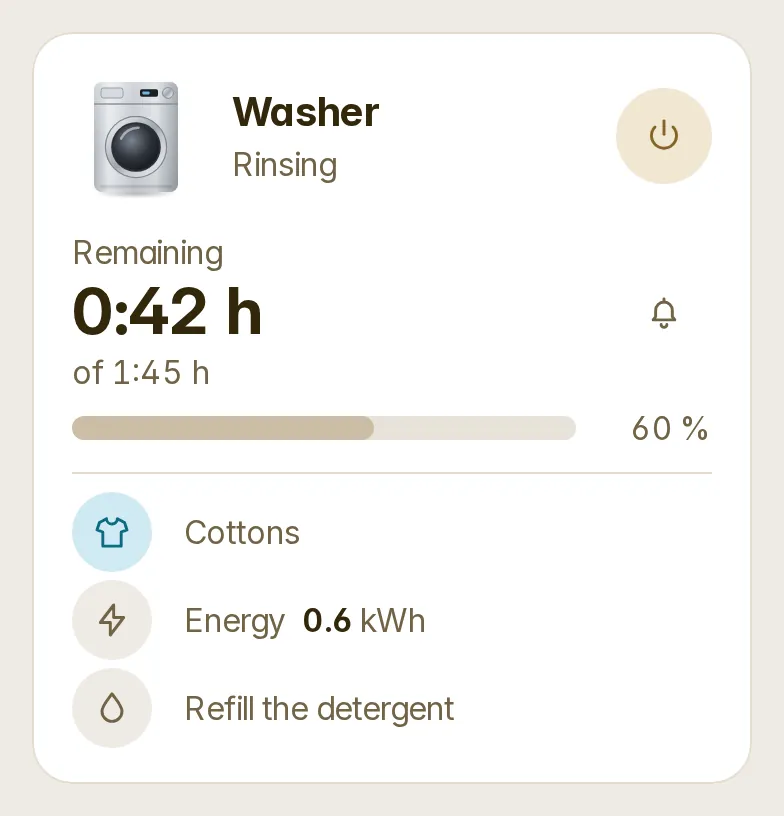

<!-- Generated by `pnpm docs:cards` from the card’s editor and its example in tools/docs/src/gallery.ts: change those, not this page. -->

# Appliance

`custom:fluvy-appliance-card` · [All cards](../cards.md#everyday) · [Try it live](https://acosta290.github.io/fluvy/?card=appliance)

A washer, dryer, dishwasher, oven, hob, fridge, coffee machine, pet feeder, fountain, litter box or small appliance on a plug, pictured: what it does, when it is ready, what it uses, its reminders.

<picture><source media="(prefers-color-scheme: dark)" srcset="../images/cards/appliance-dark.webp"></picture>

```yaml
type: custom:fluvy-appliance-card
device: miele-washer
name: Washer
```

The picture is this configuration on the demo house, whose names and figures are made up: put your own entities in place of its. [Try it in the live demo](https://acosta290.github.io/fluvy/?card=appliance), where it answers a tap as it would at home, with each of its layouts and the YAML of each.

More about it in the guide: [Appliances](../cards.md#appliances).

## Layouts

`variant` chooses the layout. The picture is `full`, the one the card has when the key is left out; each of the others is the example plus these lines.

| `variant` | Add to the example | Live |
| --- | --- | --- |
| `compact` | `variant: compact` | [Try it](https://acosta290.github.io/fluvy/?card=appliance&layout=compact) |
| `ring` | `variant: ring` | [Try it](https://acosta290.github.io/fluvy/?card=appliance&layout=ring) |
| `row` | `variant: row` | [Try it](https://acosta290.github.io/fluvy/?card=appliance&layout=row) |

## Options

Every key the card’s editor shows: the editor’s word for it in italics, then what it does. *Default* is what the card does when the key is left out, as the editor shows it on a new card; the editor never writes a default into the configuration.

| Key | What it does | Type | Default | Values |
| --- | --- | --- | --- | --- |
| `device` | *Appliance*. The device the card reads: every entity it has is found on it. | device |  |  |
| `entity` | *Entity*. An entity in place of the device, such as a plug’s switch: the card reads the appliance from it. | entity |  |  |
| `kind` | *What it is*. What the appliance is, where the card should not find it by itself. | choice | `auto` | `auto` (Automatic), `washer` (Washing machine), `dryer` (Tumble dryer), `washer_dryer`, `dishwasher`, `oven`, `microwave`, `hob`, `hood` (Cooker hood), `fridge`, `freezer`, `wine` (Wine cooler), `coffee` (Coffee machine), `kettle`, `air_fryer`, `toaster`, `blender`, `sandwich_maker`, `feeder` (Pet feeder), `fountain` (Pet fountain), `litter_box`, `appliance` |
| `variant` | *Style*. The card’s layout. | choice | `full` | `full`, `compact`, `ring`, `row` |
| `name` | *Name*. The name the card shows, in place of the entity’s own. | name |  |  |
| `icon` | *Icon*. The card’s icon, in place of the entity’s own. | icon |  |  |
| `show_icon` | *Show the icon*. Shows the icon, hides it, or lets the card decide. | choice | `auto` | `auto` (Automatic), `always`, `never` |
| `show_badge` | *Show the badge*. Shows the badge at the end of the head, such as the card’s state or a count. | boolean | `true` |  |
| `name_lines` | *Lines for the name*. Lets the name in the card’s head take two balanced lines where one would cut it; the head is a line taller whatever the name. | choice | `1` | `1`, `2` |
| `unit` | *Drum or cavity*. Which drum or cavity the card shows, where it has two. | choice | `both` | `both`, `main` (The first), `sub` (The second) |
| `picture` | *Picture*. The card’s picture: the kind’s drawing, its icon, or none. | choice | `art` | `art` (Picture), `icon`, `none` |
| `image` | *Own picture (address or entity)*. A picture of your own in place of the card’s drawing: an address, or an entity whose picture it is. | text |  |  |
| `picture_min` | *Smallest picture*. The smallest the picture becomes before a long name is shortened. Automatic: the picture shrinks, then makes room, before the name is shortened. A size keeps the picture at least that large; a long name then ends in “…”. | choice | `auto` | `auto` (Automatic), `32` (Small), `44` (Medium), `64` (Large) |
| `show_power` | *Show the power button*. Shows the round that switches it on and off. | boolean | `true` |  |
| `power_action` | *Power button*. What the power round does. | action | the card’s own |  |
| `show_notify` | *Show “Tell me when it’s done”*. Shows "Tell me when it’s done", which sets up a phone notification. | boolean | `true` |  |
| `tone` | *Tone*. The card’s colour from the palette’s tones; left out, the tone of what it shows. | choice | the card’s own | `accent`, `light`, `heat`, `cool`, `dry`, `fan`, `water`, `solar`, `grid`, `media`, `presence`, `armed`, `battery`, `house`, `gas`, `vehicle` (Car), `neutral`, `ok` (Good), `warning`, `danger` |
| `color` | *Colour*. The card’s colour: its circle, its accents and its tints wear it. Left out, the colour of what it shows. | colour |  |  |
| `card_color` | *Card colour*. Paints the card’s surface in a colour of your own. | colour |  |  |
| `card_opacity` | *Card opacity*. How see-through the card’s surface is, in percent. Untouched: every card’s, from Fluvy’s settings. | number | `100` | 0 % to 100 %, in steps of 5 |
| `card_border` | *Card border*. Draws the card’s hairline border, or leaves it out. Untouched: every card’s, from Fluvy’s settings. | boolean | `true` |  |
| `unavailable` | *When unavailable*. How the card looks while its entity is unavailable: dashed, or quiet. Untouched: every card’s, from Fluvy’s settings. | choice | `dashed` | `dashed`, `quiet` (As when off) |
| `scan` | *Search its device for the rest*. Searches the device for the rest of its entities; off, the card reads only those named. Off: the card reads only its entity and the entities named here. | boolean | `true` |  |
| `rows` | *Rows*. The rows the card shows, each a reading of the appliance chosen by its key. | list ([its items](#rows)) |  |  |
| `tiles` | *Tiles*. The tiles the card shows, each a reading of the appliance chosen by its key. | list ([its items](#tiles)) |  |  |
| `sensors` | *More readouts*. More readouts from any of the device’s entities, after the card’s own. | list ([its items](#sensors)) |  |  |
| `maintenance` | *Reminders*. The reminders the card says, such as salt, a filter or descaling. | list ([its items](#maintenance)) |  |  |
| `zones` | *Compartments*. The compartments the card shows, such as a fridge’s and its freezer’s. | list ([its items](#zones)) |  |  |
| `roles` | *Entities named by hand*. Entities named by hand for a part the card does not find on the device, or should read otherwise. Name the entities the card did not find, or None for one it should not use. | list ([its items](#roles)) |  |  |

**What it shows**

| Key | What it does | Type | Default | Values |
| --- | --- | --- | --- | --- |
| `show_hero` | *Show the figures*. Shows the large figures: the time left, the temperature, the compartments. | boolean | `true` |  |
| `show_progress` | *Show the progress*. Shows the cycle’s progress. | boolean | `true` |  |
| `progress_style` | *Progress*. Draws the cycle’s progress as a bar, or in steps. | choice | `auto` | `auto` (Automatic), `bar`, `steps` |
| `time` | *Times*. Which times the card says: the time left, the time it ends, or both. | choice | `both` | `both` (Time left and when it ends), `left` (Time left), `end` (When it ends) |
| `show_zones` | *Show the compartments or zones*. Shows the compartments or the zones. | boolean | `true` |  |
| `setpoint_style` | *Compartments as*. Shows each compartment’s temperature as a readout, or with − and + to set it. | choice | `readout` | `readout` (Values only), `stepper` (With steppers) |
| `show_drinks` | *Show the drinks*. Shows the drinks to choose from. | boolean | `true` |  |
| `show_rows` | *Show the rows*. Shows the rows under the main control. | boolean | `true` |  |
| `drinks` | *Drinks*. The drinks the card offers, in this order. | choices or text | what the device offers |  |
| `row_values` | *Values in the rows*. Where a row’s value stands: beside its words, at the end, or in one phrase with them. | choice | `inline` | `inline` (Beside the words), `end` (At the end), `plain` |
| `readouts` | *Readouts*. The readouts the card shows, in this order; left out, the kind’s. | choices | `temperature`, `spin`, `energy` | `program` (Programme), `temperature`, `spin`, `dryness`, `energy`, `water`, `cycles`, `detergent`, `elapsed`, `total` (In all), `this_cycle`, `probe` (Core), `power` |
| `show_maintenance` | *Show the reminders*. Shows the reminders, such as salt or a filter. | boolean | `true` |  |
| `show_modes` | *Show the quick modes*. Shows the fridge’s quick modes as chips. | boolean | `false` |  |
| `modes_style` | *Quick modes as*. How the modes are drawn. | choice | `chips` | `chips`, `tiles` |
| `modes` | *Quick modes*. The fridge’s quick modes the card offers, in this order. | choices | what the device offers | `super_cool`, `super_freeze`, `eco`, `holiday`, `ice_maker`, `sabbath`, `child_lock` |
| `show_controls` | *Show the buttons*. Shows the buttons. | boolean | `false` |  |
| `show_programs` | *Programmes to choose from*. Shows the programmes to choose from while it is at rest. | boolean | `false` |  |
| `controls` | *Buttons*. The buttons the card shows, in this order; left out, the kind’s. | choices | `start`, `pause`, `stop`, `power` | `start`, `pause`, `stop`, `power`, `light`, `feed` (Feed now), `clean` (Clean now), `deodorize`, `level` (Level the litter) |
| `confirm` | *Ask first*. The actions the card asks about before it runs them. | choices | `stop`, `off`, `feed`, `clean`, `level` | `start`, `resume`, `pause`, `stop`, `off` (Switch off), `feed` (Feed now), `clean` (Clean now), `level` (Level the litter) |
| `feed_amount` | *Meal amount*. The amount of a meal the feeder gives from the card. | number |  | 1 to 400 |

**Reminders**

| Key | What it does | Type | Default | Values |
| --- | --- | --- | --- | --- |
| `unload_reminder` | *Unload reminder*. Says when a finished cycle waits to be unloaded. | boolean | `true` |  |
| `unload_after` | *Remind after (min)*. How many minutes after a finish the card says it waits to be unloaded. | number | `30` | 0 to 720 |
| `done_for` | *Done for (min)*. How many minutes a finished cycle keeps saying it is done. | number | `120` | 0 to 1440 |
| `door_alert` | *Door alert after (s)*. How many seconds a door may stand open before the card warns of it. | number | `0` | 0 to 3600 |
| `low_level` | *Low below (%)*. The level, in percent, below which a tank or a filter reads low. | number | `20` | 0 to 100 |
| `low_days` | *Soon within (days)*. Says a part is soon due within this many days. | number |  | 0 to 90 |

**On a smart plug**

| Key | What it does | Type | Default | Values |
| --- | --- | --- | --- | --- |
| `running_power` | *Running from (W)*. The power in watts from which a plug’s appliance counts as running. | number | `5` | 1 to 3000 |
| `finished_after` | *Finished after (min)*. How many minutes under its running power a plug’s appliance waits before its cycle is done. | number | `3` | 1 to 120 |

**Interactions**

| Key | What it does | Type | Default | Values |
| --- | --- | --- | --- | --- |
| `tap_action` | *Tap action*. What a tap on the card does. | action | `more-info` |  |
| `hold_action` | *Hold action*. What a long press on the card does. | action | `more-info` |  |
| `double_tap_action` | *Double tap action*. What two taps on the card do. A tap waits a moment to tell it from a double tap. | action | `none` |  |
| `icon_tap_action` | *Icon tap action*. What a tap on the icon does. | action | `none` |  |
| `icon_hold_action` | *Icon hold action*. What a long press on the icon does. | action | `none` |  |
| `icon_double_tap_action` | *Icon double tap action*. What two taps on the icon do. A tap waits a moment to tell it from a double tap. | action | `none` |  |

## Lists

### `rows`

*Rows*. The rows the card shows, each a reading of the appliance chosen by its key. An item is a map with `key` and any of these keys.

| Key | What it does | Type | Values |
| --- | --- | --- | --- |
| `key` | *Row*. Which key it is. | choice | `program` (Programme), `temperature`, `target` (Target temperature), `spin`, `dryness`, `water` (Water used), `energy` (Energy used), `power`, `remaining` (Time remaining), `end` (When it ends), `elapsed` (Time so far), `mode`, `alarm`, `last_brew`, `zones` (Zones on), `last_meal`, `next_meal`, `fed_today`, `drank_today`, `purified` (Purified water), `pump`, `last_use` (Last used), `uses_today` (Used today), `entity` (Another entity), `salt`, `rinse_aid`, `detergent`, `softener`, `filter`, `machine_care`, `descale` (Descaling), `clean` (Cleaning), `water_tank` (Water), `beans`, `drip_tray`, `milk`, `water_filter`, `air_filter`, `grease_filter`, `leak`, `service`, `food`, `desiccant`, `litter`, `waste` (Waste bin), `deodorant` |
| `entity` | *Entity*. The entity the item shows. | entity |  |
| `name` | *Name*. The item’s own name, in place of the one the card would give it. | name |  |
| `icon` | *Icon*. The item’s own icon, in place of the one the card would give it. | icon |  |
| `color` | *Colour*. The item’s colour, in place of the one the card gives it. Empty: the colour the card gives it. | colour |  |

**Interactions**

| Key | What it does | Type | Values |
| --- | --- | --- | --- |
| `tap_action` | *Tap action*. What a tap on the item does. | action |  |
| `hold_action` | *Hold action*. What a long press on the item does. | action |  |
| `double_tap_action` | *Double tap action*. What two taps on the item do. A tap waits a moment to tell it from a double tap. | action |  |

### `tiles`

*Tiles*. The tiles the card shows, each a reading of the appliance chosen by its key. An item is a map with `key` and any of these keys.

| Key | What it does | Type | Values |
| --- | --- | --- | --- |
| `key` | *Row*. Which key it is. | choice | `program` (Programme), `temperature`, `target` (Target temperature), `spin`, `dryness`, `water` (Water used), `energy` (Energy used), `power`, `remaining` (Time remaining), `end` (When it ends), `elapsed` (Time so far), `mode`, `alarm`, `last_brew`, `zones` (Zones on), `last_meal`, `next_meal`, `fed_today`, `drank_today`, `purified` (Purified water), `pump`, `last_use` (Last used), `uses_today` (Used today), `entity` (Another entity), `salt`, `rinse_aid`, `detergent`, `softener`, `filter`, `machine_care`, `descale` (Descaling), `clean` (Cleaning), `water_tank` (Water), `beans`, `drip_tray`, `milk`, `water_filter`, `air_filter`, `grease_filter`, `leak`, `service`, `food`, `desiccant`, `litter`, `waste` (Waste bin), `deodorant` |
| `entity` | *Entity*. The entity the item shows. | entity |  |
| `name` | *Name*. The item’s own name, in place of the one the card would give it. | name |  |
| `icon` | *Icon*. The item’s own icon, in place of the one the card would give it. | icon |  |
| `color` | *Colour*. The item’s colour, in place of the one the card gives it. Empty: the colour the card gives it. | colour |  |

**Interactions**

| Key | What it does | Type | Values |
| --- | --- | --- | --- |
| `tap_action` | *Tap action*. What a tap on the item does. | action |  |
| `hold_action` | *Hold action*. What a long press on the item does. | action |  |
| `double_tap_action` | *Double tap action*. What two taps on the item do. A tap waits a moment to tell it from a double tap. | action |  |

### `sensors`

*More readouts*. More readouts from any of the device’s entities, after the card’s own. An item is an entity id, or a map with `entity` and any of these keys.

| Key | What it does | Type | Values |
| --- | --- | --- | --- |
| `entity` | *Entity*. The entity the item shows. | entity |  |
| `name` | *Name*. The item’s own name, in place of the one the card would give it. | name |  |

### `maintenance`

*Reminders*. The reminders the card says, such as salt, a filter or descaling. An item is a map with `key` and any of these keys.

| Key | What it does | Type | Values |
| --- | --- | --- | --- |
| `key` | *Reminder*. Which reminder it is. | choice | `salt` (Add salt), `rinse_aid` (Add rinse aid), `detergent` (Refill the detergent), `softener` (Refill the softener), `filter` (Clean the filter), `machine_care` (Run machine care), `descale`, `clean` (Clean the machine), `water_tank` (Refill the water tank), `beans` (Add beans), `drip_tray` (Empty the drip tray), `milk` (Keep the milk cool), `water_filter` (Replace the water filter), `air_filter` (Replace the air filter), `grease_filter` (Clean the grease filter), `leak` (Water leak), `service` (Needs a service), `food` (Refill the food), `desiccant` (Replace the desiccant), `litter` (Add litter), `waste` (Empty the waste bin), `deodorant` (Replace the deodorant) |
| `name` | *Name*. The item’s own name, in place of the one the card would give it. | text |  |
| `icon` | *Icon*. The item’s own icon, in place of the one the card would give it. | icon |  |
| `color` | *Colour*. The item’s colour, in place of the one the card gives it. Empty: the colour the card gives it. | colour |  |

**Interactions**

| Key | What it does | Type | Values |
| --- | --- | --- | --- |
| `tap_action` | *Tap action*. What a tap on the item does. | action |  |
| `hold_action` | *Hold action*. What a long press on the item does. | action |  |
| `double_tap_action` | *Double tap action*. What two taps on the item do. A tap waits a moment to tell it from a double tap. | action |  |

### `zones`

*Compartments*. The compartments the card shows, such as a fridge’s and its freezer’s. An item is an entity id, or a map with `entity` and any of these keys.

| Key | What it does | Type | Values |
| --- | --- | --- | --- |
| `entity` | *Entity*. The entity the item shows. | entity |  |
| `name` | *Name*. The item’s own name, in place of the one the card would give it. | name |  |
| `icon` | *Icon*. The item’s own icon, in place of the one the card would give it. | icon |  |
| `color` | *Colour*. The item’s colour, in place of the one the card gives it. Empty: the colour the card gives it. | colour |  |

**Interactions**

| Key | What it does | Type | Values |
| --- | --- | --- | --- |
| `tap_action` | *Tap action*. What a tap on the item does. | action |  |
| `hold_action` | *Hold action*. What a long press on the item does. | action |  |
| `double_tap_action` | *Double tap action*. What two taps on the item do. A tap waits a moment to tell it from a double tap. | action |  |

### `roles`

*Entities named by hand*. Entities named by hand for a part the card does not find on the device, or should read otherwise. Name the entities the card did not find, or None for one it should not use. An item is a map with `role` and any of these keys.

| Key | What it does | Type | Values |
| --- | --- | --- | --- |
| `role` | *Role*. What the entity stands for on the card. | choice | `state`, `power` (Power switch), `program` (Programme), `phase`, `remaining` (Time left), `finish` (End time), `elapsed` (Time so far), `total` (Total time), `progress`, `start_at` (Delayed start), `temperature`, `target` (Target temperature), `probe` (Core probe), `door`, `remote` (Remote start), `start` (Start button), `pause` (Pause button), `resume` (Resume button), `stop` (Stop button), `light`, `error`, `energy` (Energy meter), `water` (Water used), `watts` (Power reading), `running` (Running sensor), `online` (Connection), `feed` (Feeding control), `schedule` (Feeding plan), `next_feed` (Next meal), `last_feed` (Last meal), `fed_today`, `clean` (Clean button), `last_pet` |
| `entity` | *Entity*. The entity the item shows. | entity |  |

## Older names

Names the card still reads, so a dashboard written before keeps working. They are read, never written back.

| Older name | Read as |
| --- | --- |
| `layout` | `variant` |
| `view` | `variant` |
| `accent` | `color` |
