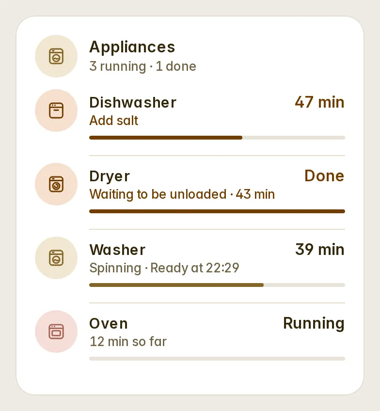

<!-- Generated by `pnpm docs:cards` from the card’s editor and its example in tools/docs/src/gallery.ts: change those, not this page. -->

# Appliances

`custom:fluvy-appliances-card` · [All cards](../cards.md#everyday) · [Try it live](https://acosta290.github.io/fluvy/?card=appliances)

The house’s appliances as live rows, or their whole cards side by side: what runs, what is done, what waits.

<picture><source media="(prefers-color-scheme: dark)" srcset="../images/cards/appliances-dark.webp"></picture>

```yaml
type: custom:fluvy-appliances-card
appliances:
  - device: lg-washer
    name: Washer
  - device: lg-dryer
    name: Dryer
  - device: hc-dish
    name: Dishwasher
  - device: hc-oven
    name: Oven
```

The picture is this configuration on the demo house, whose names and figures are made up: put your own entities in place of its. [Try it in the live demo](https://acosta290.github.io/fluvy/?card=appliances), where it answers a tap as it would at home, with each of its layouts and the YAML of each.

More about it in the guide: [Appliances](../cards.md#appliances).

## Layouts

`variant` chooses the layout. The picture is `rows`, the one the card has when the key is left out; each of the others is the example plus these lines.

| `variant` | Add to the example | Live |
| --- | --- | --- |
| `compact` | `variant: compact` | [Try it](https://acosta290.github.io/fluvy/?card=appliances&layout=compact) |
| `tiles` | `variant: tiles` | [Try it](https://acosta290.github.io/fluvy/?card=appliances&layout=tiles) |
| `cards` | `variant: cards` | [Try it](https://acosta290.github.io/fluvy/?card=appliances&layout=cards) |

## Options

Every key the card’s editor shows: the editor’s word for it in italics, then what it does. *Default* is what the card does when the key is left out, as the editor shows it on a new card; the editor never writes a default into the configuration.

| Key | What it does | Type | Default | Values |
| --- | --- | --- | --- | --- |
| `title` | *Title*. The title at the top of the card. | text |  |  |
| `subtitle` | *Subtitle*. The line under the title. | text |  |  |
| `icon` | *Icon*. The card’s icon, in place of the entity’s own. | icon |  |  |
| `show_icon` | *Show the icon*. Shows the icon, hides it, or lets the card decide. | choice | `auto` | `auto` (Automatic), `always`, `never` |
| `name_lines` | *Lines for the name*. Lets the name in the card’s head take two balanced lines where one would cut it; the head is a line taller whatever the name. | choice | `1` | `1`, `2` |
| `variant` | *Style*. The card’s layout. | choice | `rows` | `rows`, `compact`, `tiles`, `cards` (Whole cards) |
| `max_rows` | *Rows at most*. How many rows the card shows before a "more" row takes the rest. | number | `6` | 1 to 30 |
| `picture` | *Picture*. The picture each appliance shows: its drawing, its icon, or none. | choice | `art` | `art` (Picture), `icon`, `none` |
| `picture_min` | *Smallest picture*. The smallest the picture becomes before a long name is shortened. Automatic: the picture shrinks, then makes room, before the name is shortened. A size keeps the picture at least that large; a long name then ends in “…”. | choice | `auto` | `auto` (Automatic), `32` (Small), `44` (Medium), `64` (Large) |
| `confirm` | *Ask first*. The actions every appliance asks about before it runs them. Left empty, each appliance asks as on its own card, an oven, a microwave or an air fryer before it starts too. What you choose here, every appliance asks. | choices | each appliance’s own | `start`, `resume`, `pause`, `stop`, `off` (Switch off), `feed` (Feed now), `clean` (Clean now), `level` (Level the litter) |
| `show` | *Show*. Shows every appliance, or only those running, waiting or done. | choice | `all` | `all`, `active` (Only the busy ones) |
| `sort` | *Order*. Orders them by what they are doing, by name, or as listed. | choice | `state` | `state` (By what it does), `name`, `none` (As listed) |
| `show_count` | *Show how many are on*. Says on the head’s line how many run, are done and rest. | boolean | `true` |  |
| `hide_empty` | *Hide when empty*. Hides the whole card while it has nothing to show. | boolean | `false` |  |
| `empty_text` | *Text when empty*. What the card says while it has nothing to show. | text |  |  |
| `tone` | *Tone*. The card’s colour from the palette’s tones; left out, the tone of what it shows. | choice | the card’s own | `accent`, `light`, `heat`, `cool`, `dry`, `fan`, `water`, `solar`, `grid`, `media`, `presence`, `armed`, `battery`, `house`, `gas`, `vehicle` (Car), `neutral`, `ok` (Good), `warning`, `danger` |
| `color` | *Colour*. The card’s colour: its circle, its accents and its tints wear it. Left out, the colour of what it shows. | colour |  |  |
| `card_color` | *Card colour*. Paints the card’s surface in a colour of your own. | colour |  |  |
| `card_opacity` | *Card opacity*. How see-through the card’s surface is, in percent. Untouched: every card’s, from Fluvy’s settings. | number | `100` | 0 % to 100 %, in steps of 5 |
| `card_border` | *Card border*. Draws the card’s hairline border, or leaves it out. Untouched: every card’s, from Fluvy’s settings. | boolean | `true` |  |
| `unavailable` | *When unavailable*. How the card looks while its entity is unavailable: dashed, or quiet. Untouched: every card’s, from Fluvy’s settings. | choice | `dashed` | `dashed`, `quiet` (As when off) |
| `appliances` | *Appliances*. The appliances the card lists; left out, every one of the house. | list ([its items](#appliances)) |  |  |

**Interactions**

| Key | What it does | Type | Default | Values |
| --- | --- | --- | --- | --- |
| `tap_action` | *Tap action*. What a tap on the card does. | action | `none` |  |
| `hold_action` | *Hold action*. What a long press on the card does. | action | `none` |  |
| `double_tap_action` | *Double tap action*. What two taps on the card do. A tap waits a moment to tell it from a double tap. | action | `none` |  |
| `icon_tap_action` | *Icon tap action*. What a tap on the icon does. | action | `none` |  |
| `icon_hold_action` | *Icon hold action*. What a long press on the icon does. | action | `none` |  |
| `icon_double_tap_action` | *Icon double tap action*. What two taps on the icon do. A tap waits a moment to tell it from a double tap. | action | `none` |  |

## Lists

### `appliances`

*Appliances*. The appliances the card lists; left out, every one of the house. An item is a map with `device` and any of these keys.

| Key | What it does | Type | Values |
| --- | --- | --- | --- |
| `device` | *Appliance*. The appliance’s device. | device |  |
| `entity` | *Entity*. An entity in place of the device, such as a plug’s switch. | entity |  |
| `name` | *Name*. The item’s own name, in place of the one the card would give it. | name |  |
| `icon` | *Icon*. The item’s own icon, in place of the one the card would give it. | icon |  |
| `color` | *Colour*. The item’s colour, in place of the one the card gives it. Empty: the colour the card gives it. | colour |  |
| `kind` | *What it is*. What the item is. | choice | `auto` (Automatic), `washer` (Washing machine), `dryer` (Tumble dryer), `washer_dryer`, `dishwasher`, `oven`, `microwave`, `hob`, `hood` (Cooker hood), `fridge`, `freezer`, `wine` (Wine cooler), `coffee` (Coffee machine), `kettle`, `air_fryer`, `toaster`, `blender`, `sandwich_maker`, `feeder` (Pet feeder), `fountain` (Pet fountain), `litter_box`, `appliance` |

**Interactions**

| Key | What it does | Type | Values |
| --- | --- | --- | --- |
| `tap_action` | *Tap action*. What a tap on the item does. | action |  |
| `hold_action` | *Hold action*. What a long press on the item does. | action |  |
| `double_tap_action` | *Double tap action*. What two taps on the item do. A tap waits a moment to tell it from a double tap. | action |  |

## Older names

Names the card still reads, so a dashboard written before keeps working. They are read, never written back.

| Older name | Read as |
| --- | --- |
| `sub` | `subtitle` |
| `meta` | `subtitle` |
| `layout` | `variant` |
| `view` | `variant` |
| `accent` | `color` |
