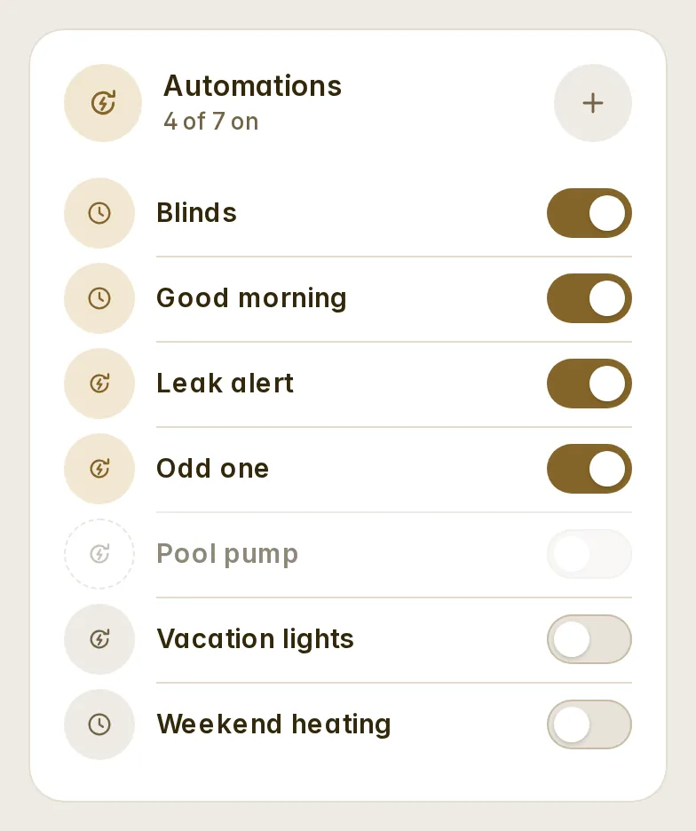
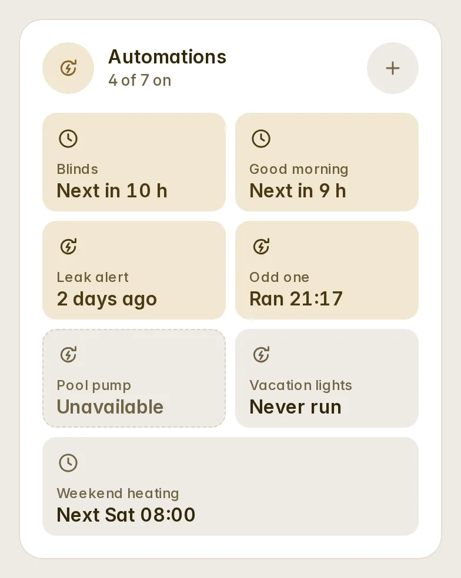

<!-- Generated by `pnpm docs:cards` from the card’s editor, its example in tools/docs/src/gallery.ts and its guide in tools/docs/guides/: change those, not this page. -->

# Automations

Every automation of the house: on or off, run, last and next run; schedules written as native automations, created and edited in a sheet.

`custom:fluvy-automations-card` · [Try it live](https://acosta290.github.io/fluvy/?card=automations) · [All cards](../cards.md#scenes-actions-and-helpers)

<picture><source media="(prefers-color-scheme: dark)" srcset="../images/cards/automations-dark.webp"></picture>

## Example

```yaml
type: custom:fluvy-automations-card
entities:
  - automation.blinds
  - automation.good_morning
  - automation.leak_alert
  - automation.odd
  - automation.broken
  - automation.vacation_lights
  - automation.weekend_heating
```

The picture above, on the demo house: put your own entities in place of its.

## Layouts

`variant` chooses the layout. The picture above is `rows`, the default; each of the others is the example plus the line over it, and opens in the live demo.

<table>
<tbody><tr>
<td align="center" valign="top" width="50%"><code>variant: compact</code><br><a href="https://acosta290.github.io/fluvy/?card=automations&amp;layout=compact"><picture><source media="(prefers-color-scheme: dark)" srcset="../images/cards/automations.compact-dark.webp"></picture></a></td>
<td align="center" valign="top" width="50%"><code>variant: tiles</code><br><a href="https://acosta290.github.io/fluvy/?card=automations&amp;layout=tiles"><picture><source media="(prefers-color-scheme: dark)" srcset="../images/cards/automations.tiles-dark.webp"></picture></a></td>
</tr></tbody>
</table>

## All options

```yaml
type: custom:fluvy-automations-card
entities:
  - automation.blinds
  - automation.good_morning
  - automation.leak_alert
  - automation.odd
  - automation.broken
  - automation.vacation_lights
  - automation.weekend_heating
```

## Options

| Option | Default | What it does |
| --- | --- | --- |
| `title` |  | The title at the top of the card. |
| `subtitle` |  | The line under the title: your own words, an entity’s state or a template. |
| `icon` |  | The card’s icon, in place of the entity’s own. |
| `variant` | `rows` | The card’s layout. `rows` · `compact` · `tiles`. |
| `show` | `all` | Lists every automation, or only Fluvy’s schedules. `all` · `schedules`. |
| `sort` | `name` | Orders the automations by name, by the next run, or by the last. `name` · `next` (The next event) · `last`. |
| `show_add` | `true` | Shows the + button that adds one. |
| `show_switch` | `true` | Shows each automation’s switch. |
| `show_last` | `true` | Says when each automation last ran. |
| `show_next` | `true` | Says when each automation next runs. |
| `show_filters` | `false` | Shows the All · Schedules · On chips under the head. |
| `max_rows` | `6` | How many rows the card shows before a "more" row takes the rest. 1 or more. |
| `entities` |  | The automations the card lists; left out, every one of the house. A list of `automation` entities. |
| `area` |  | Limits the card to the automations of this area. |
| `workday` |  | The house’s workday sensor, for schedules that run on working days. A `binary_sensor`. |
| `time_step` | `5` | How many minutes the time arrows of a schedule move by. 1 to 60. |
| `domains` | `light`, `switch`, `input_boolean`, `fan`, `cover`, `climate`, `scene`, `script` | The kinds of entity a new schedule can switch. Any of `light` · `switch` · `input_boolean` (Toggles) · `fan` · `cover` · `climate` · `scene` · `script` · `valve` · `media_player` (Players). |
| [`targets`](#targets) |  | Only these entities may be the target of a new schedule. A list: [its items](#targets). |

<details>
<summary>Its look and its actions, as on every card</summary>

| Option | Default | What it does |
| --- | --- | --- |
| `show_icon` | `auto` | Shows the icon, hides it, or lets the card decide. `auto` · `always` · `never`. |
| `name_lines` | `1` | Lets the name in the card’s head take two balanced lines where one would cut it; the head is a line taller whatever the name. `1` · `2`. |
| `tone` | the card’s own | The card’s colour from the palette’s tones; left out, the tone of what it shows. `accent` · `light` · `heat` · `cool` · `dry` · `fan` · `water` · `solar` · `grid` · `media` · `presence` · `armed` · `battery` · `house` · `gas` · `vehicle` (Car) · `neutral` · `ok` (Good) · `warning` · `danger`. |
| `color` |  | The card’s colour: its circle, its accents and its tints wear it. Left out, the colour of what it shows. |
| `card_color` |  | Paints the card’s surface in a colour of your own. |
| `card_opacity` | `100` | How solid the card’s surface is, in percent: under 100 the view’s background shows through. Left out, the house’s. 0 % to 100 %, in steps of 5. |
| `card_border` | `true` | Whether the card draws its hairline border. Left out, the house’s. |
| `unavailable` | `dashed` | How the card looks while its entity is unavailable: dashed, or quiet as when it is off. Left out, the house’s. `dashed` · `quiet` (As when off). |
| **Interactions** |  |  |
| `tap_action` | `none` | What a tap on the card does. |
| `hold_action` | `none` | What a long press on the card does. |
| `double_tap_action` | `none` | What two taps on the card do. |
| `icon_tap_action` | `none` | What a tap on the icon does. |
| `icon_hold_action` | `none` | What a long press on the icon does. |
| `icon_double_tap_action` | `none` | What two taps on the icon do. |

More about them in [Options every card takes](../customising.md#options-every-card-takes).

</details>

## Lists

### `targets`

An item is an entity id, or a map with `entity` and any of these fields.

| Field | What it does |
| --- | --- |
| `entity` | An entity a new schedule may switch. A `light`, `switch`, `fan`, `input_boolean`, `media_player`, `humidifier`, `siren`, `climate`, `cover`, `valve`, `scene`, `script`, `automation`, `button` or `input_button`. |
| `name` | The item’s own name, in place of the one the card would give it. |
| `icon` | The item’s own icon, in place of the one the card would give it. |
| `verb` | What a new schedule for it does: turn it on or off, open, close, or run it. `on` (Turn on) · `off` (Turn off) · `open` · `close` · `run`. |
| `level` | The brightness a new schedule turns a light on to. 1 to 100. |
| `temperature` | The temperature a new schedule sets. 5 to 95, in steps of 0.5. |

<details>
<summary>Older names the card still reads</summary>

| Older name | Read as |
| --- | --- |
| `sub` | `subtitle` |
| `meta` | `subtitle` |
| `layout` | `variant` |
| `view` | `variant` |
| `accent` | `color` |

</details>
