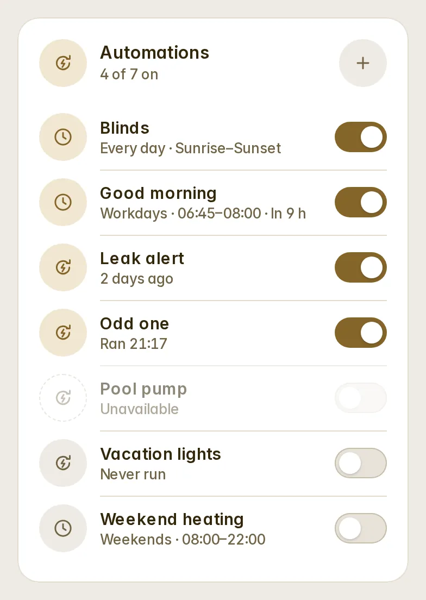

<!-- Generated by `pnpm docs:cards` from the card’s editor and its example in tools/docs/src/gallery.ts: change those, not this page. -->

# Automations

`custom:fluvy-automations-card` · [All cards](../cards.md#scenes-actions-and-helpers) · [Try it live](https://acosta290.github.io/fluvy/?card=automations)

Every automation of the house: on or off, run, last and next run; schedules written as native automations, created and edited in a sheet.

<picture><source media="(prefers-color-scheme: dark)" srcset="../images/cards/automations-dark.webp"></picture>

```yaml
type: custom:fluvy-automations-card
entities:
  - automation.blinds
  - automation.good_morning
  - automation.leak_alert
  - automation.odd
  - automation.broken
  - automation.vacation_lights
  - automation.weekend_heating
```

The picture is this configuration on the demo house, whose names and figures are made up: put your own entities in place of its. [Try it in the live demo](https://acosta290.github.io/fluvy/?card=automations), where it answers a tap as it would at home, with each of its layouts and the YAML of each.

More about it in the guide: [Schedules](../cards.md#schedules).

## Layouts

`variant` chooses the layout. The picture is `rows`, the one the card has when the key is left out; each of the others is the example plus these lines.

| `variant` | Add to the example | Live |
| --- | --- | --- |
| `compact` | `variant: compact` | [Try it](https://acosta290.github.io/fluvy/?card=automations&layout=compact) |
| `tiles` | `variant: tiles` | [Try it](https://acosta290.github.io/fluvy/?card=automations&layout=tiles) |

## Options

Every key the card’s editor shows: the editor’s word for it in italics, then what it does. *Default* is what the card does when the key is left out, as the editor shows it on a new card; the editor never writes a default into the configuration.

| Key | What it does | Type | Default | Values |
| --- | --- | --- | --- | --- |
| `title` | *Title*. The title at the top of the card. | text |  |  |
| `subtitle` | *Subtitle*. The line under the title. | text |  |  |
| `icon` | *Icon*. The card’s icon, in place of the entity’s own. | icon |  |  |
| `variant` | *Style*. The card’s layout. | choice | `rows` | `rows`, `compact`, `tiles` |
| `show_icon` | *Show the icon*. Shows the icon, hides it, or lets the card decide. | choice | `auto` | `auto` (Automatic), `always`, `never` |
| `name_lines` | *Lines for the name*. Lets the name in the card’s head take two balanced lines where one would cut it; the head is a line taller whatever the name. | choice | `1` | `1`, `2` |
| `show` | *Which automations*. Lists every automation, or only Fluvy’s schedules. | choice | `all` | `all`, `schedules` |
| `sort` | *Order*. Orders the automations by name, by the next run, or by the last. | choice | `name` | `name`, `next` (The next event), `last` (Last run) |
| `show_add` | *Show the add button*. Shows the + button that adds one. | boolean | `true` |  |
| `show_switch` | *Show the switch*. Shows each automation’s switch. | boolean | `true` |  |
| `show_last` | *Show the last run*. Says when each automation last ran. | boolean | `true` |  |
| `show_next` | *Show the next run*. Says when each automation next runs. | boolean | `true` |  |
| `show_filters` | *Show the filter chips*. Shows the All · Schedules · On chips under the head. | boolean | `false` |  |
| `max_rows` | *Rows at most*. How many rows the card shows before a "more" row takes the rest. | number | `6` | 1 or more |
| `entities` | *Entities*. The automations the card lists; left out, every one of the house. | entities (automation) |  |  |
| `area` | *Area*. Limits the card to the automations of this area. | area |  |  |
| `workday` | *Workday sensor*. The house’s workday sensor, for schedules that run on working days. Lets a schedule run on working days only. | entity (binary_sensor) |  |  |
| `time_step` | *Time step (minutes)*. How many minutes the time arrows of a schedule move by. | number | `5` | 1 to 60 |
| `domains` | *What a schedule can target*. The kinds of entity a new schedule can switch. | choices | `light`, `switch`, `input_boolean`, `fan`, `cover`, `climate`, `scene`, `script` | `light` (Lights), `switch` (Switches), `input_boolean` (Toggles), `fan` (Fans), `cover` (Covers), `climate`, `scene` (Scenes), `script` (Scripts), `valve` (Valves), `media_player` (Players) |
| `tone` | *Tone*. The card’s colour from the palette’s tones; left out, the tone of what it shows. | choice | the card’s own | `accent`, `light`, `heat`, `cool`, `dry`, `fan`, `water`, `solar`, `grid`, `media`, `presence`, `armed`, `battery`, `house`, `gas`, `vehicle` (Car), `neutral`, `ok` (Good), `warning`, `danger` |
| `color` | *Colour*. The card’s colour: its circle, its accents and its tints wear it. Left out, the colour of what it shows. | colour |  |  |
| `card_color` | *Card colour*. Paints the card’s surface in a colour of your own. | colour |  |  |
| `card_opacity` | *Card opacity*. How see-through the card’s surface is, in percent. Untouched: every card’s, from Fluvy’s settings. | number | `100` | 0 % to 100 %, in steps of 5 |
| `card_border` | *Card border*. Draws the card’s hairline border, or leaves it out. Untouched: every card’s, from Fluvy’s settings. | boolean | `true` |  |
| `unavailable` | *When unavailable*. How the card looks while its entity is unavailable: dashed, or quiet. Untouched: every card’s, from Fluvy’s settings. | choice | `dashed` | `dashed`, `quiet` (As when off) |
| `targets` | *Only these entities*. Only these entities may be the target of a new schedule. | list ([its items](#targets)) |  |  |

**Interactions**

| Key | What it does | Type | Default | Values |
| --- | --- | --- | --- | --- |
| `tap_action` | *Tap action*. What a tap on the card does. | action | `none` |  |
| `hold_action` | *Hold action*. What a long press on the card does. | action | `none` |  |
| `double_tap_action` | *Double tap action*. What two taps on the card do. A tap waits a moment to tell it from a double tap. | action | `none` |  |
| `icon_tap_action` | *Icon tap action*. What a tap on the icon does. | action | `none` |  |
| `icon_hold_action` | *Icon hold action*. What a long press on the icon does. | action | `none` |  |
| `icon_double_tap_action` | *Icon double tap action*. What two taps on the icon do. A tap waits a moment to tell it from a double tap. | action | `none` |  |

## Lists

### `targets`

*Only these entities*. Only these entities may be the target of a new schedule. An item is an entity id, or a map with `entity` and any of these keys.

| Key | What it does | Type | Values |
| --- | --- | --- | --- |
| `entity` | *Entity*. An entity a new schedule may switch. | entity (light, switch, fan, input_boolean, media_player, humidifier, siren, climate, cover, valve, scene, script, automation, button, input_button) |  |
| `name` | *Name*. The item’s own name, in place of the one the card would give it. | name |  |
| `icon` | *Icon*. The item’s own icon, in place of the one the card would give it. | icon |  |
| `verb` | *A new schedule does*. What a new schedule for it does: turn it on or off, open, close, or run it. | choice | `on` (Turn on), `off` (Turn off), `open`, `close`, `run` |
| `level` | *Brightness*. The brightness a new schedule turns a light on to. | number | 1 to 100 |
| `temperature` | *Target*. The temperature a new schedule sets. | number | 5 to 95, in steps of 0.5 |

## Older names

Names the card still reads, so a dashboard written before keeps working. They are read, never written back.

| Older name | Read as |
| --- | --- |
| `sub` | `subtitle` |
| `meta` | `subtitle` |
| `layout` | `variant` |
| `view` | `variant` |
| `accent` | `color` |
