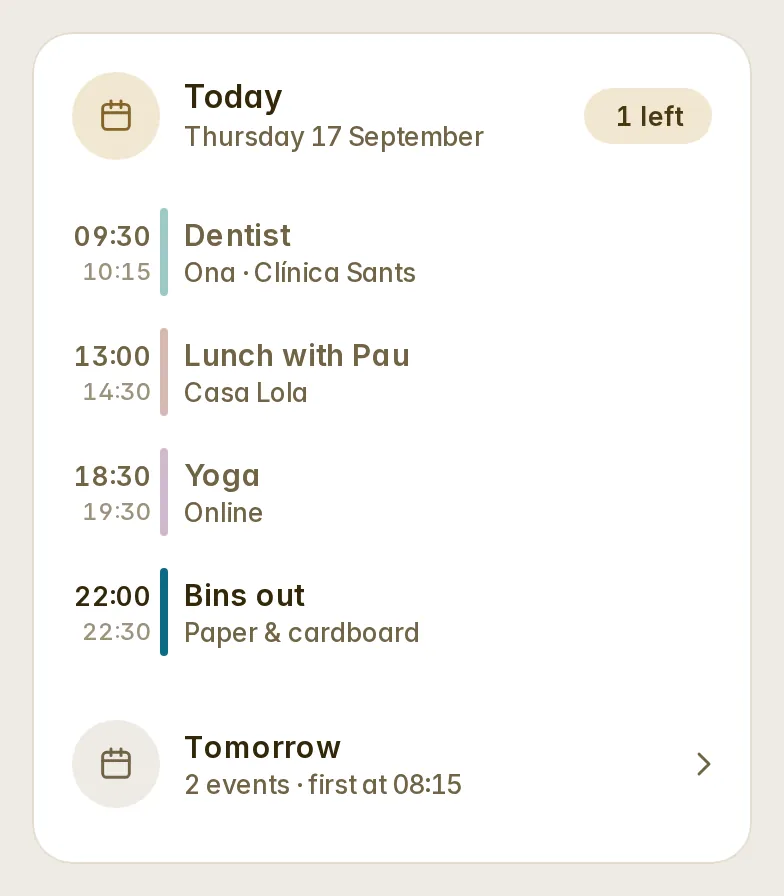

<!-- Generated by `pnpm docs:cards` from the card’s editor and its example in tools/docs/src/gallery.ts: change those, not this page. -->

# Calendar

`custom:fluvy-calendar-card` · [All cards](../cards.md#time) · [Try it live](https://acosta290.github.io/fluvy/?card=calendar)

Agenda, month, week, month + day, timeline, upcoming or tile.

<picture><source media="(prefers-color-scheme: dark)" srcset="../images/cards/calendar-dark.webp"></picture>

```yaml
type: custom:fluvy-calendar-card
calendars:
  - calendar.chores
  - calendar.family
  - calendar.ona
  - calendar.personal
  - calendar.services
first_weekday: monday
```

The picture is this configuration on the demo house, whose names and figures are made up: put your own entities in place of its. [Try it in the live demo](https://acosta290.github.io/fluvy/?card=calendar), where it answers a tap as it would at home, with each of its layouts and the YAML of each.

More about it in the guide: [Calendar](../cards.md#calendar).

## Layouts

`variant` chooses the layout. The picture is `agenda`, the one the card has when the key is left out; each of the others is the example plus these lines.

| `variant` | Add to the example | Live |
| --- | --- | --- |
| `month` | `variant: month` | [Try it](https://acosta290.github.io/fluvy/?card=calendar&layout=month) |
| `week` | `variant: week` | [Try it](https://acosta290.github.io/fluvy/?card=calendar&layout=week) |
| `month-day` | `variant: month-day` | [Try it](https://acosta290.github.io/fluvy/?card=calendar&layout=month-day) |
| `timeline` | `variant: timeline` | [Try it](https://acosta290.github.io/fluvy/?card=calendar&layout=timeline) |
| `upcoming` | `variant: upcoming` | [Try it](https://acosta290.github.io/fluvy/?card=calendar&layout=upcoming) |
| `tile` | `variant: tile` | [Try it](https://acosta290.github.io/fluvy/?card=calendar&layout=tile) |

## Options

Every key the card’s editor shows: the editor’s word for it in italics, then what it does. *Default* is what the card does when the key is left out, as the editor shows it on a new card; the editor never writes a default into the configuration.

| Key | What it does | Type | Default | Values |
| --- | --- | --- | --- | --- |
| `variant` | *Style*. The card’s layout. | choice | `agenda` | `agenda`, `month`, `week`, `month-day` (Month and day), `timeline`, `upcoming`, `tile` |
| `title` | *Title*. The title at the top of the card. | text |  |  |
| `show_icon` | *Show the icon*. Shows the icon, hides it, or lets the card decide. | choice | `auto` | `auto` (Automatic), `always`, `never` |
| `name_lines` | *Lines for the name*. Lets the name in the card’s head take two balanced lines where one would cut it; the head is a line taller whatever the name. | choice | `1` | `1`, `2` |
| `tile` | *Tile*. What the tile shows: the date, or the next event. | choice | `date` | `date` (The date), `next` (The next event) |
| `first_weekday` | *Week starts on*. The day the weeks and the months start on. | choice | `language` | `language` (As the language does), `today`, `sunday`, `monday`, `tuesday`, `wednesday`, `thursday`, `friday`, `saturday` |
| `days` | *Days ahead*. How many days ahead the agenda shows. | number |  | 1 to 31 |
| `start_hour` | *Timeline from (hour)*. The hour the timeline starts at. | number |  | 0 to 23 |
| `end_hour` | *Timeline to (hour)*. The hour the timeline ends at. | number |  | 1 to 24 |
| `color` | *Colour*. The card’s colour: its circle, its accents and its tints wear it. Left out, the colour of what it shows. | colour |  |  |
| `card_color` | *Card colour*. Paints the card’s surface in a colour of your own. | colour |  |  |
| `card_opacity` | *Card opacity*. How see-through the card’s surface is, in percent. Untouched: every card’s, from Fluvy’s settings. | number | `100` | 0 % to 100 %, in steps of 5 |
| `card_border` | *Card border*. Draws the card’s hairline border, or leaves it out. Untouched: every card’s, from Fluvy’s settings. | boolean | `true` |  |
| `unavailable` | *When unavailable*. How the card looks while its entity is unavailable: dashed, or quiet. Untouched: every card’s, from Fluvy’s settings. | choice | `dashed` | `dashed`, `quiet` (As when off) |
| `calendars` | *Rows*. The calendars whose events the card shows. | list ([its items](#calendars)) |  |  |

## Lists

### `calendars`

*Rows*. The calendars whose events the card shows. An item is an entity id, or a map with `entity` and any of these keys.

| Key | What it does | Type | Values |
| --- | --- | --- | --- |
| `entity` | *Entity*. The entity the item shows. | entity (calendar) |  |
| `name` | *Name*. The item’s own name, in place of the one the card would give it. | name |  |
| `tone` | *Tone*. The item’s colour from the palette’s tones. | choice | `accent`, `light`, `heat`, `cool`, `dry`, `fan`, `water`, `solar`, `grid`, `media`, `presence`, `armed`, `battery`, `house`, `gas`, `vehicle` (Car), `neutral`, `ok` (Good), `warning`, `danger` |
| `color` | *Colour*. The item’s colour, in place of the one the card gives it. Empty: the colour the card gives it. | colour |  |

## Older names

Names the card still reads, so a dashboard written before keeps working. They are read, never written back.

| Older name | Read as |
| --- | --- |
| `entities` | `calendars` |
| `layout` | `variant` |
| `view` | `variant` |
| `accent` | `color` |
