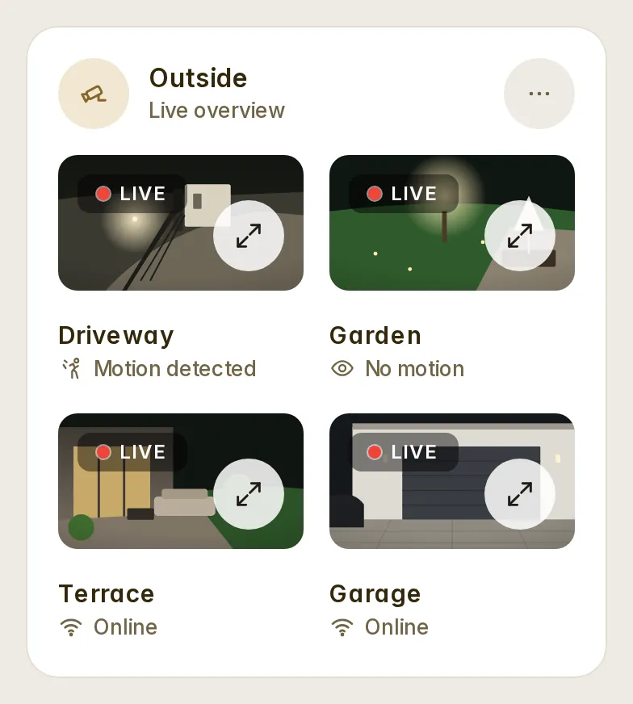

<!-- Generated by `pnpm docs:cards` from the card’s editor and its example in tools/docs/src/gallery.ts: change those, not this page. -->

# Cameras

`custom:fluvy-cameras-card` · [All cards](../cards.md#everyday) · [Try it live](https://acosta290.github.io/fluvy/?card=cameras)

Several cameras at a glance, each picture live or refreshing itself with its name and what it sees; a sheet of them all.

<picture><source media="(prefers-color-scheme: dark)" srcset="../images/cards/cameras-dark.webp"></picture>

```yaml
type: custom:fluvy-cameras-card
cameras:
  - camera.cm_driveway
  - camera.cm_garden
  - camera.cm_terrace
  - camera.cm_garage
title: Outside
```

The picture is this configuration on the demo house, whose names and figures are made up: put your own entities in place of its. [Try it in the live demo](https://acosta290.github.io/fluvy/?card=cameras), where it answers a tap as it would at home, with each of its layouts and the YAML of each.

More about it in the guide: [Cameras](../cards.md#cameras).

## Layouts

`variant` chooses the layout. The picture is `grid`, the one the card has when the key is left out; each of the others is the example plus these lines.

| `variant` | Add to the example | Live |
| --- | --- | --- |
| `list` | `variant: list` | [Try it](https://acosta290.github.io/fluvy/?card=cameras&layout=list) |
| `compact` | `variant: compact` | [Try it](https://acosta290.github.io/fluvy/?card=cameras&layout=compact) |

## Options

Every key the card’s editor shows: the editor’s word for it in italics, then what it does. *Default* is what the card does when the key is left out, as the editor shows it on a new card; the editor never writes a default into the configuration.

| Key | What it does | Type | Default | Values |
| --- | --- | --- | --- | --- |
| `title` | *Title*. The title at the top of the card. | text |  |  |
| `subtitle` | *Subtitle*. The line under the title. | text |  |  |
| `icon` | *Icon*. The card’s icon, in place of the entity’s own. | icon |  |  |
| `show_icon` | *Show the icon*. Shows the icon, hides it, or lets the card decide. | choice | `auto` | `auto` (Automatic), `always`, `never` |
| `name_lines` | *Lines for the name*. Lets the name in the card’s head take two balanced lines where one would cut it; the head is a line taller whatever the name. | choice | `1` | `1`, `2` |
| `area` | *Area*. Limits the card to the entities of this area. | area |  |  |
| `names` | *Names*. How a row is named where it has no name of its own: the entity’s full name, its own, or its device’s. Where no name of its own is set. | choice | `full` | `full` (Full name), `entity` (Entity name), `device` (Device name) |
| `variant` | *Style*. The card’s layout. | choice | `grid` | `grid`, `list`, `compact` |
| `columns` | *Columns*. How many pictures stand in a row. | choice | `auto` | `auto` (Automatic), `1`, `2`, `3`, `4` |
| `camera_view` | *Picture*. Shows still pictures that refresh by themselves, or Home Assistant’s live stream. | choice | `auto` | `auto` (Automatic), `live` |
| `max_live` | *Live at once*. How many cameras stream at once; the rest show stills. | number | `4` | 0 to 12 |
| `refresh` | *Seconds between images*. How often a still picture is taken again, in seconds. | number | `10` | 0.5 to 300, in steps of 0.5 |
| `aspect_ratio` | *Shape*. Every picture’s shape, so that a row of pictures is level. | choice or text | `16:9` | `16:9`, `4:3`, `3:2`, `1:1`, `2:1`, `21:9`, `native` (The camera’s own) |
| `fit_mode` | *Fit*. Fills the shape and crops the picture, or shows the whole picture inside it. | choice | `cover` | `cover` (Fill (crop)), `contain` (Whole picture) |
| `show_status` | *Show the status line*. Shows the line under each camera. | boolean | `true` |  |
| `status` | *Status line*. What each camera’s line says. | choice | `auto` | `auto` (Automatic), `motion`, `state`, `none` |
| `show_live` | *Show “Live”*. Marks a streaming picture "Live". | boolean | `true` |  |
| `show_fullscreen` | *Show the full-screen button*. Shows the button that opens it full screen. | boolean | `true` |  |
| `tone` | *Tone*. The card’s colour from the palette’s tones; left out, the tone of what it shows. | choice | the card’s own | `accent`, `light`, `heat`, `cool`, `dry`, `fan`, `water`, `solar`, `grid`, `media`, `presence`, `armed`, `battery`, `house`, `gas`, `vehicle` (Car), `neutral`, `ok` (Good), `warning`, `danger` |
| `color` | *Colour*. The card’s colour: its circle, its accents and its tints wear it. Left out, the colour of what it shows. | colour |  |  |
| `card_color` | *Card colour*. Paints the card’s surface in a colour of your own. | colour |  |  |
| `card_opacity` | *Card opacity*. How see-through the card’s surface is, in percent. Untouched: every card’s, from Fluvy’s settings. | number | `100` | 0 % to 100 %, in steps of 5 |
| `card_border` | *Card border*. Draws the card’s hairline border, or leaves it out. Untouched: every card’s, from Fluvy’s settings. | boolean | `true` |  |
| `unavailable` | *When unavailable*. How the card looks while its entity is unavailable: dashed, or quiet. Untouched: every card’s, from Fluvy’s settings. | choice | `dashed` | `dashed`, `quiet` (As when off) |
| `empty_text` | *Text when empty*. What the card says while it has nothing to show. | text |  |  |
| `hide_empty` | *Hide when empty*. Hides the whole card while it has nothing to show. | boolean | `false` |  |
| `cameras` | *Cameras*. The cameras, in the order they are drawn. | list ([its items](#cameras)) |  |  |

**Interactions**

| Key | What it does | Type | Default | Values |
| --- | --- | --- | --- | --- |
| `tap_action` | *Tap action*. What a tap on the card does. | action | `none` |  |
| `hold_action` | *Hold action*. What a long press on the card does. | action | `none` |  |
| `double_tap_action` | *Double tap action*. What two taps on the card do. A tap waits a moment to tell it from a double tap. | action | `none` |  |
| `icon_tap_action` | *Icon tap action*. What a tap on the icon does. | action | `none` |  |
| `icon_hold_action` | *Icon hold action*. What a long press on the icon does. | action | `none` |  |
| `icon_double_tap_action` | *Icon double tap action*. What two taps on the icon do. A tap waits a moment to tell it from a double tap. | action | `none` |  |

## Lists

### `cameras`

*Cameras*. The cameras, in the order they are drawn. An item is an entity id, or a map with `entity` and any of these keys.

| Key | What it does | Type | Values |
| --- | --- | --- | --- |
| `entity` | *Entity*. The entity the item shows. | entity (camera) |  |
| `name` | *Name*. The item’s own name, in place of the one the card would give it. | name |  |
| `icon` | *Icon*. The item’s own icon, in place of the one the card would give it. | icon |  |
| `motion` | *Motion sensor*. The motion sensor the camera’s line reads. | entity (binary_sensor) |  |
| `status` | *Status line*. What the camera’s line says. | choice | `auto` (Automatic), `motion`, `state`, `none` |
| `camera_view` | *Picture*. Shows this camera’s stills, or its live stream. | choice | `auto` (Automatic), `live` |
| `refresh` | *Seconds between images*. How often this camera’s still picture is taken again, in seconds. | number | 0.5 to 300, in steps of 0.5 |
| `fit_mode` | *Fit*. Fills the shape and crops the picture, or shows the whole picture. | choice | `cover` (Fill (crop)), `contain` (Whole picture) |
| `tone` | *Tone*. The item’s colour from the palette’s tones. | choice | `accent`, `light`, `heat`, `cool`, `dry`, `fan`, `water`, `solar`, `grid`, `media`, `presence`, `armed`, `battery`, `house`, `gas`, `vehicle` (Car), `neutral`, `ok` (Good), `warning`, `danger` |
| `color` | *Colour*. The item’s colour, in place of the one the card gives it. Empty: the colour the card gives it. | colour |  |

**Interactions**

| Key | What it does | Type | Values |
| --- | --- | --- | --- |
| `tap_action` | *Tap action*. What a tap on the item does. | action |  |
| `hold_action` | *Hold action*. What a long press on the item does. | action |  |
| `double_tap_action` | *Double tap action*. What two taps on the item do. A tap waits a moment to tell it from a double tap. | action |  |

## Older names

Names the card still reads, so a dashboard written before keeps working. They are read, never written back.

| Older name | Read as |
| --- | --- |
| `entities` | `cameras` |
| `cameras[].label` | `cameras[].name` |
| `cameras[].sub` | `cameras[].secondary` |
| `cameras[].meta` | `cameras[].subtitle` |
| `sub` | `subtitle` |
| `meta` | `subtitle` |
| `layout` | `variant` |
| `view` | `variant` |
| `accent` | `color` |
