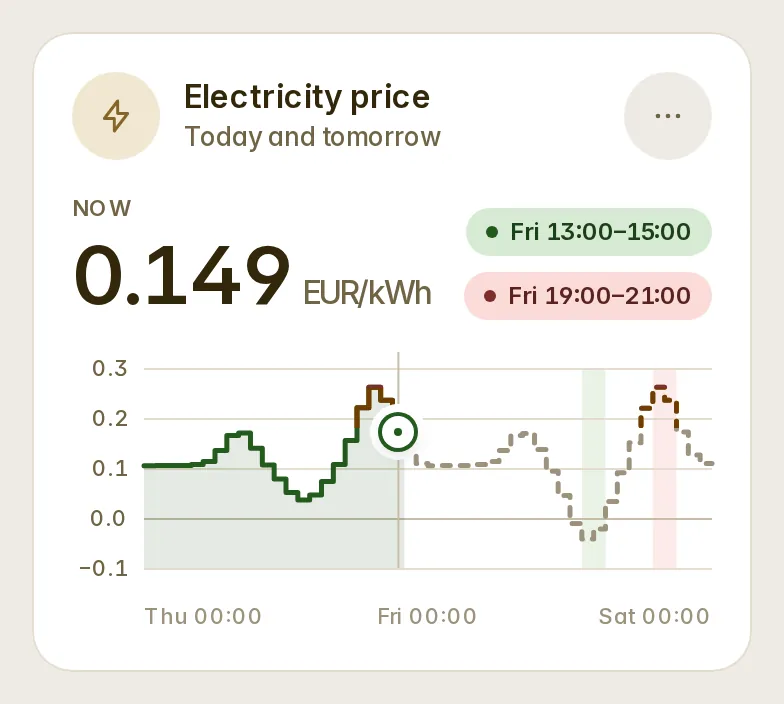

<!-- Generated by `pnpm docs:cards` from the card’s editor and its example in tools/docs/src/gallery.ts: change those, not this page. -->

# Chart

`custom:fluvy-chart-card` · [All cards](../cards.md#energy) · [Try it live](https://acosta290.github.io/fluvy/?card=chart)

Any time series on one chart — history, statistics, a list in an attribute (Nordpool’s prices, a solar forecast) or a weather’s forecast — past to future with now marked, thresholds in their colours and the cheapest hours found.

<picture><source media="(prefers-color-scheme: dark)" srcset="../images/cards/chart-dark.webp"></picture>

```yaml
type: custom:fluvy-chart-card
title: Electricity price
icon: bolt
series:
  - entity: sensor.ch_nordpool
    tone: ok
span: today+tomorrow
chart: step
thresholds:
  - tone: warning
    value: 0.18
  - tone: danger
    value: 0.26
highlight: both
highlight_hours: 2
```

The picture is this configuration on the demo house, whose names and figures are made up: put your own entities in place of its. [Try it in the live demo](https://acosta290.github.io/fluvy/?card=chart), where it answers a tap as it would at home, with each of its layouts and the YAML of each.

More about it in the guide: [Chart](../cards.md#chart).

## Layouts

`variant` chooses the layout. The picture is `full`, the one the card has when the key is left out; each of the others is the example plus these lines.

| `variant` | Add to the example | Live |
| --- | --- | --- |
| `compact` | `variant: compact` | [Try it](https://acosta290.github.io/fluvy/?card=chart&layout=compact) |
| `tile` | `variant: tile` | [Try it](https://acosta290.github.io/fluvy/?card=chart&layout=tile) |

## Options

Every key the card’s editor shows: the editor’s word for it in italics, then what it does. *Default* is what the card does when the key is left out, as the editor shows it on a new card; the editor never writes a default into the configuration.

| Key | What it does | Type | Default | Values |
| --- | --- | --- | --- | --- |
| `title` | *Title*. The title at the top of the card. | text |  |  |
| `subtitle` | *Subtitle*. The line under the title. | text |  |  |
| `icon` | *Icon*. The card’s icon, in place of the entity’s own. | icon |  |  |
| `show_icon` | *Show the icon*. Shows the icon, hides it, or lets the card decide. | choice | `auto` | `auto` (Automatic), `always`, `never` |
| `name_lines` | *Lines for the name*. Lets the name in the card’s head take two balanced lines where one would cut it; the head is a line taller whatever the name. | choice | `1` | `1`, `2` |
| `tone` | *Tone*. The card’s colour from the palette’s tones; left out, the tone of what it shows. | choice | the card’s own | `accent`, `light`, `heat`, `cool`, `dry`, `fan`, `water`, `solar`, `grid`, `media`, `presence`, `armed`, `battery`, `house`, `gas`, `vehicle` (Car), `neutral`, `ok` (Good), `warning`, `danger` |
| `color` | *Colour*. The card’s colour: its circle, its accents and its tints wear it. Left out, the colour of what it shows. | colour |  |  |
| `card_color` | *Card colour*. Paints the card’s surface in a colour of your own. | colour |  |  |
| `card_opacity` | *Card opacity*. How see-through the card’s surface is, in percent. Untouched: every card’s, from Fluvy’s settings. | number | `100` | 0 % to 100 %, in steps of 5 |
| `card_border` | *Card border*. Draws the card’s hairline border, or leaves it out. Untouched: every card’s, from Fluvy’s settings. | boolean | `true` |  |
| `unavailable` | *When unavailable*. How the card looks while its entity is unavailable: dashed, or quiet. Untouched: every card’s, from Fluvy’s settings. | choice | `dashed` | `dashed`, `quiet` (As when off) |
| `collection_key` | *Follow a date picker*. Makes the card follow an Energy date picker on the same dashboard. The key of an Energy date picker on this dashboard (Fluvy’s Energy period card or Home Assistant’s) | choice or text | none |  |
| `span` | *Window*. The window of time the chart shows. 24h, today, today+tomorrow, 7d, or any 12h or 3d. | choice or text | `12h` | `4h` (Last 4 h), `12h` (Last 12 h), `24h` (Last 24 h), `today`, `today+tomorrow` (Today and tomorrow), `48h` (Last 48 h), `7d` (Last 7 days), `30d` (Last 30 days) |
| `variant` | *Style*. The card’s layout. | choice | `full` | `full`, `compact`, `tile` |
| `show_head` | *Show the value now*. Shows the value now, large, over the chart. | boolean | `true` |  |
| `show_legend` | *Show legend*. Shows the legend under the chart. | boolean | `true` |  |
| `highlight` | *Highlight*. Marks the windows to come: the cheapest, the dearest, or both. | choice | `none` | `none`, `min` (The lowest reading), `max` (The highest reading), `both` (Lowest and highest) |
| `highlight_hours` | *Hours to highlight*. How many hours each marked window lasts. | number | `1` | 1 to 12 |
| `series` | *Series*. The series the chart draws, an entity each. | list ([its items](#series)) |  |  |
| `thresholds` | *Thresholds*. Values from which the line takes another tone. A reading takes the colour of the nearest threshold it is past. | list ([its items](#thresholds)) |  |  |

**Chart**

| Key | What it does | Type | Default | Values |
| --- | --- | --- | --- | --- |
| `chart` | *Chart*. The chart’s style; left out, the style set for the whole house. | choice | `classic` | `classic`, `soft`, `glow`, `minimal`, `step` (Steps), `bars`, `columns`, `band` |
| `points` | *A point every*. How far apart the line’s points are drawn. | choice | `auto` | `auto` (Automatic), `5m` (5 min), `15m` (15 min), `30m` (30 min), `1h` |
| `curve` | *Curve*. How the line joins its readings: smooth, straight, or in steps. | choice | `smooth` | `smooth`, `straight`, `step` (Steps) |
| `fill` | *Fill*. What lies under the line: a gradient, a flat fill, or nothing. | choice | `gradient` | `gradient`, `flat`, `none` |
| `line_width` | *Line width*. How thick the line is. | choice | `regular` | `thin`, `regular`, `bold` |
| `glow` | *Soft shadow*. Draws a soft shadow under the line. | boolean | `false` |  |
| `show_points` | *Points*. Draws points on the line: none, the last one, or every reading. | choice | `end` | `none`, `end` (At the end), `all` |
| `show_grid` | *Gridlines*. Draws gridlines across the chart. | choice | `auto` | `auto` (Automatic), `none`, `x` (Vertical lines), `y` (Horizontal lines), `both` |
| `show_axis` | *Show the scale*. Shows the scale’s labels beside the chart. | boolean | `true` |  |
| `show_now` | *Mark now*. Marks the present moment on the chart. | boolean | `false` |  |
| `animate` | *Animate*. Lets the chart or the gauge move as it draws; off, it shows its resting frame at once. | boolean | `true` |  |

**Interactions**

| Key | What it does | Type | Default | Values |
| --- | --- | --- | --- | --- |
| `tap_action` | *Tap action*. What a tap on the card does. | action | `more-info` |  |
| `hold_action` | *Hold action*. What a long press on the card does. | action | `more-info` |  |
| `double_tap_action` | *Double tap action*. What two taps on the card do. A tap waits a moment to tell it from a double tap. | action | `none` |  |
| `icon_tap_action` | *Icon tap action*. What a tap on the icon does. | action | `none` |  |
| `icon_hold_action` | *Icon hold action*. What a long press on the icon does. | action | `none` |  |
| `icon_double_tap_action` | *Icon double tap action*. What two taps on the icon do. A tap waits a moment to tell it from a double tap. | action | `none` |  |

## Lists

### `series`

*Series*. The series the chart draws, an entity each. An item is an entity id, or a map with `entity` and any of these keys.

| Key | What it does | Type | Values |
| --- | --- | --- | --- |
| `entity` | *Entity*. The entity the item shows. | entity (sensor, weather, number, input_number, counter) |  |
| `name` | *Name*. The item’s own name, in place of the one the card would give it. | name |  |
| `source` | *Read from*. Where the readings come from. Automatic: a weather’s forecast, the price or forecast list its attributes hold, else its history. | choice | `auto` (Automatic), `history`, `statistics`, `attribute` (A list in its attributes), `forecast` |
| `attribute` | *Attribute*. The attribute that holds the list of readings. Automatic: the usual price and forecast lists, else the first list of moments and values. | choice or text | `auto` (Automatic) |
| `time_key` | *Time key*. The key of each entry that holds its time. Automatic: start, from, time …; value, price … | text |  |
| `value_key` | *Value key*. The key of each entry that holds its value. Automatic: start, from, time …; value, price … | text |  |
| `stat` | *Statistic*. What each reading of the statistics is. | choice | `mean` (The mean), `min` (The lowest reading), `max` (The highest reading), `sum`, `change` (What it gained) |
| `period` | *Each reading*. How long each statistic’s reading lasts. | choice | `hour` (An hour), `day` (A day), `week` (A week), `month` (A month) |
| `kind` | *Drawn as*. How the series is drawn: a line, an area, columns, or a band. | choice | `line`, `area`, `columns`, `band` |
| `curve` | *Curve*. How this series’ line joins its readings. | choice | `smooth`, `straight`, `step` (Steps) |
| `fill` | *Fill*. What lies under this series’ line. | choice | `gradient`, `flat`, `none` |
| `tone` | *Tone*. The item’s colour from the palette’s tones. | choice | `accent`, `light`, `heat`, `cool`, `dry`, `fan`, `water`, `solar`, `grid`, `media`, `presence`, `armed`, `battery`, `house`, `gas`, `vehicle` (Car), `neutral`, `ok` (Good), `warning`, `danger` |
| `color` | *Colour*. The item’s colour, in place of the one the card gives it. Empty: the card’s colour, or the palette’s series colours for several. The palette’s colours follow it; a colour name or a #hex stays as typed. | choice or text | `graph-1` (Series 1), `graph-2` (Series 2), `graph-3` (Series 3), `graph-4` (Series 4), `graph-5` (Series 5), `graph-6` (Series 6), `graph-7` (Series 7), `graph-8` (Series 8), `graph-9` (Series 9), `graph-10` (Series 10), `graph-11` (Series 11), `graph-12` (Series 12), `accent`, `ok` (Good), `warning`, `danger`, `notice`, `light`, `solar`, `grid`, `battery`, `water`, `gas`, `home` (House) |
| `unit` | *Unit*. The unit this series is written in. | choice or text | `auto` (Automatic), `W`, `kW`, `MW`, `Wh`, `kWh`, `MWh`, `L`, `m³`, `gal`, `ft³` |
| `decimals` | *Decimals*. How many decimals the figure has. | choice | `auto` (Automatic), `0`, `1`, `2`, `3` |

### `thresholds`

*Thresholds*. Values from which the line takes another tone. A reading takes the colour of the nearest threshold it is past. An item is a map with `tone` and any of these keys.

| Key | What it does | Type | Values |
| --- | --- | --- | --- |
| `tone` | *Tone*. The item’s colour from the palette’s tones. | choice | `none`, `accent`, `light`, `heat`, `cool`, `dry`, `fan`, `water`, `solar`, `grid`, `media`, `presence`, `armed`, `battery`, `house`, `gas`, `vehicle` (Car), `neutral`, `ok` (Good), `warning`, `danger` |
| `value` | *Value*. The value from which the line takes this colour. A figure, an entity or a template. | text |  |
| `below` | *Under the value*. Counts an entity whose state, or the attribute named, is below this number. Off: from the value up. | boolean |  |
| `color` | *Colour*. The item’s colour, in place of the one the card gives it. Empty: the colour the card gives it. | colour |  |
| `label` | *Label*. Counts only the entities with this label. | text |  |
| `icon` | *Icon*. The item’s own icon, in place of the one the card would give it. | icon |  |

## Older names

Names the card still reads, so a dashboard written before keeps working. They are read, never written back.

| Older name | Read as |
| --- | --- |
| `sub` | `subtitle` |
| `meta` | `subtitle` |
| `layout` | `variant` |
| `view` | `variant` |
| `accent` | `color` |
