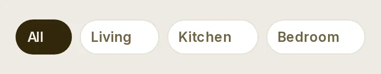

<!-- Generated by `pnpm docs:cards` from the card’s editor and its example in tools/docs/src/gallery.ts: change those, not this page. -->

# Chips

`custom:fluvy-chips-card` · [All cards](../cards.md#structure-and-navigation) · [Try it live](https://acosta290.github.io/fluvy/?card=chips)

A row of chips that navigate between views or open entities.

<picture><source media="(prefers-color-scheme: dark)" srcset="../images/cards/chips-dark.webp"></picture>

```yaml
type: custom:fluvy-chips-card
chips:
  - name: All
    path: /
  - name: Living
    path: /fluvy-home/living
  - name: Kitchen
    path: /fluvy-home/kitchen
  - name: Bedroom
    path: /fluvy-home/bedroom
```

The picture is this configuration on the demo house, whose names and figures are made up: put your own entities in place of its. [Try it in the live demo](https://acosta290.github.io/fluvy/?card=chips), where it answers a tap as it would at home, with each of its layouts and the YAML of each.

More about it in the guide: [Chips](../cards.md#chips).

## Options

Every key the card’s editor shows: the editor’s word for it in italics, then what it does. *Default* is what the card does when the key is left out, as the editor shows it on a new card; the editor never writes a default into the configuration.

| Key | What it does | Type | Default | Values |
| --- | --- | --- | --- | --- |
| `name` | *Name*. The name the card shows, in place of the entity’s own. | text |  |  |
| `tint` | *Show its colour*. When each chip shows its colour. | choice | `on` | `on` (When on), `always` |
| `empty_text` | *Text when empty*. What the card says while it has nothing to show. | text |  |  |
| `hide_empty` | *Hide when empty*. Hides the whole card while it has nothing to show. | boolean | `false` |  |
| `chips` | *Tabs*. The chips, each a tab that opens a path or runs an action. | list ([its items](#chips)) |  |  |

## Lists

### `chips`

*Tabs*. The chips, each a tab that opens a path or runs an action. An item is a map with `name` and any of these keys.

| Key | What it does | Type | Values |
| --- | --- | --- | --- |
| `name` | *Name*. The item’s own name, in place of the one the card would give it. Your own words, or a template such as {{ states('sensor.x') }}. | text |  |
| `icon` | *Icon*. The item’s own icon, in place of the one the card would give it. | icon |  |
| `path` | *Opens (path)*. Where a tap on the chip goes. | text |  |
| `entity` | *Entity*. The entity the item shows. | entity |  |
| `color` | *Colour*. The item’s colour, in place of the one the card gives it. Empty: the card’s colour. | colour |  |

**Interactions**

| Key | What it does | Type | Values |
| --- | --- | --- | --- |
| `tap_action` | *Tap action*. What a tap on the item does. | action |  |
| `hold_action` | *Hold action*. What a long press on the item does. | action |  |
| `double_tap_action` | *Double tap action*. What two taps on the item do. A tap waits a moment to tell it from a double tap. | action |  |

## Older names

Names the card still reads, so a dashboard written before keeps working. They are read, never written back.

| Older name | Read as |
| --- | --- |
| `label` | `name` |
| `chips[].label` | `chips[].name` |
| `chips[].sub` | `chips[].secondary` |
| `chips[].meta` | `chips[].subtitle` |
| `chips[].action` | `chips[].tap_action` |
