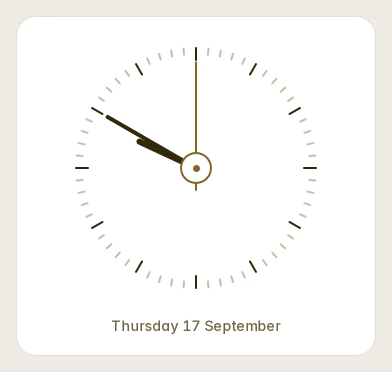

<!-- Generated by `pnpm docs:cards` from the card’s editor and its example in tools/docs/src/gallery.ts: change those, not this page. -->

# Clock

`custom:fluvy-clock-card` · [All cards](../cards.md#time) · [Try it live](https://acosta290.github.io/fluvy/?card=clock)

Analog or digital, hero, side or tile, with or without weather.

<picture><source media="(prefers-color-scheme: dark)" srcset="../images/cards/clock-dark.webp"></picture>

```yaml
type: custom:fluvy-clock-card
```

The picture is this configuration on the demo house, whose names and figures are made up: put your own entities in place of its. [Try it in the live demo](https://acosta290.github.io/fluvy/?card=clock), where it answers a tap as it would at home, with each of its layouts and the YAML of each.

## Layouts

`variant` chooses the layout. The picture is `hero`, the one the card has when the key is left out; each of the others is the example plus these lines.

| `variant` | Add to the example | Live |
| --- | --- | --- |
| `side` | `variant: side` | [Try it](https://acosta290.github.io/fluvy/?card=clock&layout=side) |
| `tile` | `variant: tile` | [Try it](https://acosta290.github.io/fluvy/?card=clock&layout=tile) |

## Options

Every key the card’s editor shows: the editor’s word for it in italics, then what it does. *Default* is what the card does when the key is left out, as the editor shows it on a new card; the editor never writes a default into the configuration.

| Key | What it does | Type | Default | Values |
| --- | --- | --- | --- | --- |
| `face` | *Face*. Draws the time on a dial, or in large digits. | choice | `analog` | `analog`, `digital` |
| `variant` | *Style*. The card’s layout. | choice | `hero` | `hero`, `side`, `tile` |
| `numerals` | *Numerals*. The numbers drawn round the dial. | choice | `none` | `none`, `quarters`, `all` |
| `title` | *Title*. A title over the clock, such as the city it shows. | text |  |  |
| `show_seconds` | *Show seconds*. Shows the seconds: the second hand on a dial, the seconds after the digits. | boolean | `true` |  |
| `hour12` | *12-hour clock*. Writes the time on a 12-hour clock; left out, as Home Assistant’s profile says. | boolean | `true` |  |
| `show_date` | *Show the date*. Shows the date. | boolean | `true` |  |
| `show_week` | *Show the week number*. Shows the week’s number after the date. | boolean | `false` |  |
| `weather` | *Weather entity*. A weather entity: its condition and temperature, and the sky’s tone on the face. | entity (weather) |  |  |
| `show_forecast` | *Show the forecast*. Shows the forecast; hidden, the card is the weather now alone. | boolean | `false` |  |
| `time_zone` | *Time zone (IANA, e.g. Europe/Madrid)*. The time zone the clock shows, as an IANA name. | text |  |  |
| `color` | *Colour*. The card’s colour: its circle, its accents and its tints wear it. Left out, the colour of what it shows. | colour |  |  |
| `card_color` | *Card colour*. Paints the card’s surface in a colour of your own. | colour |  |  |
| `card_opacity` | *Card opacity*. How see-through the card’s surface is, in percent. Untouched: every card’s, from Fluvy’s settings. | number | `100` | 0 % to 100 %, in steps of 5 |
| `card_border` | *Card border*. Draws the card’s hairline border, or leaves it out. Untouched: every card’s, from Fluvy’s settings. | boolean | `true` |  |
| `unavailable` | *When unavailable*. How the card looks while its entity is unavailable: dashed, or quiet. Untouched: every card’s, from Fluvy’s settings. | choice | `dashed` | `dashed`, `quiet` (As when off) |

**Interactions**

| Key | What it does | Type | Default | Values |
| --- | --- | --- | --- | --- |
| `tap_action` | *Tap action*. What a tap on the card does. | action | the card’s own |  |
| `hold_action` | *Hold action*. What a long press on the card does. | action | `none` |  |
| `double_tap_action` | *Double tap action*. What two taps on the card do. A tap waits a moment to tell it from a double tap. | action | `none` |  |

## Older names

Names the card still reads, so a dashboard written before keeps working. They are read, never written back.

| Older name | Read as |
| --- | --- |
| `variant` | `face` (some of its values) |
| `seconds` | `show_seconds` |
| `date` | `show_date` |
| `week` | `show_week` |
| `forecast` | `show_forecast` |
| `layout` | `variant` |
| `view` | `variant` |
| `accent` | `color` |
