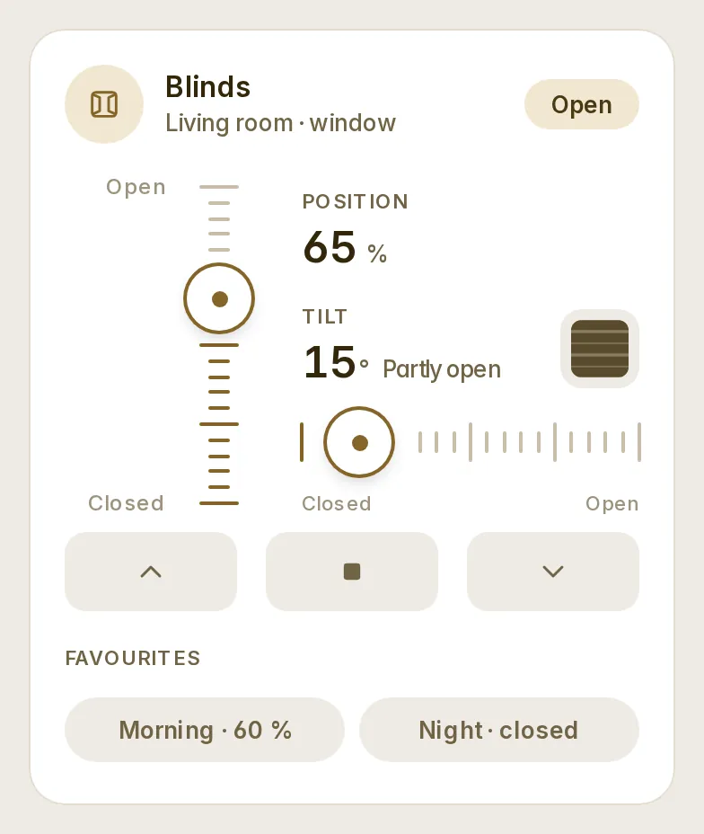

<!-- Generated by `pnpm docs:cards` from the card’s editor and its example in tools/docs/src/gallery.ts: change those, not this page. -->

# Cover

`custom:fluvy-cover-card` · [All cards](../cards.md#everyday) · [Try it live](https://acosta290.github.io/fluvy/?card=cover)

Blinds, shutters, garage doors and valves: vertical position ruler, tilt, open · stop · close, favourites.

<picture><source media="(prefers-color-scheme: dark)" srcset="../images/cards/cover-dark.webp"></picture>

```yaml
type: custom:fluvy-cover-card
entity: cover.blinds
subtitle: Living room · window
tilt_angle: 90
favorites:
  - name: Morning
    position: 60
  - name: Night
    position: 0
    tilt: 0
```

The picture is this configuration on the demo house, whose names and figures are made up: put your own entities in place of its. [Try it in the live demo](https://acosta290.github.io/fluvy/?card=cover), where it answers a tap as it would at home, with each of its layouts and the YAML of each.

## Layouts

`variant` chooses the layout. The picture is `full`, the one the card has when the key is left out; each of the others is the example plus these lines.

| `variant` | Add to the example | Live |
| --- | --- | --- |
| `compact` | `variant: compact` | [Try it](https://acosta290.github.io/fluvy/?card=cover&layout=compact) |

## Options

Every key the card’s editor shows: the editor’s word for it in italics, then what it does. *Default* is what the card does when the key is left out, as the editor shows it on a new card; the editor never writes a default into the configuration.

| Key | What it does | Type | Default | Values |
| --- | --- | --- | --- | --- |
| `entity` | *Entity*. The entity the card is about: what it shows, and what its controls act on. | entity (cover, valve) | required |  |
| `name` | *Name*. The name the card shows, in place of the entity’s own. | name |  |  |
| `icon` | *Icon*. The card’s icon, in place of the entity’s own. | icon |  |  |
| `show_icon` | *Show the icon*. Shows the icon, hides it, or lets the card decide. | choice | `auto` | `auto` (Automatic), `always`, `never` |
| `show_badge` | *Show the badge*. | boolean | `true` |  |
| `name_lines` | *Lines for the name*. Lets the name in the card’s head take two balanced lines where one would cut it; the head is a line taller whatever the name. | choice | `1` | `1`, `2` |
| `subtitle` | *Subtitle*. The line under the title. Your own words, an entity (its state), or a template such as {{ states('sensor.x') }}. | text |  |  |
| `tilt_angle` | *Tilt in degrees: angle at 100 %*. The slats’ angle at 100 % tilt: the tilt then reads in degrees. | number |  | 0 to 360 |
| `variant` | *Style*. The card’s layout. | choice | `full` | `full`, `compact` |
| `favorites_style` | *Favourites as*. Draws the favourites as chips that fill the row, or as content-sized chips. | choice | `full` | `full`, `chips` |
| `show_tilt` | *Show tilt*. Shows the tilt control. | boolean | `true` |  |
| `show_favorites` | *Show favourites*. Shows the favourite positions. | boolean | `true` |  |
| `slider_style` | *Slider style*. The slider’s style; left out, the style set for every slider. Untouched: every slider’s, from Fluvy’s settings. | choice | `house` | `house` (House (Ruler)), `ruler`, `bar`, `liquid` |
| `slider_words` | *Words under it*. Writes the words at the slider’s ends, or none. | choice | `ends` | `ends` (Ends and middle), `none` |
| `tone` | *Tone*. The card’s colour from the palette’s tones; left out, the tone of what it shows. | choice | the card’s own | `accent`, `light`, `heat`, `cool`, `dry`, `fan`, `water`, `solar`, `grid`, `media`, `presence`, `armed`, `battery`, `house`, `gas`, `vehicle` (Car), `neutral`, `ok` (Good), `warning`, `danger` |
| `color` | *Colour*. The card’s colour: its circle, its accents and its tints wear it. Left out, the colour of what it shows. | colour |  |  |
| `card_color` | *Card colour*. Paints the card’s surface in a colour of your own. | colour |  |  |
| `card_opacity` | *Card opacity*. How see-through the card’s surface is, in percent. Untouched: every card’s, from Fluvy’s settings. | number | `100` | 0 % to 100 %, in steps of 5 |
| `card_border` | *Card border*. Draws the card’s hairline border, or leaves it out. Untouched: every card’s, from Fluvy’s settings. | boolean | `true` |  |
| `unavailable` | *When unavailable*. How the card looks while its entity is unavailable: dashed, or quiet. Untouched: every card’s, from Fluvy’s settings. | choice | `dashed` | `dashed`, `quiet` (As when off) |
| `tint` | *Show its colour*. When the card shows its colour beyond its circle: never, while it is on or active, or at rest too. | choice | `off` | `off` (Never), `on` (When active), `always` |
| `tint_style` | *Shown as*. How the colour is shown: a wash over the card, the card’s edge, or the control alone. | choice | `wash` | `wash`, `edge`, `control` |
| `state_colors` | *Colours by state*. A colour for each of the device’s states, held under this key: a tone, none, or a colour of your own. Empty: the colour the card gives it. | map |  | `open`, `closed`, `opening`, `closing` |
| `favorites` | *Favourites*. Favourite positions, each a chip that moves the cover there. | list ([its items](#favorites)) |  |  |

**Position and tilt**

| Key | What it does | Type | Default | Values |
| --- | --- | --- | --- | --- |
| `direction` | *Position counts*. | choice | `up` | `up` (How far it is open), `down` (How far it is down) |
| `invert_position` | *Position reversed*. For a cover that reports 100 % when it is closed; best put right in its integration. | boolean | `false` |  |
| `position_presets` | *Position presets*. | choices or text |  | `0` (0 %), `25` (25 %), `50` (50 %), `75` (75 %), `100` (100 %) |
| `open_label` | *Word for open*. | text |  |  |
| `closed_label` | *Word for closed*. | text |  |  |
| `tilt_style` | *Tilt as*. | choice | `steps` | `steps`, `slats` |
| `invert_tilt` | *Tilt reversed*. | boolean | `false` |  |
| `tilt_presets` | *Tilt presets*. | choices or text |  | `0` (0 %), `25` (25 %), `50` (50 %), `75` (75 %), `100` (100 %) |

**Interactions**

| Key | What it does | Type | Default | Values |
| --- | --- | --- | --- | --- |
| `tap_action` | *Tap action*. What a tap on the card does. | action | `more-info` |  |
| `hold_action` | *Hold action*. What a long press on the card does. | action | `more-info` |  |
| `double_tap_action` | *Double tap action*. What two taps on the card do. A tap waits a moment to tell it from a double tap. | action | `none` |  |
| `icon_tap_action` | *Icon tap action*. What a tap on the icon does. | action | `none` |  |
| `icon_hold_action` | *Icon hold action*. What a long press on the icon does. | action | `none` |  |
| `icon_double_tap_action` | *Icon double tap action*. What two taps on the icon do. A tap waits a moment to tell it from a double tap. | action | `none` |  |

## Lists

### `favorites`

*Favourites*. Favourite positions, each a chip that moves the cover there. An item is a map with `name` and any of these keys.

| Key | What it does | Type | Values |
| --- | --- | --- | --- |
| `name` | *Name*. The item’s own name, in place of the one the card would give it. | text |  |
| `position` | *Position*. The cover’s position the favourite moves it to, in percent. | number | 0 to 100 |
| `tilt` | *Tilt*. The tilt the favourite moves the slats to. | number | 0 to 100 |

## Older names

Names the card still reads, so a dashboard written before keeps working. They are read, never written back.

| Older name | Read as |
| --- | --- |
| `favorites[].label` | `favorites[].name` |
| `favorites[].sub` | `favorites[].secondary` |
| `favorites[].meta` | `favorites[].subtitle` |
| `sub` | `subtitle` |
| `meta` | `subtitle` |
| `layout` | `variant` |
| `view` | `variant` |
| `accent` | `color` |
