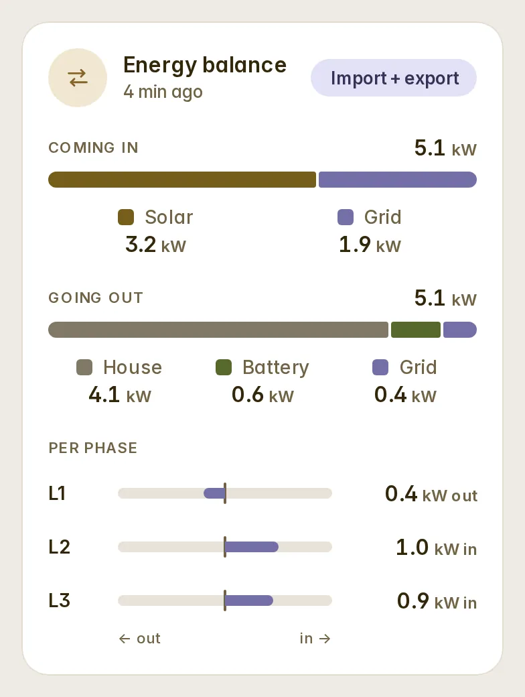

<!-- Generated by `pnpm docs:cards` from the card’s editor and its example in tools/docs/src/gallery.ts: change those, not this page. -->

# Energy balance

`custom:fluvy-energy-balance-card` · [All cards](../cards.md#energy) · [Try it live](https://acosta290.github.io/fluvy/?card=energy-balance)

What comes in against what goes out, live or over a period: the house is the remainder, so the totals agree; each phase of the grid, and the money.

<picture><source media="(prefers-color-scheme: dark)" srcset="../images/cards/energy-balance-dark.webp"></picture>

```yaml
type: custom:fluvy-energy-balance-card
sources:
  - type: solar
    power: sensor.bl_solar
  - type: grid
    phases:
      - sensor.bl_l1
      - sensor.bl_l2
      - sensor.bl_l3
  - type: battery
    power: sensor.bl_battery
```

The picture is this configuration on the demo house, whose names and figures are made up: put your own entities in place of its. [Try it in the live demo](https://acosta290.github.io/fluvy/?card=energy-balance), where it answers a tap as it would at home, with each of its layouts and the YAML of each.

## Options

Every key the card’s editor shows: the editor’s word for it in italics, then what it does. *Default* is what the card does when the key is left out, as the editor shows it on a new card; the editor never writes a default into the configuration.

| Key | What it does | Type | Default | Values |
| --- | --- | --- | --- | --- |
| `title` | *Title*. The title at the top of the card. | text |  |  |
| `subtitle` | *Subtitle*. The line under the title. | text |  |  |
| `icon` | *Icon*. The card’s icon, in place of the entity’s own. | icon |  |  |
| `period` | *What it shows*. Shows the power now, or a period’s totals. | choice | `live` | `live`, `day`, `week`, `month` |
| `show_icon` | *Show the icon*. Shows the icon, hides it, or lets the card decide. | choice | `auto` | `auto` (Automatic), `always`, `never` |
| `name_lines` | *Lines for the name*. Lets the name in the card’s head take two balanced lines where one would cut it; the head is a line taller whatever the name. | choice | `1` | `1`, `2` |
| `collection_key` | *Follow a date picker*. Makes the card follow an Energy date picker on the same dashboard. The key of an Energy date picker on this dashboard (Fluvy’s Energy period card or Home Assistant’s) | choice or text | none |  |
| `show_period` | *Day · Week · Month chips*. Shows the chips that choose the period. | boolean | `true` |  |
| `show_phases` | *Per phase (a grid read by phase)*. Adds a row per phase for a grid read by phase. | boolean | `true` |  |
| `show_cost` | *Cost and feed-in (over a period)*. Shows what the grid cost and what feeding it paid, over a period. | boolean | `true` |  |
| `tone` | *Tone*. The card’s colour from the palette’s tones; left out, the tone of what it shows. | choice | the card’s own | `accent`, `light`, `heat`, `cool`, `dry`, `fan`, `water`, `solar`, `grid`, `media`, `presence`, `armed`, `battery`, `house`, `gas`, `vehicle` (Car), `neutral`, `ok` (Good), `warning`, `danger` |
| `color` | *Colour*. The card’s colour: its circle, its accents and its tints wear it. Left out, the colour of what it shows. | colour |  |  |
| `card_color` | *Card colour*. Paints the card’s surface in a colour of your own. | colour |  |  |
| `card_opacity` | *Card opacity*. How see-through the card’s surface is, in percent. Untouched: every card’s, from Fluvy’s settings. | number | `100` | 0 % to 100 %, in steps of 5 |
| `card_border` | *Card border*. Draws the card’s hairline border, or leaves it out. Untouched: every card’s, from Fluvy’s settings. | boolean | `true` |  |
| `unavailable` | *When unavailable*. How the card looks while its entity is unavailable: dashed, or quiet. Untouched: every card’s, from Fluvy’s settings. | choice | `dashed` | `dashed`, `quiet` (As when off) |
| `unit` | *Unit*. The unit the figures are written in; automatic keeps the sensor’s. | choice or text | `auto` | `auto` (Automatic), `W`, `kW`, `MW`, `Wh`, `kWh`, `MWh` |
| `decimals` | *Decimals*. How many decimals the figures have; automatic decides by their size. | choice | `auto` | `auto` (Automatic), `0`, `1`, `2`, `3` |
| `sources` | *Sources (none: the Energy dashboard’s)*. The sources of energy, each with its sensors; left out, the Energy dashboard’s. | list ([its items](#sources)) |  |  |

**Interactions**

| Key | What it does | Type | Default | Values |
| --- | --- | --- | --- | --- |
| `tap_action` | *Tap action*. What a tap on the card does. | action | `none` |  |
| `hold_action` | *Hold action*. What a long press on the card does. | action | `none` |  |
| `double_tap_action` | *Double tap action*. What two taps on the card do. A tap waits a moment to tell it from a double tap. | action | `none` |  |
| `icon_tap_action` | *Icon tap action*. What a tap on the icon does. | action | `none` |  |
| `icon_hold_action` | *Icon hold action*. What a long press on the icon does. | action | `none` |  |
| `icon_double_tap_action` | *Icon double tap action*. What two taps on the icon do. A tap waits a moment to tell it from a double tap. | action | `none` |  |

## Lists

### `sources`

*Sources (none: the Energy dashboard’s)*. The sources of energy, each with its sensors; left out, the Energy dashboard’s. An item is a map with `type` and any of these keys.

| Key | What it does | Type | Values |
| --- | --- | --- | --- |
| `type` | *Kind*. What kind of source it is. | choice | `solar`, `grid`, `battery`, `generator`, `vehicle` (Car) |
| `power` | *Power (one sensor, + coming in)*. One signed sensor of its power: positive while it comes in. | entity (sensor) |  |
| `phases` | *Per phase (each signed, summed)*. One sensor per phase, each signed and summed. | entities (sensor) |  |
| `import` | *Coming in (import, discharge)*. A sensor of the power coming in from it, positive. | entity (sensor) |  |
| `export` | *Going out (export, charge)*. A sensor of the power going out of it, positive. | entity (sensor) |  |
| `invert` | *The sensor counts going out as positive*. Reads the sensor the other way round. | boolean |  |
| `name` | *Name*. The item’s own name, in place of the one the card would give it. | text |  |
| `color` | *Colour*. The item’s colour, in place of the one the card gives it. Empty: the colour the card gives it. | colour |  |
| `threshold` | *Rests below (W)*. Below this many watts the source’s lane rests. | number | 0 to 10000 |

## Older names

Names the card still reads, so a dashboard written before keeps working. They are read, never written back.

| Older name | Read as |
| --- | --- |
| `sources[].power` | `sources[].phases` (some of its values) |
| `sub` | `subtitle` |
| `meta` | `subtitle` |
| `accent` | `color` |
