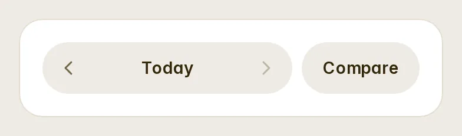

<!-- Generated by `pnpm docs:cards` from the card’s editor and its example in tools/docs/src/gallery.ts: change those, not this page. -->

# Energy period

`custom:fluvy-energy-period-card` · [All cards](../cards.md#energy) · [Try it live](https://acosta290.github.io/fluvy/?card=energy-period)

The view’s date picker as a strip: ‹ the day, week, month or year › and back to today, Home Assistant’s own, so its energy cards follow it as Fluvy’s do.

<picture><source media="(prefers-color-scheme: dark)" srcset="../images/cards/energy-period-dark.webp"></picture>

```yaml
type: custom:fluvy-energy-period-card
collection_key: energy_pg
show_compare: true
```

The picture is this configuration on the demo house, whose names and figures are made up: put your own entities in place of its. [Try it in the live demo](https://acosta290.github.io/fluvy/?card=energy-period), where it answers a tap as it would at home, with each of its layouts and the YAML of each.

## Layouts

`variant` chooses the layout. The picture is `row`, the one the card has when the key is left out; each of the others is the example plus these lines.

| `variant` | Add to the example | Live |
| --- | --- | --- |
| `compact` | `variant: compact` | [Try it](https://acosta290.github.io/fluvy/?card=energy-period&layout=compact) |
| `stacked` | `variant: stacked` | [Try it](https://acosta290.github.io/fluvy/?card=energy-period&layout=stacked) |
| `bar` | `variant: bar` | [Try it](https://acosta290.github.io/fluvy/?card=energy-period&layout=bar) |

## Options

Every key the card’s editor shows: the editor’s word for it in italics, then what it does. *Default* is what the card does when the key is left out, as the editor shows it on a new card; the editor never writes a default into the configuration.

| Key | What it does | Type | Default | Values |
| --- | --- | --- | --- | --- |
| `variant` | *Style*. The card’s layout. | choice | `row` | `row`, `compact`, `stacked` (With the periods), `bar` (Across the section) |
| `collection_key` | *Follow a date picker*. Makes the card follow an Energy date picker on the same dashboard. The key of an Energy date picker on this dashboard (Fluvy’s Energy period card or Home Assistant’s) | choice or text | none |  |
| `periods` | *Periods*. The periods the card offers to choose from, in this order. | choices | `day`, `week`, `month`, `year`, `custom` | `day`, `week`, `month`, `year`, `custom` |
| `show_today` | *Show the Today button*. Shows the Today button, which comes back to the present period. | boolean | `true` |  |
| `show_compare` | *Show the Compare button*. Shows the Compare button, which adds the period before. | boolean | `false` |  |
| `tone` | *Tone*. The card’s colour from the palette’s tones; left out, the tone of what it shows. | choice | the card’s own | `accent`, `light`, `heat`, `cool`, `dry`, `fan`, `water`, `solar`, `grid`, `media`, `presence`, `armed`, `battery`, `house`, `gas`, `vehicle` (Car), `neutral`, `ok` (Good), `warning`, `danger` |
| `color` | *Colour*. The card’s colour: its circle, its accents and its tints wear it. Left out, the colour of what it shows. | colour |  |  |
| `card_color` | *Card colour*. Paints the card’s surface in a colour of your own. | colour |  |  |
| `card_opacity` | *Card opacity*. How see-through the card’s surface is, in percent. Untouched: every card’s, from Fluvy’s settings. | number | `100` | 0 % to 100 %, in steps of 5 |
| `card_border` | *Card border*. Draws the card’s hairline border, or leaves it out. Untouched: every card’s, from Fluvy’s settings. | boolean | `true` |  |
| `unavailable` | *When unavailable*. How the card looks while its entity is unavailable: dashed, or quiet. Untouched: every card’s, from Fluvy’s settings. | choice | `dashed` | `dashed`, `quiet` (As when off) |

## Older names

Names the card still reads, so a dashboard written before keeps working. They are read, never written back.

| Older name | Read as |
| --- | --- |
| `layout` | `variant` |
| `view` | `variant` |
| `accent` | `color` |
