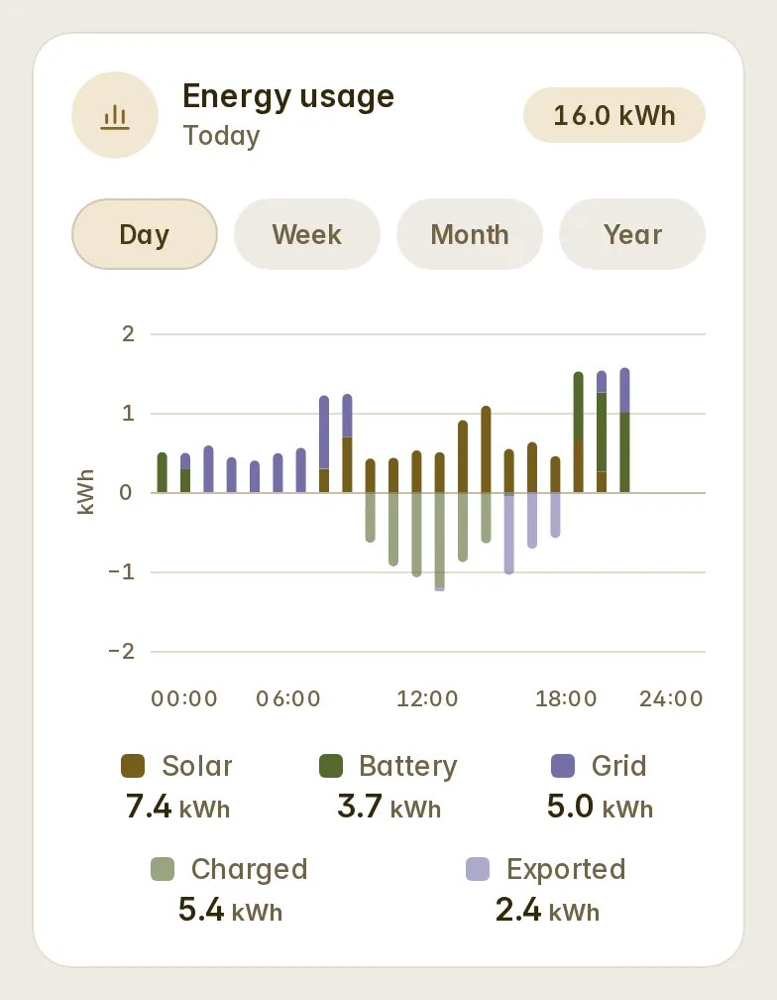

<!-- Generated by `pnpm docs:cards` from the card’s editor and its example in tools/docs/src/gallery.ts: change those, not this page. -->

# Energy usage

`custom:fluvy-energy-usage-card` · [All cards](../cards.md#energy) · [Try it live](https://acosta290.github.io/fluvy/?card=energy-usage)

Electricity, water or gas used by the hour, the day or the month, stacked by source or meter.

<picture><source media="(prefers-color-scheme: dark)" srcset="../images/cards/energy-usage-dark.webp"></picture>

```yaml
type: custom:fluvy-energy-usage-card
```

The picture is this configuration on the demo house, whose names and figures are made up: put your own entities in place of its. [Try it in the live demo](https://acosta290.github.io/fluvy/?card=energy-usage), where it answers a tap as it would at home, with each of its layouts and the YAML of each.

More about it in the guide: [Energy usage](../cards.md#energy-usage).

## Layouts

`variant` chooses the layout. The picture is `full`, the one the card has when the key is left out; each of the others is the example plus these lines.

| `variant` | Add to the example | Live |
| --- | --- | --- |
| `compact` | `variant: compact` | [Try it](https://acosta290.github.io/fluvy/?card=energy-usage&layout=compact) |
| `mini` | `variant: mini` | [Try it](https://acosta290.github.io/fluvy/?card=energy-usage&layout=mini) |

## Options

Every key the card’s editor shows: the editor’s word for it in italics, then what it does. *Default* is what the card does when the key is left out, as the editor shows it on a new card; the editor never writes a default into the configuration.

| Key | What it does | Type | Default | Values |
| --- | --- | --- | --- | --- |
| `kind` | *What it charts*. What the card charts: energy, water, or gas. | choice | `energy` | `energy` (Electricity), `water`, `gas` |
| `title` | *Title*. The title at the top of the card. | text |  |  |
| `subtitle` | *Subtitle*. The line under the title. | text |  |  |
| `icon` | *Icon*. The card’s icon, in place of the entity’s own. | icon |  |  |
| `variant` | *Style*. The card’s layout. | choice | `full` | `full`, `compact`, `mini` |
| `show_icon` | *Show the icon*. Shows the icon, hides it, or lets the card decide. | choice | `auto` | `auto` (Automatic), `always`, `never` |
| `name_lines` | *Lines for the name*. Lets the name in the card’s head take two balanced lines where one would cut it; the head is a line taller whatever the name. | choice | `1` | `1`, `2` |
| `mode` | *What the columns show*. Shows what the house used from each source, or every flow between them. Used by the house from each source. | choice | `usage` | `usage` (Used by the house), `flows` (Metered flows) |
| `plot_height` | *Chart height (px)*. The chart’s height in pixels. | number | `160` | 48 to 480, in steps of 4 |
| `period` | *Period*. The span the columns show. | choice | `day` | `day`, `week`, `month`, `year` |
| `collection_key` | *Follow a date picker*. Makes the card follow an Energy date picker on the same dashboard. The key of an Energy date picker on this dashboard (Fluvy’s Energy period card or Home Assistant’s) | choice or text | none |  |
| `show_period` | *Day · Week · Month · Year chips*. Shows the chips that choose the period. | boolean | `true` |  |
| `show_returns` | *Show what was charged and exported*. Shows what went into the battery and out to the grid, under the line. | boolean | `true` |  |
| `show_legend` | *Show the legend*. Shows the legend under the chart. | boolean | `true` |  |
| `compare` | *Show the period before behind the columns*. Draws the period before as faint columns behind the bars. | boolean | `false` |  |
| `max_sources` | *Sources before the rest become “Other”*. How many sources keep their own name before the rest fold into "Other". | number | `6` | 2 to 6 |
| `tone` | *Tone*. The card’s colour from the palette’s tones; left out, the tone of what it shows. | choice | the card’s own | `accent`, `light`, `heat`, `cool`, `dry`, `fan`, `water`, `solar`, `grid`, `media`, `presence`, `armed`, `battery`, `house`, `gas`, `vehicle` (Car), `neutral`, `ok` (Good), `warning`, `danger` |
| `color` | *Colour*. The card’s colour: its circle, its accents and its tints wear it. Left out, the colour of what it shows. | colour |  |  |
| `card_color` | *Card colour*. Paints the card’s surface in a colour of your own. | colour |  |  |
| `card_opacity` | *Card opacity*. How see-through the card’s surface is, in percent. Untouched: every card’s, from Fluvy’s settings. | number | `100` | 0 % to 100 %, in steps of 5 |
| `card_border` | *Card border*. Draws the card’s hairline border, or leaves it out. Untouched: every card’s, from Fluvy’s settings. | boolean | `true` |  |
| `unavailable` | *When unavailable*. How the card looks while its entity is unavailable: dashed, or quiet. Untouched: every card’s, from Fluvy’s settings. | choice | `dashed` | `dashed`, `quiet` (As when off) |
| `unit` | *Unit*. The unit the figures are written in; automatic keeps the sensor’s. | choice or text | `auto` | `auto` (Automatic), `Wh`, `kWh`, `MWh` |
| `decimals` | *Decimals*. How many decimals the figures have; automatic decides by their size. | choice | `auto` | `auto` (Automatic), `0`, `1`, `2`, `3` |
| `sources` | *Sources (none: the Energy dashboard’s)*. The sources of energy, each with its sensors; left out, the Energy dashboard’s. | list ([its items](#sources)) |  |  |
| `meters` | *Meters (none: the Energy dashboard’s)*. The water or gas meters charted; left out, the Energy dashboard’s. | list ([its items](#meters)) |  |  |

**Chart**

| Key | What it does | Type | Default | Values |
| --- | --- | --- | --- | --- |
| `chart` | *Chart*. The chart’s style; left out, the style set for the whole house. | choice | `classic` | `classic`, `soft` |
| `show_grid` | *Gridlines*. Draws gridlines across the chart. | choice | `auto` | `auto` (Automatic), `none`, `x` (Vertical lines), `y` (Horizontal lines), `both` |
| `show_axis` | *Show the scale*. Shows the scale’s labels beside the chart. | boolean | `true` |  |
| `animate` | *Animate*. Lets the chart or the gauge move as it draws; off, it shows its resting frame at once. | boolean | `true` |  |

**Interactions**

| Key | What it does | Type | Default | Values |
| --- | --- | --- | --- | --- |
| `tap_action` | *Tap action*. What a tap on the card does. | action | `none` |  |
| `hold_action` | *Hold action*. What a long press on the card does. | action | `none` |  |
| `double_tap_action` | *Double tap action*. What two taps on the card do. A tap waits a moment to tell it from a double tap. | action | `none` |  |
| `icon_tap_action` | *Icon tap action*. What a tap on the icon does. | action | `none` |  |
| `icon_hold_action` | *Icon hold action*. What a long press on the icon does. | action | `none` |  |
| `icon_double_tap_action` | *Icon double tap action*. What two taps on the icon do. A tap waits a moment to tell it from a double tap. | action | `none` |  |

## Lists

### `sources`

*Sources (none: the Energy dashboard’s)*. The sources of energy, each with its sensors; left out, the Energy dashboard’s. An item is a map with `type` and any of these keys.

| Key | What it does | Type | Values |
| --- | --- | --- | --- |
| `type` | *Kind*. What kind of source it is. | choice | `solar`, `battery`, `grid` |
| `name` | *Name*. The item’s own name, in place of the one the card would give it. | text |  |
| `color` | *Colour*. The item’s colour, in place of the one the card gives it. Empty: its energy’s own colour. The palette’s colours follow it; a colour name or a #hex stays as typed. | choice or text | `graph-1` (Series 1), `graph-2` (Series 2), `graph-3` (Series 3), `graph-4` (Series 4), `graph-5` (Series 5), `graph-6` (Series 6), `graph-7` (Series 7), `graph-8` (Series 8), `graph-9` (Series 9), `graph-10` (Series 10), `graph-11` (Series 11), `graph-12` (Series 12), `accent`, `ok` (Good), `warning`, `danger`, `notice`, `light`, `solar`, `grid`, `battery`, `water`, `gas`, `home` (House) |
| `show` | *Show*. Draws this source. | boolean |  |

### `meters`

*Meters (none: the Energy dashboard’s)*. The water or gas meters charted; left out, the Energy dashboard’s. An item is an entity id, or a map with `entity` and any of these keys.

| Key | What it does | Type | Values |
| --- | --- | --- | --- |
| `entity` | *Entity*. The meter’s statistic. | statistic |  |
| `name` | *Name*. The item’s own name, in place of the one the card would give it. | name |  |
| `color` | *Colour*. The item’s colour, in place of the one the card gives it. Empty: a shade of water’s or gas’s colour. The palette’s colours follow it; a colour name or a #hex stays as typed. | choice or text | `graph-1` (Series 1), `graph-2` (Series 2), `graph-3` (Series 3), `graph-4` (Series 4), `graph-5` (Series 5), `graph-6` (Series 6), `graph-7` (Series 7), `graph-8` (Series 8), `graph-9` (Series 9), `graph-10` (Series 10), `graph-11` (Series 11), `graph-12` (Series 12), `accent`, `ok` (Good), `warning`, `danger`, `notice`, `light`, `solar`, `grid`, `battery`, `water`, `gas`, `home` (House) |

## Older names

Names the card still reads, so a dashboard written before keeps working. They are read, never written back.

| Older name | Read as |
| --- | --- |
| `sub` | `subtitle` |
| `meta` | `subtitle` |
| `layout` | `variant` |
| `view` | `variant` |
| `accent` | `color` |
