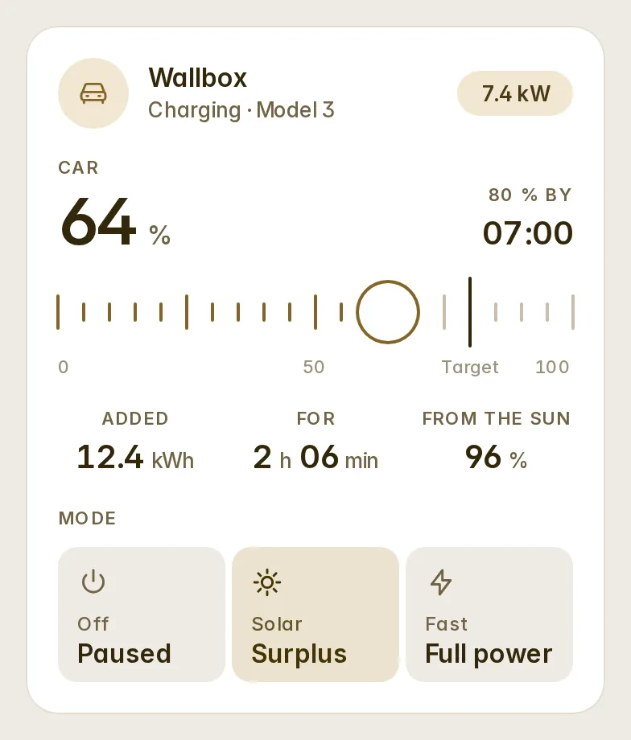

<!-- Generated by `pnpm docs:cards` from the card’s editor and its example in tools/docs/src/gallery.ts: change those, not this page. -->

# Car charger

`custom:fluvy-ev-charger-card` · [All cards](../cards.md#energy) · [Try it live](https://acosta290.github.io/fluvy/?card=ev-charger)

The car on its charger: its charge against the target, ready by when, what the session added and how much of it came from the sun, the charging mode.

<picture><source media="(prefers-color-scheme: dark)" srcset="../images/cards/ev-charger-dark.webp"></picture>

```yaml
type: custom:fluvy-ev-charger-card
entity: sensor.st_wallbox
level: sensor.st_car_level
target: 80
ready_by: '07:00'
session_energy: sensor.st_session
status: sensor.st_wallbox_status
vehicle: Model 3
solar_share: sensor.st_solar_share
mode: select.st_wallbox_mode
```

The picture is this configuration on the demo house, whose names and figures are made up: put your own entities in place of its. [Try it in the live demo](https://acosta290.github.io/fluvy/?card=ev-charger), where it answers a tap as it would at home, with each of its layouts and the YAML of each.

## Options

Every key the card’s editor shows: the editor’s word for it in italics, then what it does. *Default* is what the card does when the key is left out, as the editor shows it on a new card; the editor never writes a default into the configuration.

| Key | What it does | Type | Default | Values |
| --- | --- | --- | --- | --- |
| `entity` | *Charger power (+ charging the car)*. The charger’s power sensor, positive while it charges the car. | entity (sensor) | required |  |
| `name` | *Name*. The name the card shows, in place of the entity’s own. | name |  |  |
| `icon` | *Icon*. The card’s icon, in place of the entity’s own. | icon |  |  |
| `show_icon` | *Show the icon*. Shows the icon, hides it, or lets the card decide. | choice | `auto` | `auto` (Automatic), `always`, `never` |
| `name_lines` | *Lines for the name*. Lets the name in the card’s head take two balanced lines where one would cut it; the head is a line taller whatever the name. | choice | `1` | `1`, `2` |
| `invert` | *The sensor counts charging as negative*. Reads the charger’s sensor the other way round, for one that counts charging as negative. | boolean | `false` |  |
| `level` | *The car’s state of charge*. A sensor of the car’s state of charge. | entity (sensor) |  |  |
| `target` | *Target: a % or an entity*. Where the charge should stop: a percentage, or an entity that holds one. | text |  |  |
| `ready_by` | *Ready by: a time (07:00) or an entity*. When the car should be charged: a time, or an entity that holds one. | text |  |  |
| `status` | *Status (charging, connected)*. A sensor that says whether the car is charging or connected. | entity (sensor, binary_sensor) |  |  |
| `session_energy` | *Energy added this session*. A sensor of the energy this charging session has added. | entity (sensor) |  |  |
| `solar_share` | *Share from the sun (%)*. A sensor of how much of the charge comes from the sun, in percent. | entity (sensor) |  |  |
| `vehicle` | *The car’s name*. The car’s name, said after the status. | text |  |  |
| `mode` | *Mode (a select entity)*. A select entity of the charging mode, shown as tiles to choose from. | entity (select, input_select) |  |  |
| `tone` | *Tone*. The card’s colour from the palette’s tones; left out, the tone of what it shows. | choice | the card’s own | `accent`, `light`, `heat`, `cool`, `dry`, `fan`, `water`, `solar`, `grid`, `media`, `presence`, `armed`, `battery`, `house`, `gas`, `vehicle` (Car), `neutral`, `ok` (Good), `warning`, `danger` |
| `color` | *Colour*. The card’s colour: its circle, its accents and its tints wear it. Left out, the colour of what it shows. | colour |  |  |
| `card_color` | *Card colour*. Paints the card’s surface in a colour of your own. | colour |  |  |
| `card_opacity` | *Card opacity*. How see-through the card’s surface is, in percent. Untouched: every card’s, from Fluvy’s settings. | number | `100` | 0 % to 100 %, in steps of 5 |
| `card_border` | *Card border*. Draws the card’s hairline border, or leaves it out. Untouched: every card’s, from Fluvy’s settings. | boolean | `true` |  |
| `unavailable` | *When unavailable*. How the card looks while its entity is unavailable: dashed, or quiet. Untouched: every card’s, from Fluvy’s settings. | choice | `dashed` | `dashed`, `quiet` (As when off) |
| `unit` | *Unit*. The unit the figures are written in; automatic keeps the sensor’s. | choice or text | `auto` | `auto` (Automatic), `W`, `kW`, `MW`, `Wh`, `kWh`, `MWh`, `L`, `m³`, `gal`, `ft³` |
| `decimals` | *Decimals*. How many decimals the figures have; automatic decides by their size. | choice | `auto` | `auto` (Automatic), `0`, `1`, `2`, `3` |

**Interactions**

| Key | What it does | Type | Default | Values |
| --- | --- | --- | --- | --- |
| `tap_action` | *Tap action*. What a tap on the card does. | action | `more-info` |  |
| `hold_action` | *Hold action*. What a long press on the card does. | action | `more-info` |  |
| `double_tap_action` | *Double tap action*. What two taps on the card do. A tap waits a moment to tell it from a double tap. | action | `none` |  |
| `icon_tap_action` | *Icon tap action*. What a tap on the icon does. | action | `none` |  |
| `icon_hold_action` | *Icon hold action*. What a long press on the icon does. | action | `none` |  |
| `icon_double_tap_action` | *Icon double tap action*. What two taps on the icon do. A tap waits a moment to tell it from a double tap. | action | `none` |  |

## Older names

Names the card still reads, so a dashboard written before keeps working. They are read, never written back.

| Older name | Read as |
| --- | --- |
| `accent` | `color` |
