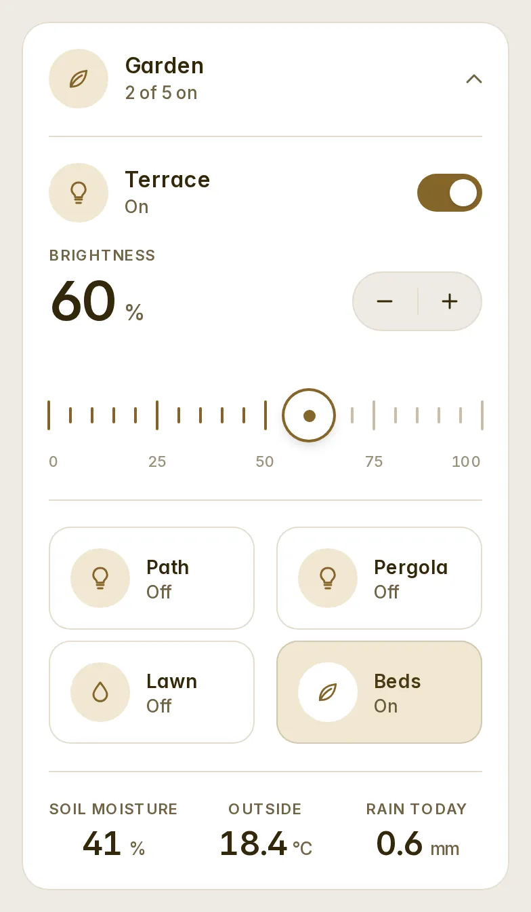

<!-- Generated by `pnpm docs:cards` from the card’s editor and its example in tools/docs/src/gallery.ts: change those, not this page. -->

# Expander

`custom:fluvy-expander-card` · [All cards](../cards.md#structure-and-navigation) · [Try it live](https://acosta290.github.io/fluvy/?card=expander)

Any cards folded away under a head: a tap opens them, on one surface or each on its own.

<picture><source media="(prefers-color-scheme: dark)" srcset="../images/cards/expander-dark.webp"></picture>

```yaml
type: custom:fluvy-expander-card
title: Garden
icon: leaf
entities:
  - light.ex_terrace
  - light.ex_path
  - light.ex_pergola
  - switch.ex_lawn
  - switch.ex_beds
remember: 'off'
cards:
  - type: custom:fluvy-light-card
    entity: light.ex_terrace
  - type: custom:fluvy-tiles-card
    size: compact
    columns: 2
    tiles:
      - entity: light.ex_path
      - entity: light.ex_pergola
      - entity: switch.ex_lawn
        icon: drop
      - entity: switch.ex_beds
        icon: leaf
  - type: custom:fluvy-readouts-card
    entities:
      - sensor.ex_soil
      - sensor.ex_garden_temperature
      - sensor.ex_rain
expanded: true
```

The picture is this configuration on the demo house, whose names and figures are made up: put your own entities in place of its. [Try it in the live demo](https://acosta290.github.io/fluvy/?card=expander), where it answers a tap as it would at home, with each of its layouts and the YAML of each.

More about it in the guide: [Expander](../cards.md#expander).

## Layouts

`style` chooses the layout. The picture is `card`, the one the card has when the key is left out; each of the others is the example plus these lines.

| `style` | Add to the example | Live |
| --- | --- | --- |
| `plain` | `style: plain` | [Try it](https://acosta290.github.io/fluvy/?card=expander&layout=plain) |

## Options

Every key the card’s editor shows: the editor’s word for it in italics, then what it does. *Default* is what the card does when the key is left out, as the editor shows it on a new card; the editor never writes a default into the configuration.

| Key | What it does | Type | Default | Values |
| --- | --- | --- | --- | --- |
| `title` | *Title*. The title in the head. | text |  |  |
| `icon` | *Icon*. The card’s icon, in place of the entity’s own. | icon |  |  |
| `subtitle` | *Subtitle*. The line under the title. Your own words, an entity (its state), or a template such as {{ states('sensor.x') }}. | text |  |  |
| `entities` | *Entities*. The entities the head’s line counts ("2 of 5 on"). Counted on the line under the title: 2 of 5 on. | entities |  |  |
| `show_summary` | *Count the entities on its line*. Counts the entities on the line under the title ("2 of 5 on"). | boolean | `true` |  |
| `style` | *Style*. Draws the card on its own surface, or plain on the page. | choice | `card` | `card` (One card), `plain` |
| `columns` | *Columns*. How many of its cards stand side by side. | choice | `1` | `1`, `2`, `3`, `4` |
| `gap` | *Room between cards (px)*. The room between the cards it holds, in pixels. | number | `40` | 0 to 64, in steps of 4 |
| `show_icon` | *Show the icon*. Shows the icon, hides it, or lets the card decide. | choice | `auto` | `auto` (Automatic), `always`, `never` |
| `name_lines` | *Lines for the name*. Lets the name in the card’s head take two balanced lines where one would cut it; the head is a line taller whatever the name. | choice | `1` | `1`, `2` |
| `show_chevron` | *Show the chevron*. Shows the chevron that opens and folds the card. | boolean | `true` |  |
| `chevron_position` | *Chevron*. Where the chevron that opens and folds it stands. | choice | `end` | `end` (At the end), `start` (At the start), `bottom` (At the foot) |
| `chevron_size` | *Chevron size*. How large the chevron is. | choice | `regular` | `regular`, `large` |
| `expanded` | *Open at first*. Opens the card as the page loads; off, it starts folded. | boolean | `false` |  |
| `remember` | *Remember how it was left*. Where the way it was left open or folded is kept: this device, the person, or nowhere. | choice | `device` | `device` (On this device), `user` (For each person), `off` |
| `open_when` | *Open by itself*. A condition that opens the card by itself while it holds. It opens when this starts to hold, and folds again when it no longer does. | condition |  |  |
| `close_after` | *Fold again after (minutes)*. Folds the card again by itself this many minutes after it was opened; 0 never does. | number | `0` | 0 to 1440 |
| `id` | *ID*. A name other cards use to open, fold or toggle this one. Another card opens, folds or toggles it with this action in its YAML: tap_action: {action: fire-dom-event, fluvy_expander: {id: clock, action: toggle}}. | text |  |  |
| `tone` | *Tone*. The card’s colour from the palette’s tones; left out, the tone of what it shows. | choice | the card’s own | `accent`, `light`, `heat`, `cool`, `dry`, `fan`, `water`, `solar`, `grid`, `media`, `presence`, `armed`, `battery`, `house`, `gas`, `vehicle` (Car), `neutral`, `ok` (Good), `warning`, `danger` |
| `color` | *Colour*. The card’s colour: its circle, its accents and its tints wear it. Left out, the colour of what it shows. | colour |  |  |
| `icon_color` | *Icon colour*. Paints the icon’s circle in a colour of its own. Empty: the card’s colour. | colour |  |  |
| `card_color` | *Card colour*. Paints the card’s surface in a colour of your own. | colour |  |  |
| `card_opacity` | *Card opacity*. How see-through the card’s surface is, in percent. Untouched: every card’s, from Fluvy’s settings. | number | `100` | 0 % to 100 %, in steps of 5 |
| `card_border` | *Card border*. Draws the card’s hairline border, or leaves it out. Untouched: every card’s, from Fluvy’s settings. | boolean | `true` |  |
| `head_cards` | *Cards in the head*. Cards that stand in the head in place of its icon and title, and stay while it is folded. | object |  |  |
| `cards` | *Cards*. The cards the Expander holds and shows while it is open: any card, Fluvy’s or not. | object |  |  |

**Interactions**

| Key | What it does | Type | Default | Values |
| --- | --- | --- | --- | --- |
| `tap_action` | *Tap action*. What a tap on the card does. | action | `more-info` |  |
| `hold_action` | *Hold action*. What a long press on the card does. | action | `more-info` |  |
| `double_tap_action` | *Double tap action*. What two taps on the card do. A tap waits a moment to tell it from a double tap. | action | `none` |  |

## Older names

Names the card still reads, so a dashboard written before keeps working. They are read, never written back.

| Older name | Read as |
| --- | --- |
| `sub` | `subtitle` |
| `meta` | `subtitle` |
| `accent` | `color` |
