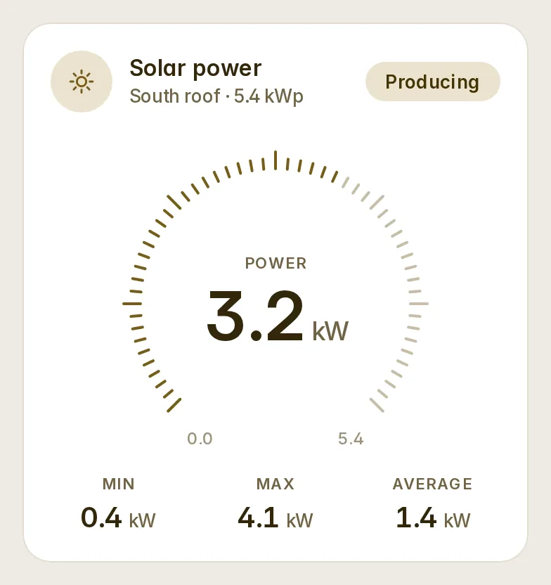

<!-- Generated by `pnpm docs:cards` from the card’s editor and its example in tools/docs/src/gallery.ts: change those, not this page. -->

# Gauge

`custom:fluvy-gauge-card` · [All cards](../cards.md#energy) · [Try it live](https://acosta290.github.io/fluvy/?card=gauge)

A ring gauge for any numeric sensor with min, max and average, or centred on zero for a meter that runs both ways.

<picture><source media="(prefers-color-scheme: dark)" srcset="../images/cards/gauge-dark.webp"></picture>

```yaml
type: custom:fluvy-gauge-card
entity: sensor.so_solar_power
icon: sun
subtitle: South roof · 5.4 kWp
max_entity: sensor.so_solar_capacity
```

The picture is this configuration on the demo house, whose names and figures are made up: put your own entities in place of its. [Try it in the live demo](https://acosta290.github.io/fluvy/?card=gauge), where it answers a tap as it would at home, with each of its layouts and the YAML of each.

## Layouts

`variant` chooses the layout. The picture is `ring`, the one the card has when the key is left out; each of the others is the example plus these lines.

| `variant` | Add to the example | Live |
| --- | --- | --- |
| `bar` | `variant: bar` | [Try it](https://acosta290.github.io/fluvy/?card=gauge&layout=bar) |
| `signed` | `variant: signed` | [Try it](https://acosta290.github.io/fluvy/?card=gauge&layout=signed) |

## Options

Every key the card’s editor shows: the editor’s word for it in italics, then what it does. *Default* is what the card does when the key is left out, as the editor shows it on a new card; the editor never writes a default into the configuration.

| Key | What it does | Type | Default | Values |
| --- | --- | --- | --- | --- |
| `entity` | *Entity*. The entity the card is about: what it shows, and what its controls act on. | entity (sensor, number, input_number, counter) | required |  |
| `name` | *Name*. The name the card shows, in place of the entity’s own. | name |  |  |
| `subtitle` | *Subtitle*. The line under the title. Your own words, an entity (its state), or a template such as {{ states('sensor.x') }}. | text |  |  |
| `icon` | *Icon*. The card’s icon, in place of the entity’s own. | icon |  |  |
| `variant` | *Style*. The card’s layout. | choice | `ring` | `ring`, `bar`, `signed` (Centred on zero) |
| `gauge` | *Gauge*. The gauge’s style. | choice | `ticks` | `ticks`, `dial`, `ring`, `liquid`, `thermo` (Sky), `tank`, `battery`, `pulse`, `air`, `sun` |
| `animate` | *Animate*. Lets the chart or the gauge move as it draws; off, it shows its resting frame at once. | boolean | `true` |  |
| `show_icon` | *Show the icon*. Shows the icon, hides it, or lets the card decide. | choice | `auto` | `auto` (Automatic), `always`, `never` |
| `name_lines` | *Lines for the name*. Lets the name in the card’s head take two balanced lines where one would cut it; the head is a line taller whatever the name. | choice | `1` | `1`, `2` |
| `tone` | *Tone*. The card’s colour from the palette’s tones; left out, the tone of what it shows. | choice | the card’s own | `accent`, `light`, `heat`, `cool`, `dry`, `fan`, `water`, `solar`, `grid`, `media`, `presence`, `armed`, `battery`, `house`, `gas`, `vehicle` (Car), `neutral`, `ok` (Good), `warning`, `danger` |
| `color` | *Colour*. The card’s colour: its circle, its accents and its tints wear it. Left out, the colour of what it shows. | colour |  |  |
| `card_color` | *Card colour*. Paints the card’s surface in a colour of your own. | colour |  |  |
| `card_opacity` | *Card opacity*. How see-through the card’s surface is, in percent. Untouched: every card’s, from Fluvy’s settings. | number | `100` | 0 % to 100 %, in steps of 5 |
| `card_border` | *Card border*. Draws the card’s hairline border, or leaves it out. Untouched: every card’s, from Fluvy’s settings. | boolean | `true` |  |
| `unavailable` | *When unavailable*. How the card looks while its entity is unavailable: dashed, or quiet. Untouched: every card’s, from Fluvy’s settings. | choice | `dashed` | `dashed`, `quiet` (As when off) |
| `min` | *Minimum*. The bottom of the ring, in the sensor’s unit. | number |  | -1000000 to 1000000, in steps of 0.1 |
| `max` | *Maximum*. The top of the ring, in the sensor’s unit. | number |  | -1000000 to 1000000, in steps of 0.1 |
| `max_entity` | *Maximum from an entity*. An entity that holds the top of the scale, such as an inverter’s rated power. | entity (sensor, number, input_number) |  |  |
| `label` | *Label inside the ring*. The words inside the ring, over the figure. | text |  |  |
| `badge` | *Badge text*. The words in the head’s badge. Your own words, an entity (its state), or a template such as {{ states('sensor.x') }}. | text |  |  |
| `show_stats` | *Show min / max / average*. Shows the row of figures under the gauge. | boolean | `true` |  |
| `hours` | *Hours of history*. How many hours of history the card draws, up to now. | number |  | 1 to 168 |
| `stats` | *Figures shown*. The figures shown in the row under the gauge, in this order. | choices | `min`, `max`, `average` | `min`, `max`, `average` |
| `tint` | *Show its colour*. When the card shows its colour beyond its circle: never, while it is on or active, or at rest too. | choice | `off` | `off` (Never), `on` (Past a threshold) |
| `tint_style` | *Shown as*. How the colour is shown: a wash over the card, the card’s edge, or the control alone. | choice | `wash` | `wash`, `edge` |
| `unit` | *Unit*. The unit the figures are written in; automatic keeps the sensor’s. | choice or text | `auto` | `auto` (Automatic), `W`, `kW`, `MW`, `Wh`, `kWh`, `MWh`, `L`, `m³`, `gal`, `ft³` |
| `decimals` | *Decimals*. How many decimals the figures have; automatic decides by their size. | choice | `auto` | `auto` (Automatic), `0`, `1`, `2`, `3` |
| `thresholds` | *Thresholds*. A reading takes the colour of the nearest threshold it is past. | list ([its items](#thresholds)) |  |  |

**Interactions**

| Key | What it does | Type | Default | Values |
| --- | --- | --- | --- | --- |
| `tap_action` | *Tap action*. What a tap on the card does. | action | `more-info` |  |
| `hold_action` | *Hold action*. What a long press on the card does. | action | `more-info` |  |
| `double_tap_action` | *Double tap action*. What two taps on the card do. A tap waits a moment to tell it from a double tap. | action | `none` |  |
| `icon_tap_action` | *Icon tap action*. What a tap on the icon does. | action | `none` |  |
| `icon_hold_action` | *Icon hold action*. What a long press on the icon does. | action | `none` |  |
| `icon_double_tap_action` | *Icon double tap action*. What two taps on the icon do. A tap waits a moment to tell it from a double tap. | action | `none` |  |

## Lists

### `thresholds`

*Thresholds*. A reading takes the colour of the nearest threshold it is past. An item is a map with `tone` and any of these keys.

| Key | What it does | Type | Values |
| --- | --- | --- | --- |
| `tone` | *Tone*. The item’s colour from the palette’s tones. | choice | `none`, `accent`, `light`, `heat`, `cool`, `dry`, `fan`, `water`, `solar`, `grid`, `media`, `presence`, `armed`, `battery`, `house`, `gas`, `vehicle` (Car), `neutral`, `ok` (Good), `warning`, `danger` |
| `value` | *Value*. The value from which the line takes this colour. A figure, an entity or a template. | text |  |
| `below` | *Under the value*. Counts an entity whose state, or the attribute named, is below this number. Off: from the value up. | boolean |  |
| `color` | *Colour*. The item’s colour, in place of the one the card gives it. Empty: the colour the card gives it. | colour |  |
| `label` | *Label*. Counts only the entities with this label. | text |  |
| `icon` | *Icon*. The item’s own icon, in place of the one the card would give it. | icon |  |

## Older names

Names the card still reads, so a dashboard written before keeps working. They are read, never written back.

| Older name | Read as |
| --- | --- |
| `sub` | `subtitle` |
| `meta` | `subtitle` |
| `layout` | `variant` |
| `view` | `variant` |
| `trend_hours` | `hours` |
| `accent` | `color` |
