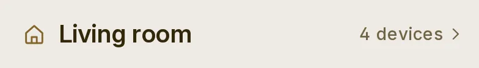

<!-- Generated by `pnpm docs:cards` from the card’s editor and its example in tools/docs/src/gallery.ts: change those, not this page. -->

# Heading

`custom:fluvy-heading-card` · [All cards](../cards.md#structure-and-navigation) · [Try it live](https://acosta290.github.io/fluvy/?card=heading)

A section title with its count and a link.

<picture><source media="(prefers-color-scheme: dark)" srcset="../images/cards/heading-dark.webp"></picture>

```yaml
type: custom:fluvy-heading-card
title: Living room
icon: fluvy:home
subtitle: '4 devices'
path: /fluvy-home/living
```

The picture is this configuration on the demo house, whose names and figures are made up: put your own entities in place of its. [Try it in the live demo](https://acosta290.github.io/fluvy/?card=heading), where it answers a tap as it would at home, with each of its layouts and the YAML of each.

## Layouts

`variant` chooses the layout. The picture is `bar`, the one the card has when the key is left out; each of the others is the example plus these lines.

| `variant` | Add to the example | Live |
| --- | --- | --- |
| `plain` | `variant: plain` | [Try it](https://acosta290.github.io/fluvy/?card=heading&layout=plain) |

## Options

Every key the card’s editor shows: the editor’s word for it in italics, then what it does. *Default* is what the card does when the key is left out, as the editor shows it on a new card; the editor never writes a default into the configuration.

| Key | What it does | Type | Default | Values |
| --- | --- | --- | --- | --- |
| `title` | *Title*. The heading’s words. | text |  |  |
| `heading_style` | *Heading style*. The heading’s size: a page’s title, a group’s, or a quiet label. | choice | `subtitle` | `title`, `subtitle`, `label` |
| `icon` | *Icon*. The card’s icon, in place of the entity’s own. | icon |  |  |
| `variant` | *Style*. The card’s layout. | choice | `bar` | `bar`, `plain` |
| `subtitle` | *Subtitle*. The line under the title. | text |  |  |
| `path` | *Opens (path)*. Where a tap on the heading goes. | text |  |  |
| `entities` | *Entities*. Entities whose state the heading shows at its end. | entities |  |  |

**Interactions**

| Key | What it does | Type | Default | Values |
| --- | --- | --- | --- | --- |
| `tap_action` | *Tap action*. What a tap on the card does. | action | the card’s own |  |

## Older names

Names the card still reads, so a dashboard written before keeps working. They are read, never written back.

| Older name | Read as |
| --- | --- |
| `meta` | `subtitle` |
| `sub` | `subtitle` |
| `layout` | `variant` |
| `view` | `variant` |
