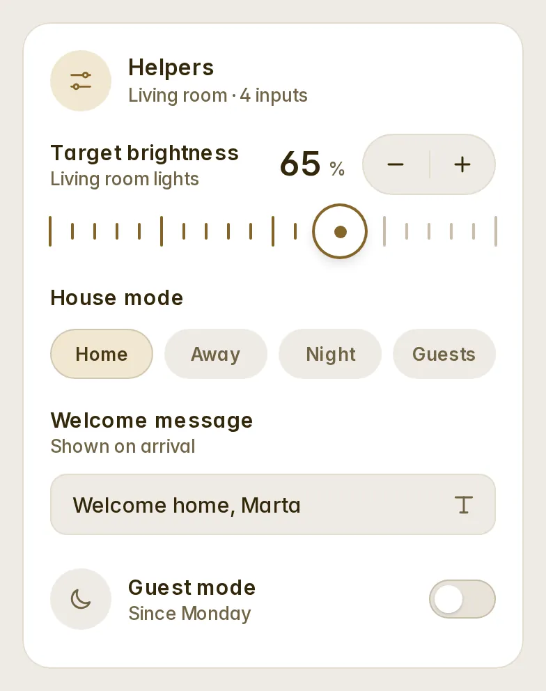

<!-- Generated by `pnpm docs:cards` from the card’s editor and its example in tools/docs/src/gallery.ts: change those, not this page. -->

# Helpers

`custom:fluvy-helpers-card` · [All cards](../cards.md#scenes-actions-and-helpers) · [Try it live](https://acosta290.github.io/fluvy/?card=helpers)

Numbers, selects, texts, booleans and dates as their own controls.

<picture><source media="(prefers-color-scheme: dark)" srcset="../images/cards/helpers-dark.webp"></picture>

```yaml
type: custom:fluvy-helpers-card
title: Helpers
subtitle: Living room · 4 inputs
tap_action:
  action: navigate
  navigation_path: /config/helpers
rows:
  - entity: input_number.brightness
    secondary: Living room lights
  - entity: input_select.house_mode
    secondary: ''
  - entity: input_text.welcome
    secondary: Shown on arrival
  - entity: input_boolean.guest
    icon: moon
    secondary: Since Monday
```

The picture is this configuration on the demo house, whose names and figures are made up: put your own entities in place of its. [Try it in the live demo](https://acosta290.github.io/fluvy/?card=helpers), where it answers a tap as it would at home, with each of its layouts and the YAML of each.

More about it in the guide: [Helpers](../cards.md#helpers).

## Options

Every key the card’s editor shows: the editor’s word for it in italics, then what it does. *Default* is what the card does when the key is left out, as the editor shows it on a new card; the editor never writes a default into the configuration.

| Key | What it does | Type | Default | Values |
| --- | --- | --- | --- | --- |
| `title` | *Title*. The title at the top of the card. | text |  |  |
| `subtitle` | *Subtitle*. The line under the title. | text |  |  |
| `icon` | *Icon*. The card’s icon, in place of the entity’s own. | icon |  |  |
| `options_style` | *Options as*. Draws a select’s options as chips that fill the row, or as content-sized chips. | choice | `full` | `full`, `chips` |
| `show_icon` | *Show the icon*. Shows the icon, hides it, or lets the card decide. | choice | `auto` | `auto` (Automatic), `always`, `never` |
| `name_lines` | *Lines for the name*. Lets the name in the card’s head take two balanced lines where one would cut it; the head is a line taller whatever the name. | choice | `1` | `1`, `2` |
| `slider_style` | *Slider style*. The slider’s style; left out, the style set for every slider. Untouched: every slider’s, from Fluvy’s settings. | choice | `house` | `house` (House (Ruler)), `ruler`, `bar`, `liquid` |
| `slider_words` | *Words under it*. Writes the words at the slider’s ends, or none. | choice | `ends` | `ends` (Ends and middle), `none` |
| `tone` | *Tone*. The card’s colour from the palette’s tones; left out, the tone of what it shows. | choice | the card’s own | `accent`, `light`, `heat`, `cool`, `dry`, `fan`, `water`, `solar`, `grid`, `media`, `presence`, `armed`, `battery`, `house`, `gas`, `vehicle` (Car), `neutral`, `ok` (Good), `warning`, `danger` |
| `color` | *Colour*. The card’s colour: its circle, its accents and its tints wear it. Left out, the colour of what it shows. | colour |  |  |
| `card_color` | *Card colour*. Paints the card’s surface in a colour of your own. | colour |  |  |
| `card_opacity` | *Card opacity*. How see-through the card’s surface is, in percent. Untouched: every card’s, from Fluvy’s settings. | number | `100` | 0 % to 100 %, in steps of 5 |
| `card_border` | *Card border*. Draws the card’s hairline border, or leaves it out. Untouched: every card’s, from Fluvy’s settings. | boolean | `true` |  |
| `unavailable` | *When unavailable*. How the card looks while its entity is unavailable: dashed, or quiet. Untouched: every card’s, from Fluvy’s settings. | choice | `dashed` | `dashed`, `quiet` (As when off) |
| `names` | *Names*. How a row is named where it has no name of its own: the entity’s full name, its own, or its device’s. Where no name of its own is set. | choice | `full` | `full` (Full name), `entity` (Entity name), `device` (Device name) |
| `empty_text` | *Text when empty*. What the card says while it has nothing to show. | text |  |  |
| `hide_empty` | *Hide when empty*. Hides the whole card while it has nothing to show. | boolean | `false` |  |
| `rows` | *Rows*. The helpers the card sets, a row each. | list ([its items](#rows)) |  |  |

**Interactions**

| Key | What it does | Type | Default | Values |
| --- | --- | --- | --- | --- |
| `tap_action` | *Tap action*. What a tap on the card does. | action | `none` |  |
| `hold_action` | *Hold action*. What a long press on the card does. | action | `none` |  |
| `double_tap_action` | *Double tap action*. What two taps on the card do. A tap waits a moment to tell it from a double tap. | action | `none` |  |
| `icon_tap_action` | *Icon tap action*. What a tap on the icon does. | action | `none` |  |
| `icon_hold_action` | *Icon hold action*. What a long press on the icon does. | action | `none` |  |
| `icon_double_tap_action` | *Icon double tap action*. What two taps on the icon do. A tap waits a moment to tell it from a double tap. | action | `none` |  |

## Lists

### `rows`

*Rows*. The helpers the card sets, a row each. An item is an entity id, or a map with `entity` and any of these keys.

| Key | What it does | Type | Values |
| --- | --- | --- | --- |
| `entity` | *Entity*. The entity the item shows. | entity |  |
| `name` | *Name*. The item’s own name, in place of the one the card would give it. | name |  |
| `icon` | *Icon*. The item’s own icon, in place of the one the card would give it. | icon |  |
| `secondary` | *Secondary text*. The line under the item’s name. Your own words, or a template such as {{ states('sensor.x') }}. | text |  |
| `since` | *Last change from*. Where the time of the last change is read from. A timestamp sensor, or attribute:name. | choice or text |  |
| `presets` | *Quick-set times*. Times offered as chips to set the helper with. | choices or text |  |
| `options` | *Options*. The select’s options offered, in this order. | choices |  |
| `display` | *Options as*. Draws a select’s options as chips, or as a dropdown. | choice | `auto` (Automatic), `chips`, `dropdown` |
| `labels` | *Option names*. Names of your own for the options. | object |  |

## Older names

Names the card still reads, so a dashboard written before keeps working. They are read, never written back.

| Older name | Read as |
| --- | --- |
| `entities` | `rows` |
| `rows[].label` | `rows[].name` |
| `rows[].sub` | `rows[].secondary` |
| `rows[].meta` | `rows[].subtitle` |
| `sub` | `subtitle` |
| `meta` | `subtitle` |
| `accent` | `color` |
