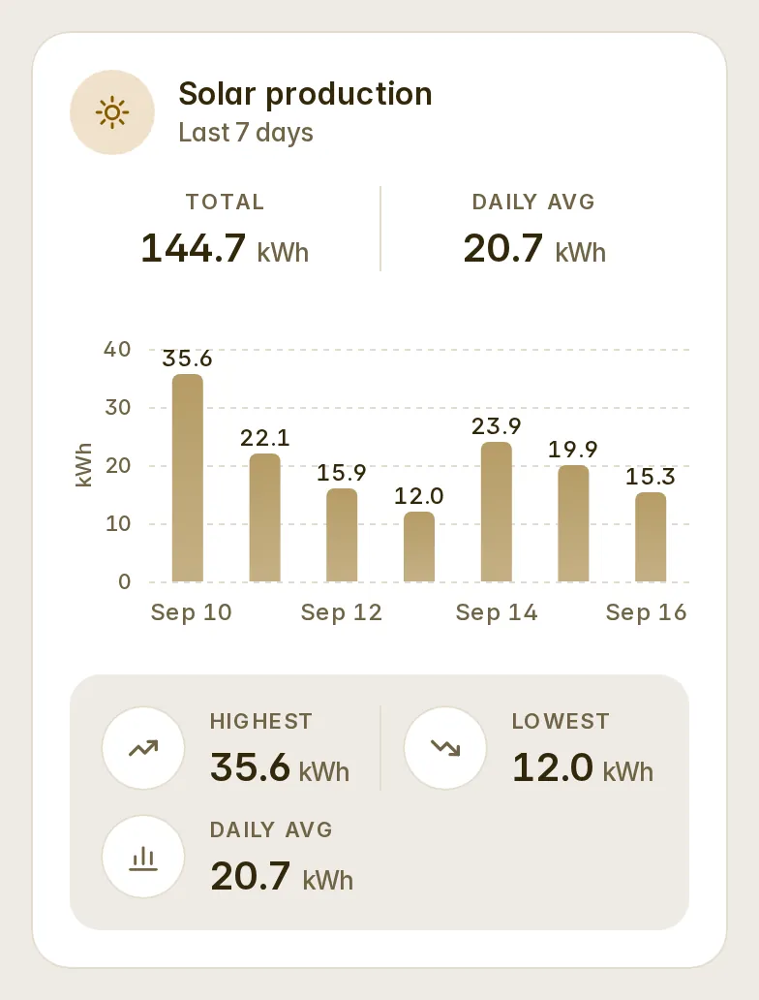

<!-- Generated by `pnpm docs:cards` from the card’s editor and its example in tools/docs/src/gallery.ts: change those, not this page. -->

# History bars

`custom:fluvy-history-bars-card` · [All cards](../cards.md#energy) · [Try it live](https://acosta290.github.io/fluvy/?card=history-bars)

A sensor’s last days, weeks or months as bars from its long-term statistics: the total and the average in the head, the value over each bar, and a strip of facts under them — the highest and lowest, or what it comes to in CO₂, trees, kilometres or money.

<picture><source media="(prefers-color-scheme: dark)" srcset="../images/cards/history-bars-dark.webp"></picture>

```yaml
type: custom:fluvy-history-bars-card
entity: sensor.hb_solar
icon: sun
color: '#C9A063'
```

The picture is this configuration on the demo house, whose names and figures are made up: put your own entities in place of its. [Try it in the live demo](https://acosta290.github.io/fluvy/?card=history-bars), where it answers a tap as it would at home, with each of its layouts and the YAML of each.

## Layouts

`variant` chooses the layout. The picture is `full`, the one the card has when the key is left out; each of the others is the example plus these lines.

| `variant` | Add to the example | Live |
| --- | --- | --- |
| `compact` | `variant: compact` | [Try it](https://acosta290.github.io/fluvy/?card=history-bars&layout=compact) |
| `mini` | `variant: mini` | [Try it](https://acosta290.github.io/fluvy/?card=history-bars&layout=mini) |

## Options

Every key the card’s editor shows: the editor’s word for it in italics, then what it does. *Default* is what the card does when the key is left out, as the editor shows it on a new card; the editor never writes a default into the configuration.

| Key | What it does | Type | Default | Values |
| --- | --- | --- | --- | --- |
| `entity` | *Entity*. The sensor whose history the bars show: a meter, or any reading. | entity (sensor) | required |  |
| `name` | *Name*. The name the card shows, in place of the entity’s own. | name |  |  |
| `subtitle` | *Subtitle*. The line under the title. | text |  |  |
| `icon` | *Icon*. The card’s icon, in place of the entity’s own. | icon |  |  |
| `variant` | *Style*. The card’s layout. | choice | `full` | `full`, `compact`, `mini` |
| `show_icon` | *Show the icon*. Shows the icon, hides it, or lets the card decide. | choice | `auto` | `auto` (Automatic), `always`, `never` |
| `name_lines` | *Lines for the name*. Lets the name in the card’s head take two balanced lines where one would cut it; the head is a line taller whatever the name. | choice | `1` | `1`, `2` |
| `tone` | *Tone*. The card’s colour from the palette’s tones; left out, the tone of what it shows. | choice | the card’s own | `accent`, `light`, `heat`, `cool`, `dry`, `fan`, `water`, `solar`, `grid`, `media`, `presence`, `armed`, `battery`, `house`, `gas`, `vehicle` (Car), `neutral`, `ok` (Good), `warning`, `danger` |
| `color` | *Colour*. The card’s colour: its circle, its accents and its tints wear it. Left out, the colour of what it shows. | colour |  |  |
| `card_color` | *Card colour*. Paints the card’s surface in a colour of your own. | colour |  |  |
| `card_opacity` | *Card opacity*. How see-through the card’s surface is, in percent. Untouched: every card’s, from Fluvy’s settings. | number | `100` | 0 % to 100 %, in steps of 5 |
| `card_border` | *Card border*. Draws the card’s hairline border, or leaves it out. Untouched: every card’s, from Fluvy’s settings. | boolean | `true` |  |
| `unavailable` | *When unavailable*. How the card looks while its entity is unavailable: dashed, or quiet. Untouched: every card’s, from Fluvy’s settings. | choice | `dashed` | `dashed`, `quiet` (As when off) |
| `days` | *Bars*. How many bars the card draws. | number | `7` | 1 to 92 |
| `period` | *A bar is a*. What one bar stands for: a day, a week, or a month. | choice | `day` | `day`, `week`, `month` |
| `stat` | *A bar shows*. What each bar shows: what the meter gained, its reading, the mean, the highest or the lowest. | choice | `state` | `change` (What it gained), `state` (The reading at the end), `mean` (The mean), `max` (The highest reading), `min` (The lowest reading) |
| `reset` | *When it resets*. When the meter starts again from zero, so the bars count each period once. A counter that starts again: its bars come from its readings, so a reset or a restart is never counted twice. | choice | `auto` | `auto` (As Home Assistant counts it), `never` (Never (a lifetime meter)), `day` (Every day), `week` (Every week), `month` (Every month), `year` (Every year) |
| `source` | *Read from*. Reads the bars from Home Assistant’s statistics, or from the sensor’s history. Home Assistant keeps a sensor’s history for its last days (10 by default) | choice | `auto` | `auto` (Statistics, else the history), `history` (The history (recent days)) |
| `date_format` | *Dates as*. How each bar’s date is written under it. | choice | `date` | `date` (The date), `weekday` (The weekday), `short` |
| `negative_color` | *Bars below zero*. Paints the bars below zero in a colour of their own. Empty: the card’s colour. | colour |  |  |
| `current_color` | *The bar in progress*. Paints the bar still in progress in a colour of its own. Empty: the card’s colour. | colour |  |  |
| `include_today` | *Include the one in progress*. Adds the period still in progress as the last bar. | boolean | `false` |  |
| `show_head` | *Show the head*. Shows the head’s figures over the bars. | boolean | `true` |  |
| `show_values` | *Show the values above the bars*. Writes each bar’s value over it. | boolean | `true` |  |
| `show_axis` | *Show the scale*. Shows the scale’s labels beside the chart. | boolean | `true` |  |
| `show_grid` | *Show the gridlines*. Draws gridlines behind the bars. | boolean | `true` |  |
| `show_dates` | *Show the dates*. Writes each bar’s date under it. | boolean | `true` |  |
| `show_facts` | *Show the facts strip*. Shows the strip of facts under the bars. | boolean | `true` |  |
| `co2_factor` | *CO₂ per kWh (kg)*. Kilograms of CO₂ a kWh of grid power costs, for the CO₂ and the trees. | number | `0.4` | 0 to 2, in steps of 0.01 |
| `price` | *Price per unit*. The price per unit the money is worked out with. | number |  | 0 to 100, in steps of 0.001 |
| `unit` | *Unit*. The unit the figures are written in; automatic keeps the sensor’s. Energy, power, volume and distance convert; another unit is ignored. | choice or text | `auto` | `auto` (Automatic), `W`, `kW`, `MW`, `Wh`, `kWh`, `MWh`, `L`, `m³`, `gal`, `ft³` |
| `decimals` | *Decimals*. How many decimals the figures have; automatic decides by their size. | choice | `1` | `0`, `1`, `2`, `3` |
| `entities` | *Sensors summed bar by bar (several arrays)*. Sensors added up bar by bar, such as several arrays. | list ([its items](#entities)) |  |  |
| `head` | *Readouts in the head*. The figures in the head, in this order. | list ([its items](#head)) |  |  |
| `facts` | *Facts under the chart*. The facts under the chart, in this order. | list ([its items](#facts)) |  |  |

**Chart**

| Key | What it does | Type | Default | Values |
| --- | --- | --- | --- | --- |
| `chart` | *Chart*. The bars’ style. | choice | `classic` | `classic`, `bars`, `columns`, `minimal` |
| `highlight` | *Highlight*. Marks out a bar: the lowest, the highest, both, or the current one. | choice | `none` | `none`, `min` (The lowest reading), `max` (The highest reading), `both` (Lowest and highest), `current` (The current one) |
| `animate` | *Animate*. Lets the chart or the gauge move as it draws; off, it shows its resting frame at once. | boolean | `true` |  |

**Interactions**

| Key | What it does | Type | Default | Values |
| --- | --- | --- | --- | --- |
| `tap_action` | *Tap action*. What a tap on the card does. | action | `more-info` |  |
| `hold_action` | *Hold action*. What a long press on the card does. | action | `more-info` |  |
| `double_tap_action` | *Double tap action*. What two taps on the card do. A tap waits a moment to tell it from a double tap. | action | `none` |  |
| `icon_tap_action` | *Icon tap action*. What a tap on the icon does. | action | `none` |  |
| `icon_hold_action` | *Icon hold action*. What a long press on the icon does. | action | `none` |  |
| `icon_double_tap_action` | *Icon double tap action*. What two taps on the icon do. A tap waits a moment to tell it from a double tap. | action | `none` |  |

## Lists

### `entities`

*Sensors summed bar by bar (several arrays)*. Sensors added up bar by bar, such as several arrays. An item is an entity id, or a map with `entity` and any of these keys.

| Key | What it does | Type | Values |
| --- | --- | --- | --- |
| `entity` | *Entity*. The entity the item shows. | entity (sensor) |  |

### `head`

*Readouts in the head*. The figures in the head, in this order. An item is a map with `kind` and any of these keys.

| Key | What it does | Type | Values |
| --- | --- | --- | --- |
| `kind` | *Kind*. What the figure says. | choice | `total`, `average`, `highest`, `lowest`, `today` (Today, this week or this month), `co2` (CO₂), `trees`, `km` (Kilometres), `share` (Share of another sensor), `money`, `template` |
| `name` | *Name*. The figure’s name. | text |  |
| `unit` | *Unit*. The unit the figure is written in. | text |  |
| `decimals` | *Decimals*. How many decimals the figure has. | number | 0 to 3 |
| `factor` | *Factor*. The factor the figure is worked out with. CO₂: kg per kWh · trees: kg a tree takes in a year · kilometres: km per kWh · money: the price per unit. | number | 0 to 100000, in steps of 0.001 |
| `of` | *Share of (a sensor)*. The sensor the share is of. | entity (sensor) |  |
| `template` | *Template*. A template of your own for the figure. Your own words, or a template such as {{ states('sensor.x') }}. | text |  |

**Interactions**

| Key | What it does | Type | Values |
| --- | --- | --- | --- |
| `tap_action` | *Tap action*. What a tap on the item does. | action |  |
| `hold_action` | *Hold action*. What a long press on the item does. | action |  |
| `double_tap_action` | *Double tap action*. What two taps on the item do. A tap waits a moment to tell it from a double tap. | action |  |

### `facts`

*Facts under the chart*. The facts under the chart, in this order. An item is a map with `kind` and any of these keys.

| Key | What it does | Type | Values |
| --- | --- | --- | --- |
| `kind` | *Kind*. What the fact says. | choice | `total`, `average`, `highest`, `lowest`, `today` (Today, this week or this month), `co2` (CO₂), `trees`, `km` (Kilometres), `share` (Share of another sensor), `money`, `template` |
| `name` | *Name*. The fact’s name. | text |  |
| `icon` | *Icon*. The item’s own icon, in place of the one the card would give it. | icon |  |
| `color` | *Colour*. The item’s colour, in place of the one the card gives it. Empty: the colour the card gives it. | colour |  |
| `unit` | *Unit*. The unit the figure is written in. | text |  |
| `decimals` | *Decimals*. How many decimals the figure has. | number | 0 to 3 |
| `factor` | *Factor*. The factor the figure is worked out with. CO₂: kg per kWh · trees: kg a tree takes in a year · kilometres: km per kWh · money: the price per unit. | number | 0 to 100000, in steps of 0.001 |
| `of` | *Share of (a sensor)*. The sensor the share is of. | entity (sensor) |  |
| `template` | *Template*. A template of your own for the figure. Your own words, or a template such as {{ states('sensor.x') }}. | text |  |

**Interactions**

| Key | What it does | Type | Values |
| --- | --- | --- | --- |
| `tap_action` | *Tap action*. What a tap on the item does. | action |  |
| `hold_action` | *Hold action*. What a long press on the item does. | action |  |
| `double_tap_action` | *Double tap action*. What two taps on the item do. A tap waits a moment to tell it from a double tap. | action |  |

## Older names

Names the card still reads, so a dashboard written before keeps working. They are read, never written back.

| Older name | Read as |
| --- | --- |
| `title` | `name` |
| `entities[].label` | `entities[].name` |
| `entities[].sub` | `entities[].secondary` |
| `entities[].meta` | `entities[].subtitle` |
| `sub` | `subtitle` |
| `meta` | `subtitle` |
| `layout` | `variant` |
| `view` | `variant` |
| `accent` | `color` |
