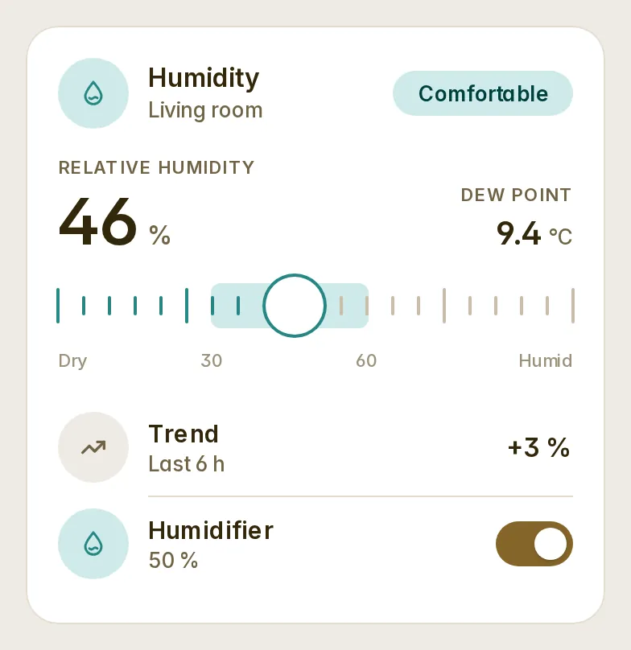

<!-- Generated by `pnpm docs:cards` from the card’s editor and its example in tools/docs/src/gallery.ts: change those, not this page. -->

# Humidity

`custom:fluvy-humidity-card` · [All cards](../cards.md#energy) · [Try it live](https://acosta290.github.io/fluvy/?card=humidity)

Humidity on a comfort band, with dew point and trend.

<picture><source media="(prefers-color-scheme: dark)" srcset="../images/cards/humidity-dark.webp"></picture>

```yaml
type: custom:fluvy-humidity-card
entity: sensor.so_living_humidity
subtitle: Living room
temperature_entity: sensor.so_living_temperature
humidifier_entity: humidifier.so_living
```

The picture is this configuration on the demo house, whose names and figures are made up: put your own entities in place of its. [Try it in the live demo](https://acosta290.github.io/fluvy/?card=humidity), where it answers a tap as it would at home, with each of its layouts and the YAML of each.

## Layouts

`gauge` chooses the layout. The picture is `ticks`, the one the card has when the key is left out; each of the others is the example plus these lines.

| `gauge` | Add to the example | Live |
| --- | --- | --- |
| `ruler` | `gauge: ruler` | [Try it](https://acosta290.github.io/fluvy/?card=humidity&layout=ruler) |
| `liquid` | `gauge: liquid` | [Try it](https://acosta290.github.io/fluvy/?card=humidity&layout=liquid) |

## Options

Every key the card’s editor shows: the editor’s word for it in italics, then what it does. *Default* is what the card does when the key is left out, as the editor shows it on a new card; the editor never writes a default into the configuration.

| Key | What it does | Type | Default | Values |
| --- | --- | --- | --- | --- |
| `entity` | *Entity*. The humidity sensor the card reads. | entity (sensor, number, input_number) | required |  |
| `name` | *Name*. The name the card shows, in place of the entity’s own. | name |  |  |
| `subtitle` | *Subtitle*. The line under the title. Your own words, an entity (its state), or a template such as {{ states('sensor.x') }}. | text |  |  |
| `icon` | *Icon*. The card’s icon, in place of the entity’s own. | icon |  |  |
| `show_icon` | *Show the icon*. Shows the icon, hides it, or lets the card decide. | choice | `auto` | `auto` (Automatic), `always`, `never` |
| `show_badge` | *Show the badge*. Shows the badge at the end of the head, such as the card’s state or a count. | boolean | `true` |  |
| `name_lines` | *Lines for the name*. Lets the name in the card’s head take two balanced lines where one would cut it; the head is a line taller whatever the name. | choice | `1` | `1`, `2` |
| `tone` | *Tone*. The card’s colour from the palette’s tones; left out, the tone of what it shows. | choice | the card’s own | `accent`, `light`, `heat`, `cool`, `dry`, `fan`, `water`, `solar`, `grid`, `media`, `presence`, `armed`, `battery`, `house`, `gas`, `vehicle` (Car), `neutral`, `ok` (Good), `warning`, `danger` |
| `color` | *Colour*. The card’s colour: its circle, its accents and its tints wear it. Left out, the colour of what it shows. | colour |  |  |
| `card_color` | *Card colour*. Paints the card’s surface in a colour of your own. | colour |  |  |
| `card_opacity` | *Card opacity*. How see-through the card’s surface is, in percent. Untouched: every card’s, from Fluvy’s settings. | number | `100` | 0 % to 100 %, in steps of 5 |
| `card_border` | *Card border*. Draws the card’s hairline border, or leaves it out. Untouched: every card’s, from Fluvy’s settings. | boolean | `true` |  |
| `unavailable` | *When unavailable*. How the card looks while its entity is unavailable: dashed, or quiet. Untouched: every card’s, from Fluvy’s settings. | choice | `dashed` | `dashed`, `quiet` (As when off) |
| `low` | *Comfort from (%)*. The bottom of the comfortable band, in percent. | number |  | 0 to 100 |
| `high` | *Comfort up to (%)*. The top of the comfortable band, in percent. | number |  | 0 to 100 |
| `gauge` | *Gauge*. The gauge’s style. | choice | `ticks` | `ticks` (Classic), `ruler`, `liquid` |
| `animate` | *Animate*. Lets the chart or the gauge move as it draws; off, it shows its resting frame at once. | boolean | `true` |  |
| `temperature_entity` | *Temperature entity (dew point)*. The room’s temperature: with it the card can say the dew point. | entity (sensor) |  |  |
| `humidifier_entity` | *Humidifier*. A humidifier, a dehumidifier or a switch shown as a row with its switch. | entity (humidifier, switch, fan, input_boolean) |  |  |
| `hours` | *Hours of history*. How many hours of history the card draws, up to now. | number |  | 1 to 48 |
| `show_trend` | *Show the trend*. Shows the trend row. | boolean | `true` |  |

**Interactions**

| Key | What it does | Type | Default | Values |
| --- | --- | --- | --- | --- |
| `tap_action` | *Tap action*. What a tap on the card does. | action | `more-info` |  |
| `hold_action` | *Hold action*. What a long press on the card does. | action | `more-info` |  |
| `double_tap_action` | *Double tap action*. What two taps on the card do. A tap waits a moment to tell it from a double tap. | action | `none` |  |
| `icon_tap_action` | *Icon tap action*. What a tap on the icon does. | action | `none` |  |
| `icon_hold_action` | *Icon hold action*. What a long press on the icon does. | action | `none` |  |
| `icon_double_tap_action` | *Icon double tap action*. What two taps on the icon do. A tap waits a moment to tell it from a double tap. | action | `none` |  |

## Older names

Names the card still reads, so a dashboard written before keeps working. They are read, never written back.

| Older name | Read as |
| --- | --- |
| `trend_hours` | `hours` |
| `sub` | `subtitle` |
| `meta` | `subtitle` |
| `accent` | `color` |
