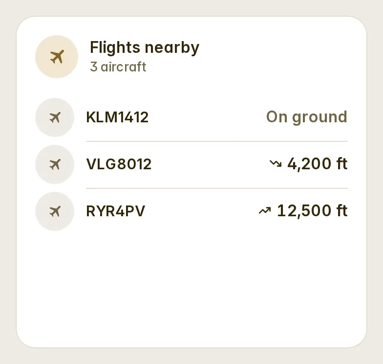
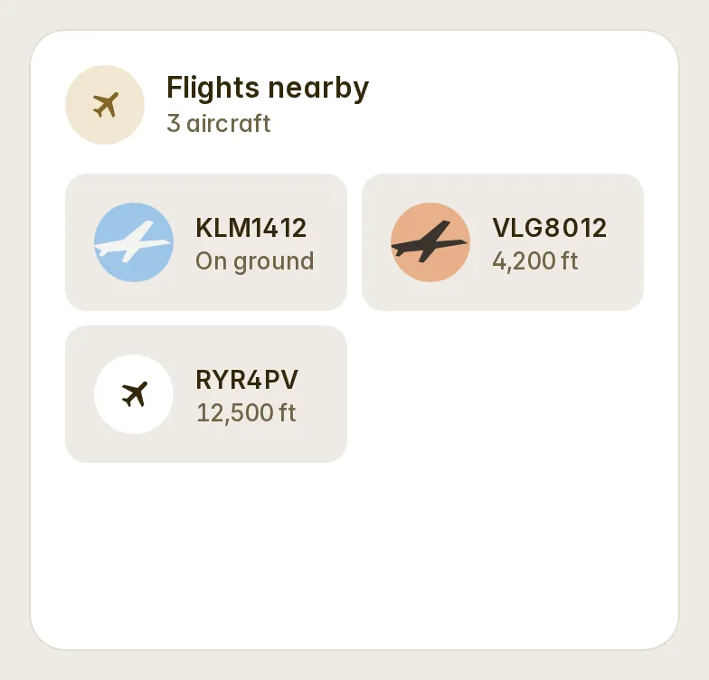

<!-- Generated by `pnpm docs:cards` from the card’s editor, its example in tools/docs/src/gallery.ts and its guide in tools/docs/guides/: change those, not this page. -->

# Items

The items of a sensor’s list attribute, a row each — flights overhead, departures, deliveries — with a flights preset for FlightRadar24.

`custom:fluvy-items-card` · [Try it live](https://acosta290.github.io/fluvy/?card=items) · [All cards](../cards.md#everyday)

<picture><source media="(prefers-color-scheme: dark)" srcset="../images/cards/items-dark.webp"></picture>

## Example

```yaml
type: custom:fluvy-items-card
entity: sensor.it_flights
```

The picture above, on the demo house: put your own entities in place of its.

## Layouts

`variant` chooses the layout. The picture above is `rows`, the default; each of the others is the example plus the line over it, and opens in the live demo.

<table>
<tbody><tr>
<td align="center" valign="top" width="50%"><code>variant: compact</code><br><a href="https://acosta290.github.io/fluvy/?card=items&amp;layout=compact"><picture><source media="(prefers-color-scheme: dark)" srcset="../images/cards/items.compact-dark.webp"></picture></a></td>
<td align="center" valign="top" width="50%"><code>variant: tiles</code><br><a href="https://acosta290.github.io/fluvy/?card=items&amp;layout=tiles"><picture><source media="(prefers-color-scheme: dark)" srcset="../images/cards/items.tiles-dark.webp"></picture></a></td>
</tr></tbody>
</table>

## All options

```yaml
type: custom:fluvy-items-card
entity: sensor.it_flights
```

## Options

| Option | Default | What it does |
| --- | --- | --- |
| `entity` | **required** | The sensor whose attribute holds the list of items. A `sensor`. |
| `title` |  | The title at the top of the card. |
| `subtitle` |  | The line under the title. |
| `icon` |  | The card’s icon, in place of the entity’s own. |
| `attribute` | `auto` | The attribute of the sensor that holds the list of items. `auto`, or your own. |
| `preset` | `auto` | Reads the items as a known kind of list (flights), or by the fields below. `auto` · `none` · `flights`. |
| `item_name` |  | Where each item’s name comes from. |
| `item_secondary` |  | Where the line under each item’s name comes from. |
| `item_value` |  | Where each item’s value comes from. |
| `item_unit` |  | Where each item’s unit comes from. |
| `item_icon` |  | Where each item’s icon comes from. |
| `item_image` |  | Where each item’s picture comes from. |
| `item_url` |  | Where each item’s link comes from. |
| `items_template` |  | Makes the list from a template, so that any sensor can be a list of items. |
| `sort` |  | Sorts the items by one of their fields. |
| `sort_order` | `ascending` | Sorts the items up or down. `ascending` · `descending`. |
| `variant` | `rows` | The card’s layout. `rows` · `compact` · `tiles`. |
| `max_rows` | `5` | How many rows the card has room for. 1 to 20. |
| `show_count` | `true` | Says on the head’s line how many items there are. |
| `show_image` | `true` | Shows each item’s picture in its circle. |
| `item_tap` | `sheet` | What a tap on an item does: open its sheet, or nothing. `sheet` (Opens its details) · `none`. |
| `empty_text` |  | What the card says while it has nothing to show. |
| `hide_empty` | `false` | Hides the whole card while it has nothing to show. |

<details>
<summary>Its look and its actions, as on every card</summary>

| Option | Default | What it does |
| --- | --- | --- |
| `show_icon` | `auto` | Shows the icon, hides it, or lets the card decide. `auto` · `always` · `never`. |
| `name_lines` | `1` | Lets the name in the card’s head take two balanced lines where one would cut it; the head is a line taller whatever the name. `1` · `2`. |
| `tone` | the card’s own | The card’s colour from the palette’s tones; left out, the tone of what it shows. `accent` · `light` · `heat` · `cool` · `dry` · `fan` · `water` · `solar` · `grid` · `media` · `presence` · `armed` · `battery` · `house` · `gas` · `vehicle` (Car) · `neutral` · `ok` (Good) · `warning` · `danger`. |
| `color` |  | The card’s colour: its circle, its accents and its tints wear it. Left out, the colour of what it shows. |
| `card_color` |  | Paints the card’s surface in a colour of your own. |
| `card_opacity` | `100` | How solid the card’s surface is, in percent: under 100 the view’s background shows through. Left out, the house’s. 0 % to 100 %, in steps of 5. |
| `card_border` | `true` | Whether the card draws its hairline border. Left out, the house’s. |
| `unavailable` | `dashed` | How the card looks while its entity is unavailable: dashed, or quiet as when it is off. Left out, the house’s. `dashed` · `quiet` (As when off). |
| **Interactions** |  |  |
| `tap_action` | `more-info` | What a tap on the card does. |
| `hold_action` | `more-info` | What a long press on the card does. |
| `double_tap_action` | `none` | What two taps on the card do. |
| `icon_tap_action` | `none` | What a tap on the icon does. |
| `icon_hold_action` | `none` | What a long press on the icon does. |
| `icon_double_tap_action` | `none` | What two taps on the icon do. |

More about them in [Options every card takes](../customising.md#options-every-card-takes).

</details>

<details>
<summary>Older names the card still reads</summary>

| Older name | Read as |
| --- | --- |
| `sub` | `subtitle` |
| `meta` | `subtitle` |
| `layout` | `variant` |
| `view` | `variant` |
| `accent` | `color` |

</details>
