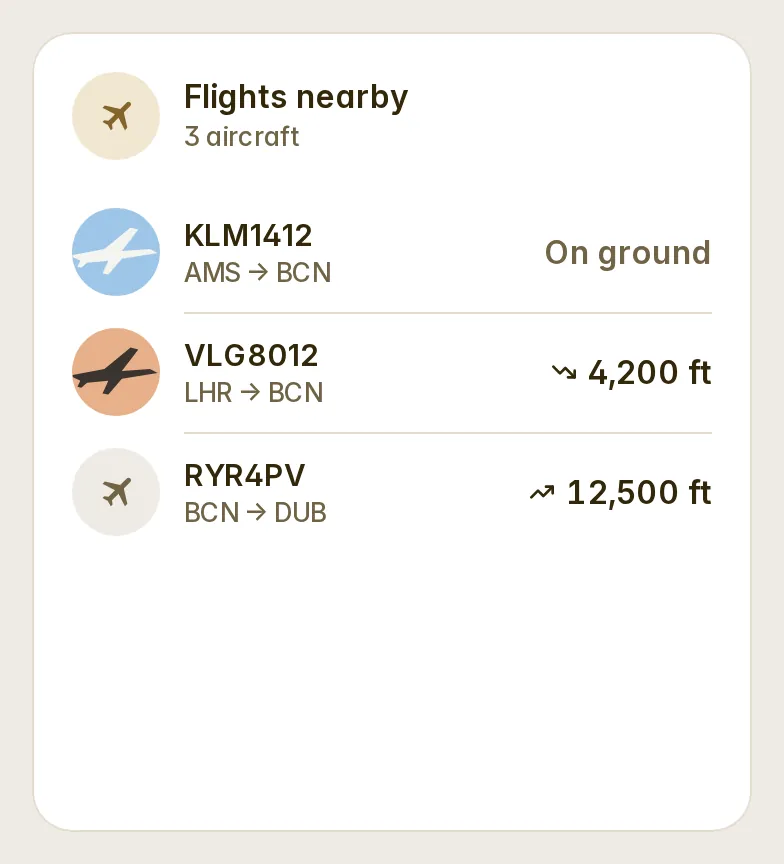

<!-- Generated by `pnpm docs:cards` from the card’s editor and its example in tools/docs/src/gallery.ts: change those, not this page. -->

# Items

`custom:fluvy-items-card` · [All cards](../cards.md#everyday) · [Try it live](https://acosta290.github.io/fluvy/?card=items)

The items of a sensor’s list attribute, a row each — flights overhead, departures, deliveries — with a flights preset for FlightRadar24.

<picture><source media="(prefers-color-scheme: dark)" srcset="../images/cards/items-dark.webp"></picture>

```yaml
type: custom:fluvy-items-card
entity: sensor.it_flights
```

The picture is this configuration on the demo house, whose names and figures are made up: put your own entities in place of its. [Try it in the live demo](https://acosta290.github.io/fluvy/?card=items), where it answers a tap as it would at home, with each of its layouts and the YAML of each.

More about it in the guide: [Items](../cards.md#items).

## Layouts

`variant` chooses the layout. The picture is `rows`, the one the card has when the key is left out; each of the others is the example plus these lines.

| `variant` | Add to the example | Live |
| --- | --- | --- |
| `compact` | `variant: compact` | [Try it](https://acosta290.github.io/fluvy/?card=items&layout=compact) |
| `tiles` | `variant: tiles` | [Try it](https://acosta290.github.io/fluvy/?card=items&layout=tiles) |

## Options

Every key the card’s editor shows: the editor’s word for it in italics, then what it does. *Default* is what the card does when the key is left out, as the editor shows it on a new card; the editor never writes a default into the configuration.

| Key | What it does | Type | Default | Values |
| --- | --- | --- | --- | --- |
| `entity` | *Entity*. The sensor whose attribute holds the list of items. | entity (sensor) | required |  |
| `title` | *Title*. The title at the top of the card. | text |  |  |
| `subtitle` | *Subtitle*. The line under the title. | text |  |  |
| `icon` | *Icon*. The card’s icon, in place of the entity’s own. | icon |  |  |
| `show_icon` | *Show the icon*. Shows the icon, hides it, or lets the card decide. | choice | `auto` | `auto` (Automatic), `always`, `never` |
| `name_lines` | *Lines for the name*. Lets the name in the card’s head take two balanced lines where one would cut it; the head is a line taller whatever the name. | choice | `1` | `1`, `2` |
| `attribute` | *Attribute*. The attribute of the sensor that holds the list of items. Automatic: the first attribute that holds a list of items. | choice or text | `auto` | `auto` (Automatic) |
| `preset` | *Preset*. Reads the items as a known kind of list (flights), or by the fields below. Automatic found no preset: the fields below map the items. | choice | `auto` | `auto` (Automatic), `none`, `flights` |
| `item_name` | *Name*. Where each item’s name comes from. A field of the item (altitude, airport.city) or words with {field}; {a\|b} takes b where a is empty. | text |  |  |
| `item_secondary` | *Line under the name*. Where the line under each item’s name comes from. A field of the item (altitude, airport.city) or words with {field}; {a\|b} takes b where a is empty. | text |  |  |
| `item_value` | *Value*. Where each item’s value comes from. A field of the item (altitude, airport.city) or words with {field}; {a\|b} takes b where a is empty. | text |  |  |
| `item_unit` | *Unit*. Where each item’s unit comes from. A field of the item (altitude, airport.city) or words with {field}; {a\|b} takes b where a is empty. | text |  |  |
| `item_icon` | *Icon*. Where each item’s icon comes from. A field of the item (altitude, airport.city) or words with {field}; {a\|b} takes b where a is empty. | text |  |  |
| `item_image` | *Picture*. Where each item’s picture comes from. A field of the item (altitude, airport.city) or words with {field}; {a\|b} takes b where a is empty. | text |  |  |
| `item_url` | *Link*. Where each item’s link comes from. A field of the item (altitude, airport.city) or words with {field}; {a\|b} takes b where a is empty. | text |  |  |
| `items_template` | *Items template*. Makes the list from a template, so that any sensor can be a list of items. A template that gives the list, in place of the attribute. | text |  |  |
| `sort` | *Sort by*. Sorts the items by one of their fields. A field of the item; empty keeps the sensor’s order. | text |  |  |
| `sort_order` | *Order*. Sorts the items up or down. | choice | `ascending` | `ascending`, `descending` |
| `variant` | *Style*. The card’s layout. | choice | `rows` | `rows`, `compact`, `tiles` |
| `max_rows` | *Rows at most*. How many rows the card has room for. | number | `5` | 1 to 20 |
| `show_count` | *Show how many are on*. Says on the head’s line how many items there are. | boolean | `true` |  |
| `show_image` | *Show pictures*. Shows each item’s picture in its circle. | boolean | `true` |  |
| `item_tap` | *Tap on an item*. What a tap on an item does: open its sheet, or nothing. | choice | `sheet` | `sheet` (Opens its details), `none` |
| `tone` | *Tone*. The card’s colour from the palette’s tones; left out, the tone of what it shows. | choice | the card’s own | `accent`, `light`, `heat`, `cool`, `dry`, `fan`, `water`, `solar`, `grid`, `media`, `presence`, `armed`, `battery`, `house`, `gas`, `vehicle` (Car), `neutral`, `ok` (Good), `warning`, `danger` |
| `color` | *Colour*. The card’s colour: its circle, its accents and its tints wear it. Left out, the colour of what it shows. | colour |  |  |
| `card_color` | *Card colour*. Paints the card’s surface in a colour of your own. | colour |  |  |
| `card_opacity` | *Card opacity*. How see-through the card’s surface is, in percent. Untouched: every card’s, from Fluvy’s settings. | number | `100` | 0 % to 100 %, in steps of 5 |
| `card_border` | *Card border*. Draws the card’s hairline border, or leaves it out. Untouched: every card’s, from Fluvy’s settings. | boolean | `true` |  |
| `unavailable` | *When unavailable*. How the card looks while its entity is unavailable: dashed, or quiet. Untouched: every card’s, from Fluvy’s settings. | choice | `dashed` | `dashed`, `quiet` (As when off) |
| `empty_text` | *Text when empty*. What the card says while it has nothing to show. | text |  |  |
| `hide_empty` | *Hide when empty*. Hides the whole card while it has nothing to show. | boolean | `false` |  |

**Interactions**

| Key | What it does | Type | Default | Values |
| --- | --- | --- | --- | --- |
| `tap_action` | *Tap action*. What a tap on the card does. | action | `more-info` |  |
| `hold_action` | *Hold action*. What a long press on the card does. | action | `more-info` |  |
| `double_tap_action` | *Double tap action*. What two taps on the card do. A tap waits a moment to tell it from a double tap. | action | `none` |  |
| `icon_tap_action` | *Icon tap action*. What a tap on the icon does. | action | `none` |  |
| `icon_hold_action` | *Icon hold action*. What a long press on the icon does. | action | `none` |  |
| `icon_double_tap_action` | *Icon double tap action*. What two taps on the icon do. A tap waits a moment to tell it from a double tap. | action | `none` |  |

## Older names

Names the card still reads, so a dashboard written before keeps working. They are read, never written back.

| Older name | Read as |
| --- | --- |
| `sub` | `subtitle` |
| `meta` | `subtitle` |
| `layout` | `variant` |
| `view` | `variant` |
| `accent` | `color` |
