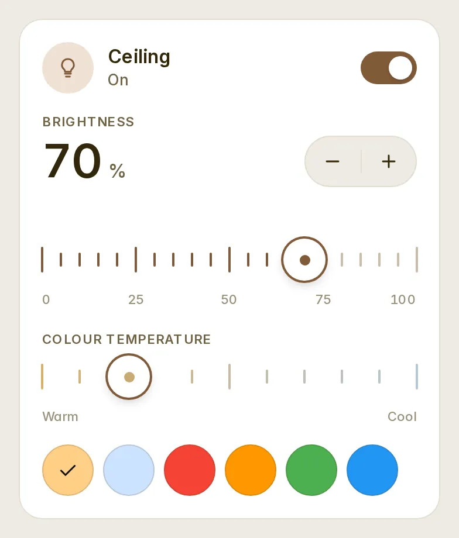

<!-- Generated by `pnpm docs:cards` from the card’s editor and its example in tools/docs/src/gallery.ts: change those, not this page. -->

# Light

`custom:fluvy-light-card` · [All cards](../cards.md#everyday) · [Try it live](https://acosta290.github.io/fluvy/?card=light)

The precision dimmer: relative drag, slide away to slow down, hold for the 1 % scale, colour temperature.

<picture><source media="(prefers-color-scheme: dark)" srcset="../images/cards/light-dark.webp"></picture>

```yaml
type: custom:fluvy-light-card
entity: light.ceiling
```

The picture is this configuration on the demo house, whose names and figures are made up: put your own entities in place of its. [Try it in the live demo](https://acosta290.github.io/fluvy/?card=light), where it answers a tap as it would at home, with each of its layouts and the YAML of each.

## Layouts

`variant` chooses the layout. The picture is `auto`, the one the card has when the key is left out; each of the others is the example plus these lines.

| `variant` | Add to the example | Live |
| --- | --- | --- |
| `full` | `variant: full` | [Try it](https://acosta290.github.io/fluvy/?card=light&layout=full) |
| `compact` | `variant: compact` | [Try it](https://acosta290.github.io/fluvy/?card=light&layout=compact) |

## Options

Every key the card’s editor shows: the editor’s word for it in italics, then what it does. *Default* is what the card does when the key is left out, as the editor shows it on a new card; the editor never writes a default into the configuration.

| Key | What it does | Type | Default | Values |
| --- | --- | --- | --- | --- |
| `entity` | *Entity*. The entity the card is about: what it shows, and what its controls act on. | entity (light) | required |  |
| `name` | *Name*. The name the card shows, in place of the entity’s own. | name |  |  |
| `icon` | *Icon*. The card’s icon, in place of the entity’s own. | icon |  |  |
| `show_icon` | *Show the icon*. Shows the icon, hides it, or lets the card decide. | choice | `auto` | `auto` (Automatic), `always`, `never` |
| `name_lines` | *Lines for the name*. Lets the name in the card’s head take two balanced lines where one would cut it; the head is a line taller whatever the name. | choice | `1` | `1`, `2` |
| `show_brightness` | *Show the brightness*. Shows the brightness ruler. | choice | `true` | `true` (Always), `when_on`, `false` (Never) |
| `variant` | *Style*. The card’s layout. | choice | `auto` | `auto` (Automatic), `full`, `compact` |
| `show_stepper` | *Show the − and + buttons*. Shows the − and + buttons. | boolean | `true` |  |
| `live_update` | *Update while dragging*. Sends the value while the slider is dragged, not only when it is let go. | boolean | `false` |  |
| `slider_style` | *Slider style*. The slider’s style; left out, the style set for every slider. Untouched: every slider’s, from Fluvy’s settings. | choice | `house` | `house` (House (Ruler)), `ruler`, `bar`, `liquid` |
| `slider_words` | *Words under it*. Writes the words at the slider’s ends, or none. | choice | `ends` | `ends` (Ends and middle), `none` |
| `show_temperature` | *Colour temperature*. Shows the colour temperature ruler. | boolean | `true` |  |
| `show_color` | *Show colour*. Shows the colour controls. | boolean | `true` |  |
| `temperature_tint` | *Tint the colour temperature ruler*. Tints the colour temperature ruler from warm to cool. | boolean | `true` |  |
| `tone` | *Tone*. The card’s colour from the palette’s tones; left out, the tone of what it shows. | choice | the card’s own | `accent`, `light`, `heat`, `cool`, `dry`, `fan`, `water`, `solar`, `grid`, `media`, `presence`, `armed`, `battery`, `house`, `gas`, `vehicle` (Car), `neutral`, `ok` (Good), `warning`, `danger` |
| `color` | *Colour*. The card’s colour: its circle, its accents and its tints wear it. Left out, the colour of what it shows. | colour |  |  |
| `card_color` | *Card colour*. Paints the card’s surface in a colour of your own. | colour |  |  |
| `card_opacity` | *Card opacity*. How see-through the card’s surface is, in percent. Untouched: every card’s, from Fluvy’s settings. | number | `100` | 0 % to 100 %, in steps of 5 |
| `card_border` | *Card border*. Draws the card’s hairline border, or leaves it out. Untouched: every card’s, from Fluvy’s settings. | boolean | `true` |  |
| `unavailable` | *When unavailable*. How the card looks while its entity is unavailable: dashed, or quiet. Untouched: every card’s, from Fluvy’s settings. | choice | `dashed` | `dashed`, `quiet` (As when off) |
| `tint` | *Show its colour*. When the card shows its colour beyond its circle: never, while it is on or active, or at rest too. | choice | `off` | `off` (Never), `on` (When on), `always` |
| `tint_strength` | *How much colour*. How much colour the card shows: a soft wash, the whole fill, or as much as the light is bright. | choice | `full` | `soft`, `brightness` (Soft, with the brightness), `full` (Full colour), `full_brightness` (Full colour, with the brightness) |
| `light_whites` | *Whites*. Draws a lit white by its colour temperature, or as the palette’s light. | choice | `temperature` | `palette` (The theme’s light), `temperature` (The bulb’s white) |
| `colors` | *Quick colours*. Quick colours offered as rounds, in this order. | list ([its items](#colors)) |  |  |

**Interactions**

| Key | What it does | Type | Default | Values |
| --- | --- | --- | --- | --- |
| `tap_action` | *Tap action*. What a tap on the card does. | action | `more-info` |  |
| `hold_action` | *Hold action*. What a long press on the card does. | action | `more-info` |  |
| `double_tap_action` | *Double tap action*. What two taps on the card do. A tap waits a moment to tell it from a double tap. | action | `none` |  |
| `icon_tap_action` | *Icon tap action*. What a tap on the icon does. | action | `none` |  |
| `icon_hold_action` | *Icon hold action*. What a long press on the icon does. | action | `none` |  |
| `icon_double_tap_action` | *Icon double tap action*. What two taps on the icon do. A tap waits a moment to tell it from a double tap. | action | `none` |  |

## Lists

### `colors`

*Quick colours*. Quick colours offered as rounds, in this order. An item is a map with `color` and any of these keys.

| Key | What it does | Type | Values |
| --- | --- | --- | --- |
| `color` | *Colour*. The quick colour: a named one, or any colour of your own. Pick one, or choose Custom colour and pick any colour in its well. | choice | `warm`, `cool`, `red`, `orange`, `yellow`, `green`, `blue`, `purple`, `pink`, `picker` (Colour picker), `custom` (Custom colour) |
| `name` | *Name*. What the round says. What the round says; empty, the colour’s word or its hex. | text |  |
| `rgb` | *Any colour*. Any colour, picked in the colour well. | colour |  |

## Older names

Names the card still reads, so a dashboard written before keeps working. They are read, never written back.

| Older name | Read as |
| --- | --- |
| `layout` | `variant` |
| `view` | `variant` |
| `accent` | `color` |
