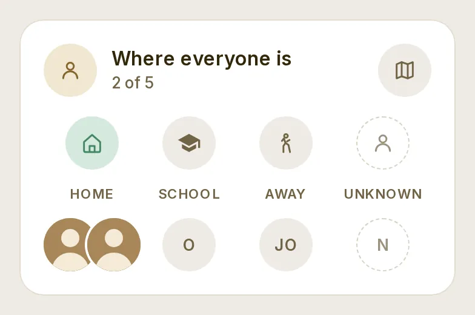

<!-- Generated by `pnpm docs:cards` from the card’s editor and its example in tools/docs/src/gallery.ts: change those, not this page. -->

# Map

`custom:fluvy-map-card` · [All cards](../cards.md#rooms-and-the-map) · [Try it live](https://acosta290.github.io/fluvy/?card=map)

Where everyone is: the house’s zones as columns of faces, a row a person, or Home Assistant’s map on a plate.

<picture><source media="(prefers-color-scheme: dark)" srcset="../images/cards/map-dark.webp"></picture>

```yaml
type: custom:fluvy-map-card
entities:
  - person.am_marta
  - person.am_pau
  - person.am_ona
  - person.am_jan
  - person.am_noa
```

The picture is this configuration on the demo house, whose names and figures are made up: put your own entities in place of its. [Try it in the live demo](https://acosta290.github.io/fluvy/?card=map), where it answers a tap as it would at home, with each of its layouts and the YAML of each.

## Layouts

`variant` chooses the layout. The picture is `zones`, the one the card has when the key is left out; each of the others is the example plus these lines.

| `variant` | Add to the example | Live |
| --- | --- | --- |
| `map` | `variant: map` | [Try it](https://acosta290.github.io/fluvy/?card=map&layout=map) |
| `rows` | `variant: rows` | [Try it](https://acosta290.github.io/fluvy/?card=map&layout=rows) |

## Options

Every key the card’s editor shows: the editor’s word for it in italics, then what it does. *Default* is what the card does when the key is left out, as the editor shows it on a new card; the editor never writes a default into the configuration.

| Key | What it does | Type | Default | Values |
| --- | --- | --- | --- | --- |
| `entities` | *Entities*. The people and trackers the map shows. | entities (person, device_tracker) | required |  |
| `title` | *Title*. The title at the top of the card. | text |  |  |
| `icon` | *Icon*. The card’s icon, in place of the entity’s own. | icon |  |  |
| `show_icon` | *Show the icon*. Shows the icon, hides it, or lets the card decide. | choice | `auto` | `auto` (Automatic), `always`, `never` |
| `name_lines` | *Lines for the name*. Lets the name in the card’s head take two balanced lines where one would cut it; the head is a line taller whatever the name. | choice | `1` | `1`, `2` |
| `variant` | *Style*. The card’s layout. | choice | `zones` | `zones`, `map`, `rows` |
| `map_shape` | *Map shape*. The map’s shape: wide, or square. | choice | `wide` | `wide`, `square` |
| `hours_to_show` | *Hours of history*. How many hours of each person’s path the map draws. | number |  | 0 to 168 |
| `default_zoom` | *Zoom*. How close the map is drawn while it fits nobody in particular. | number |  | 1 to 20 |
| `fit_zones` | *Fit the zones*. Fits the map round the zones as well as the people. | boolean | `false` |  |
| `show_empty` | *Show empty zones*. Keeps a zone with nobody in it. | boolean | `false` |  |
| `show_distance` | *Show the distance from home*. Says how far from home each person who is away is. | boolean | `false` |  |
| `map_path` | *Map path*. Where the map button goes. | text |  |  |
| `tone` | *Tone*. The card’s colour from the palette’s tones; left out, the tone of what it shows. | choice | the card’s own | `accent`, `light`, `heat`, `cool`, `dry`, `fan`, `water`, `solar`, `grid`, `media`, `presence`, `armed`, `battery`, `house`, `gas`, `vehicle` (Car), `neutral`, `ok` (Good), `warning`, `danger` |
| `color` | *Colour*. The card’s colour: its circle, its accents and its tints wear it. Left out, the colour of what it shows. | colour |  |  |
| `card_color` | *Card colour*. Paints the card’s surface in a colour of your own. | colour |  |  |
| `card_opacity` | *Card opacity*. How see-through the card’s surface is, in percent. Untouched: every card’s, from Fluvy’s settings. | number | `100` | 0 % to 100 %, in steps of 5 |
| `card_border` | *Card border*. Draws the card’s hairline border, or leaves it out. Untouched: every card’s, from Fluvy’s settings. | boolean | `true` |  |
| `unavailable` | *When unavailable*. How the card looks while its entity is unavailable: dashed, or quiet. Untouched: every card’s, from Fluvy’s settings. | choice | `dashed` | `dashed`, `quiet` (As when off) |
| `empty_text` | *Text when empty*. What the card says while it has nothing to show. | text |  |  |
| `hide_empty` | *Hide when empty*. Hides the whole card while it has nothing to show. | boolean | `false` |  |
| `zones` | *Zones*. The zones the card shows people in, in this order. | list ([its items](#zones)) |  |  |

**Interactions**

| Key | What it does | Type | Default | Values |
| --- | --- | --- | --- | --- |
| `tap_action` | *Tap action*. What a tap on the card does. | action | `none` |  |
| `hold_action` | *Hold action*. What a long press on the card does. | action | `none` |  |
| `double_tap_action` | *Double tap action*. What two taps on the card do. A tap waits a moment to tell it from a double tap. | action | `none` |  |
| `icon_tap_action` | *Icon tap action*. What a tap on the icon does. | action | `none` |  |
| `icon_hold_action` | *Icon hold action*. What a long press on the icon does. | action | `none` |  |
| `icon_double_tap_action` | *Icon double tap action*. What two taps on the icon do. A tap waits a moment to tell it from a double tap. | action | `none` |  |

## Lists

### `zones`

*Zones*. The zones the card shows people in, in this order. An item is an entity id, or a map with `entity` and any of these keys.

| Key | What it does | Type | Values |
| --- | --- | --- | --- |
| `entity` | *Entity*. The entity the item shows. | entity (zone) |  |
| `name` | *Name*. The item’s own name, in place of the one the card would give it. | name |  |
| `icon` | *Icon*. The item’s own icon, in place of the one the card would give it. | icon |  |

## Older names

Names the card still reads, so a dashboard written before keeps working. They are read, never written back.

| Older name | Read as |
| --- | --- |
| `layout` | `variant` |
| `view` | `variant` |
| `accent` | `color` |
