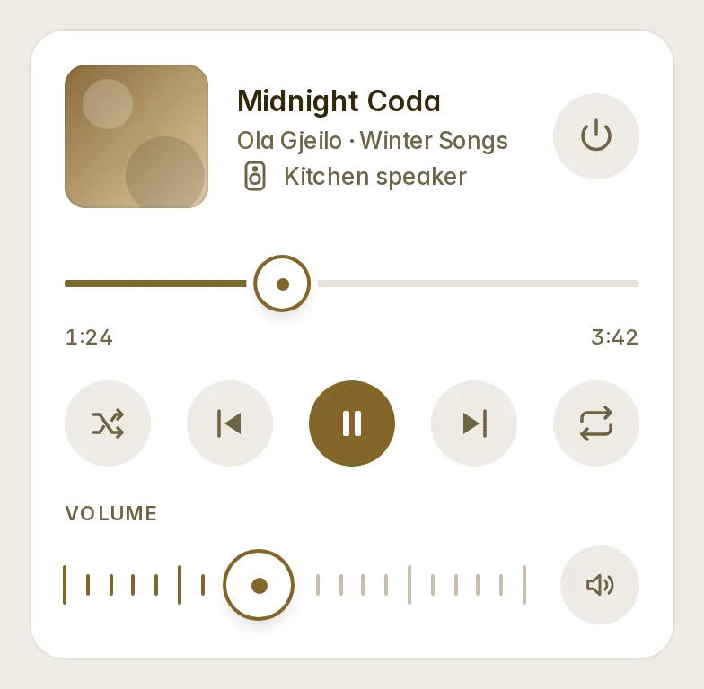

<!-- Generated by `pnpm docs:cards` from the card’s editor and its example in tools/docs/src/gallery.ts: change those, not this page. -->

# Media

`custom:fluvy-media-card` · [All cards](../cards.md#everyday) · [Try it live](https://acosta290.github.io/fluvy/?card=media)

A media player: artwork, seek bar, transport and volume — full, compact row or hero.

<picture><source media="(prefers-color-scheme: dark)" srcset="../images/cards/media-dark.webp"></picture>

```yaml
type: custom:fluvy-media-card
entity: media_player.kitchen
```

The picture is this configuration on the demo house, whose names and figures are made up: put your own entities in place of its. [Try it in the live demo](https://acosta290.github.io/fluvy/?card=media), where it answers a tap as it would at home, with each of its layouts and the YAML of each.

More about it in the guide: [Media](../cards.md#media).

## Layouts

`variant` chooses the layout. The picture is `full`, the one the card has when the key is left out; each of the others is the example plus these lines.

| `variant` | Add to the example | Live |
| --- | --- | --- |
| `mini` | `variant: mini` | [Try it](https://acosta290.github.io/fluvy/?card=media&layout=mini) |
| `hero` | `variant: hero` | [Try it](https://acosta290.github.io/fluvy/?card=media&layout=hero) |

## Options

Every key the card’s editor shows: the editor’s word for it in italics, then what it does. *Default* is what the card does when the key is left out, as the editor shows it on a new card; the editor never writes a default into the configuration.

| Key | What it does | Type | Default | Values |
| --- | --- | --- | --- | --- |
| `entity` | *Entity*. The entity the card is about: what it shows, and what its controls act on. | entity (media_player) | required |  |
| `name` | *Name*. The name the card shows, in place of the entity’s own. | name |  |  |
| `icon` | *Icon*. The card’s icon, in place of the entity’s own. | icon |  |  |
| `secondary` | *Secondary text*. The line under the title, in place of what is playing. Your own words, an entity (its state), or a template such as {{ states('sensor.x') }}. | text |  |  |
| `image` | *Own picture (address or entity)*. A picture of your own in place of the card’s drawing: an address, or an entity whose picture it is. | text |  |  |
| `image_mode` | *Own picture shown*. Shows your own picture only while the player has no artwork, or always. | choice | `fallback` | `fallback` (Without artwork), `always` |
| `variant` | *Style*. The card’s layout. | choice | `full` | `full`, `mini`, `hero` |
| `source_style` | *Sources as*. Draws the sources as chips that fill the row, or as content-sized chips. | choice | `full` | `full`, `chips` |
| `show_source` | *Show sources*. Shows the player’s sources to choose from. | boolean | `true` |  |
| `show_volume` | *Show volume*. Shows the volume control. | boolean | `true` |  |
| `show_power` | *Show power*. Shows the power button. | boolean | `true` |  |
| `controls` | *Controls*. The rounds of the mini layout’s row, in this order. | choices | `play`, `next` | `power`, `previous`, `play`, `next`, `volume` |
| `slider_style` | *Slider style*. The slider’s style; left out, the style set for every slider. Untouched: every slider’s, from Fluvy’s settings. | choice | `house` | `house` (House (Ruler)), `ruler`, `bar`, `liquid` |
| `slider_words` | *Words under it*. Writes the words at the slider’s ends, or none. | choice | `ends` | `ends` (Ends and middle), `none` |
| `tone` | *Tone*. The card’s colour from the palette’s tones; left out, the tone of what it shows. | choice | the card’s own | `accent`, `light`, `heat`, `cool`, `dry`, `fan`, `water`, `solar`, `grid`, `media`, `presence`, `armed`, `battery`, `house`, `gas`, `vehicle` (Car), `neutral`, `ok` (Good), `warning`, `danger` |
| `color` | *Colour*. The card’s colour: its circle, its accents and its tints wear it. Left out, the colour of what it shows. | colour |  |  |
| `card_color` | *Card colour*. Paints the card’s surface in a colour of your own. | colour |  |  |
| `card_opacity` | *Card opacity*. How see-through the card’s surface is, in percent. Untouched: every card’s, from Fluvy’s settings. | number | `100` | 0 % to 100 %, in steps of 5 |
| `card_border` | *Card border*. Draws the card’s hairline border, or leaves it out. Untouched: every card’s, from Fluvy’s settings. | boolean | `true` |  |
| `unavailable` | *When unavailable*. How the card looks while its entity is unavailable: dashed, or quiet. Untouched: every card’s, from Fluvy’s settings. | choice | `dashed` | `dashed`, `quiet` (As when off) |

**Interactions**

| Key | What it does | Type | Default | Values |
| --- | --- | --- | --- | --- |
| `tap_action` | *Tap action*. What a tap on the card does. | action | `more-info` |  |
| `hold_action` | *Hold action*. What a long press on the card does. | action | `more-info` |  |
| `double_tap_action` | *Double tap action*. What two taps on the card do. A tap waits a moment to tell it from a double tap. | action | `none` |  |

## Older names

Names the card still reads, so a dashboard written before keeps working. They are read, never written back.

| Older name | Read as |
| --- | --- |
| `layout` | `variant` |
| `view` | `variant` |
| `accent` | `color` |
