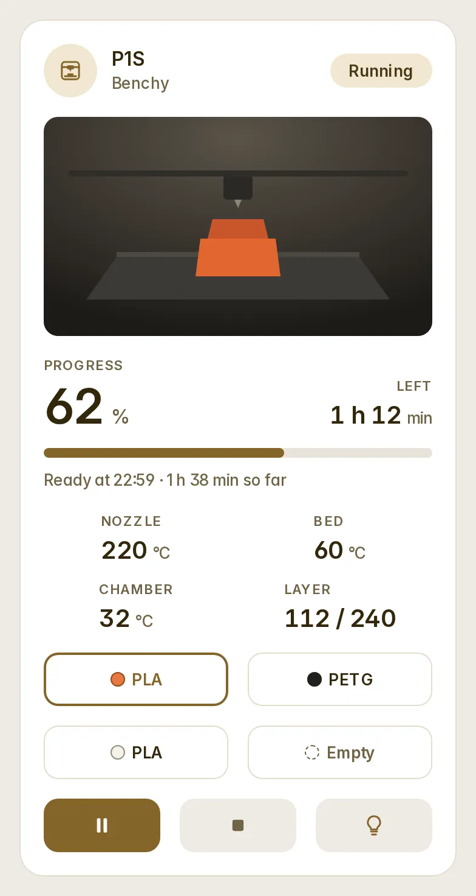

<!-- Generated by `pnpm docs:cards` from the card’s editor and its example in tools/docs/src/gallery.ts: change those, not this page. -->

# 3D printer

`custom:fluvy-printer-card` · [All cards](../cards.md#everyday) · [Try it live](https://acosta290.github.io/fluvy/?card=printer)

A 3D printer’s job: progress, time left, heaters, layers, filament and the camera; pause, resume and stop. OctoPrint, PrusaLink, Bambu Lab, Moonraker, Creality, Elegoo, Anycubic, Snapmaker and FlashForge.

<picture><source media="(prefers-color-scheme: dark)" srcset="../images/cards/printer-dark.webp"></picture>

```yaml
type: custom:fluvy-printer-card
device: d-p1s
```

The picture is this configuration on the demo house, whose names and figures are made up: put your own entities in place of its. [Try it in the live demo](https://acosta290.github.io/fluvy/?card=printer), where it answers a tap as it would at home, with each of its layouts and the YAML of each.

## Layouts

`variant` chooses the layout. The picture is `full`, the one the card has when the key is left out; each of the others is the example plus these lines.

| `variant` | Add to the example | Live |
| --- | --- | --- |
| `compact` | `variant: compact` | [Try it](https://acosta290.github.io/fluvy/?card=printer&layout=compact) |
| `row` | `variant: row` | [Try it](https://acosta290.github.io/fluvy/?card=printer&layout=row) |

## Options

Every key the card’s editor shows: the editor’s word for it in italics, then what it does. *Default* is what the card does when the key is left out, as the editor shows it on a new card; the editor never writes a default into the configuration.

| Key | What it does | Type | Default | Values |
| --- | --- | --- | --- | --- |
| `device` | *Printer*. The device the card reads: every entity it has is found on it. | device |  |  |
| `entity` | *Entity*. An entity of the printer, where its device is not named: the device is found from it. | entity |  |  |
| `name` | *Name*. The name the card shows, in place of the entity’s own. | name |  |  |
| `icon` | *Icon*. The card’s icon, in place of the entity’s own. | icon |  |  |
| `show_icon` | *Show the icon*. Shows the icon, hides it, or lets the card decide. | choice | `auto` | `auto` (Automatic), `always`, `never` |
| `name_lines` | *Lines for the name*. Lets the name in the card’s head take two balanced lines where one would cut it; the head is a line taller whatever the name. | choice | `1` | `1`, `2` |
| `variant` | *Style*. The card’s layout. | choice | `full` | `full`, `compact`, `row` |
| `readouts` | *Readouts (up to six)*. The readouts the card shows, up to six, in this order. | choices | `nozzle`, `bed`, `chamber`, `layer` | `nozzle`, `bed`, `chamber`, `layer`, `speed`, `filament`, `elapsed` |
| `show_image` | *Show the camera or preview*. Shows the camera or the print’s preview above the progress. | boolean | `true` |  |
| `image` | *Picture*. What the picture shows: the camera, the print’s preview, or the card’s choice. | choice | `auto` | `auto` (Automatic), `camera`, `preview` (Job preview) |
| `camera_view` | *Picture*. Shows still pictures that refresh by themselves, or Home Assistant’s live stream. | choice | `auto` | `auto` (Automatic), `live` |
| `fit_mode` | *Fit*. Fills the shape and crops the picture, or shows the whole picture inside it. | choice | `cover` | `cover` (Fill (crop)), `contain` (Whole picture) |
| `aspect_ratio` | *Shape*. The picture’s shape, so that the card keeps its height before the picture arrives. | choice | `16:9` | `16:9`, `4:3`, `3:2`, `1:1`, `2:1`, `21:9`, `native` (The camera’s own) |
| `show_filament` | *Show the filament*. Shows the filament unit’s trays, the one in use marked. | boolean | `true` |  |
| `show_controls` | *Show the buttons*. Shows the pause, stop and light buttons. | boolean | `true` |  |
| `color` | *Colour*. The card’s colour: its circle, its accents and its tints wear it. Left out, the colour of what it shows. | colour |  |  |
| `card_color` | *Card colour*. Paints the card’s surface in a colour of your own. | colour |  |  |
| `card_opacity` | *Card opacity*. How see-through the card’s surface is, in percent. Untouched: every card’s, from Fluvy’s settings. | number | `100` | 0 % to 100 %, in steps of 5 |
| `card_border` | *Card border*. Draws the card’s hairline border, or leaves it out. Untouched: every card’s, from Fluvy’s settings. | boolean | `true` |  |
| `unavailable` | *When unavailable*. How the card looks while its entity is unavailable: dashed, or quiet. Untouched: every card’s, from Fluvy’s settings. | choice | `dashed` | `dashed`, `quiet` (As when off) |
| `sensors` | *More readouts*. More readouts from any of the device’s entities, after the card’s own. | list ([its items](#sensors)) |  |  |
| `roles` | *Entities named by hand*. Entities named by hand for a part the card does not find on the device, or should read otherwise. | list ([its items](#roles)) |  |  |

**Interactions**

| Key | What it does | Type | Default | Values |
| --- | --- | --- | --- | --- |
| `tap_action` | *Tap action*. What a tap on the card does. | action | `more-info` |  |
| `hold_action` | *Hold action*. What a long press on the card does. | action | `more-info` |  |
| `double_tap_action` | *Double tap action*. What two taps on the card do. A tap waits a moment to tell it from a double tap. | action | `none` |  |
| `icon_tap_action` | *Icon tap action*. What a tap on the icon does. | action | `none` |  |
| `icon_hold_action` | *Icon hold action*. What a long press on the icon does. | action | `none` |  |
| `icon_double_tap_action` | *Icon double tap action*. What two taps on the icon do. A tap waits a moment to tell it from a double tap. | action | `none` |  |

## Lists

### `sensors`

*More readouts*. More readouts from any of the device’s entities, after the card’s own. An item is an entity id, or a map with `entity` and any of these keys.

| Key | What it does | Type | Values |
| --- | --- | --- | --- |
| `entity` | *Entity*. The entity the item shows. | entity |  |
| `name` | *Name*. The item’s own name, in place of the one the card would give it. | name |  |

### `roles`

*Entities named by hand*. Entities named by hand for a part the card does not find on the device, or should read otherwise. An item is a map with `role` and any of these keys.

| Key | What it does | Type | Values |
| --- | --- | --- | --- |
| `role` | *What it is*. What the entity is to the printer. | choice | `status`, `printing` (Printing (on/off)), `progress`, `remaining` (Time left), `finish` (Finish time), `start` (Start time), `file`, `stage`, `error`, `elapsed` (Time printed), `filament` (Filament in use), `nozzle`, `nozzle_target`, `bed`, `bed_target`, `chamber`, `layer`, `layers` (Total layers), `speed`, `camera`, `preview`, `pause` (Pause button), `resume` (Resume button), `stop` (Stop button), `light` |
| `entity` | *Entity*. The entity the item shows. | entity |  |

## Older names

Names the card still reads, so a dashboard written before keeps working. They are read, never written back.

| Older name | Read as |
| --- | --- |
| `layout` | `variant` |
| `view` | `variant` |
| `accent` | `color` |
