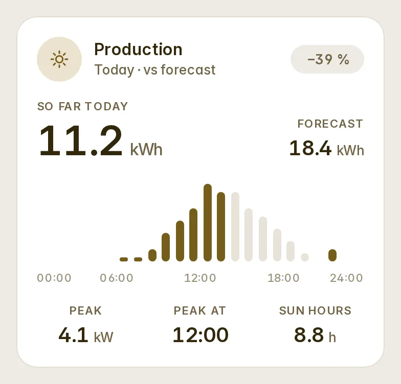

<!-- Generated by `pnpm docs:cards` from the card’s editor and its example in tools/docs/src/gallery.ts: change those, not this page. -->

# Production

`custom:fluvy-production-card` · [All cards](../cards.md#energy) · [Try it live](https://acosta290.github.io/fluvy/?card=production)

Hourly production bars with the forecast behind, stacked per array when there are several.

<picture><source media="(prefers-color-scheme: dark)" srcset="../images/cards/production-dark.webp"></picture>

```yaml
type: custom:fluvy-production-card
entity: sensor.so_energy_today
forecast_entity: sensor.so_forecast_today
peak_entity: sensor.so_peak_today
```

The picture is this configuration on the demo house, whose names and figures are made up: put your own entities in place of its. [Try it in the live demo](https://acosta290.github.io/fluvy/?card=production), where it answers a tap as it would at home, with each of its layouts and the YAML of each.

## Layouts

`variant` chooses the layout. The picture is `full`, the one the card has when the key is left out; each of the others is the example plus these lines.

| `variant` | Add to the example | Live |
| --- | --- | --- |
| `compact` | `variant: compact` | [Try it](https://acosta290.github.io/fluvy/?card=production&layout=compact) |

## Options

Every key the card’s editor shows: the editor’s word for it in italics, then what it does. *Default* is what the card does when the key is left out, as the editor shows it on a new card; the editor never writes a default into the configuration.

| Key | What it does | Type | Default | Values |
| --- | --- | --- | --- | --- |
| `entity` | *Entity*. A sensor of what the panels made today: its state is the day’s total so far. | entity (sensor) | required |  |
| `name` | *Name*. The name the card shows, in place of the entity’s own. | name |  |  |
| `subtitle` | *Subtitle*. The line under the title. | text |  |  |
| `icon` | *Icon*. The card’s icon, in place of the entity’s own. | icon |  |  |
| `show_icon` | *Show the icon*. Shows the icon, hides it, or lets the card decide. | choice | `auto` | `auto` (Automatic), `always`, `never` |
| `show_badge` | *Show the badge*. | boolean | `true` |  |
| `name_lines` | *Lines for the name*. Lets the name in the card’s head take two balanced lines where one would cut it; the head is a line taller whatever the name. | choice | `1` | `1`, `2` |
| `tone` | *Tone*. The card’s colour from the palette’s tones; left out, the tone of what it shows. | choice | the card’s own | `accent`, `light`, `heat`, `cool`, `dry`, `fan`, `water`, `solar`, `grid`, `media`, `presence`, `armed`, `battery`, `house`, `gas`, `vehicle` (Car), `neutral`, `ok` (Good), `warning`, `danger` |
| `color` | *Colour*. The card’s colour: its circle, its accents and its tints wear it. Left out, the colour of what it shows. | colour |  |  |
| `card_color` | *Card colour*. Paints the card’s surface in a colour of your own. | colour |  |  |
| `card_opacity` | *Card opacity*. How see-through the card’s surface is, in percent. Untouched: every card’s, from Fluvy’s settings. | number | `100` | 0 % to 100 %, in steps of 5 |
| `card_border` | *Card border*. Draws the card’s hairline border, or leaves it out. Untouched: every card’s, from Fluvy’s settings. | boolean | `true` |  |
| `unavailable` | *When unavailable*. How the card looks while its entity is unavailable: dashed, or quiet. Untouched: every card’s, from Fluvy’s settings. | choice | `dashed` | `dashed`, `quiet` (As when off) |
| `day` | *What it shows*. The day the card shows: today’s production, tomorrow’s forecast, or the days ahead. | choice | `today` | `today`, `tomorrow`, `ahead` (Days ahead) |
| `days` | *Days ahead*. How many days ahead the forecast shows. | number |  | 2 to 14 |
| `forecast_entity` | *Forecast entity*. A sensor of today’s forecast: its state is the day’s total, its attributes may hold the hours. | entity (sensor) |  |  |
| `peak_entity` | *Peak power entity*. A sensor of today’s peak power; left out, the best hour stands in. | entity (sensor) |  |  |
| `show_forecast` | *Show the forecast*. Shows the forecast; hidden, the card is the weather now alone. | boolean | `true` |  |
| `show_peak` | *Show the peak*. Shows the day’s peak and its hour. | boolean | `true` |  |
| `badge` | *Badge*. What the head’s badge compares with the forecast: the day so far, or the hour under the pointer. | choice | `day` | `day` (The day so far), `hour` (The hour under the pointer, else the day) |
| `variant` | *Style*. The card’s layout. | choice | `full` | `full`, `compact` |
| `collection_key` | *Follow a date picker*. Makes the card follow an Energy date picker on the same dashboard. The key of an Energy date picker on this dashboard (Fluvy’s Energy period card or Home Assistant’s) | choice or text | none |  |
| `unit` | *Unit*. The unit the figures are written in; automatic keeps the sensor’s. | choice or text | `auto` | `auto` (Automatic), `W`, `kW`, `MW`, `Wh`, `kWh`, `MWh`, `L`, `m³`, `gal`, `ft³` |
| `decimals` | *Decimals*. How many decimals the figures have; automatic decides by their size. | choice | `auto` | `auto` (Automatic), `0`, `1`, `2`, `3` |
| `arrays` | *Arrays (each its own power or energy sensor)*. The arrays, each its own power or energy sensor, drawn on the same bars. | list ([its items](#arrays)) |  |  |

**Chart**

| Key | What it does | Type | Default | Values |
| --- | --- | --- | --- | --- |
| `chart` | *Chart*. The bars’ style. | choice | `classic` | `classic`, `soft`, `columns` |
| `show_now` | *Mark now*. Marks the present moment on the chart. | boolean | `false` |  |
| `highlight` | *Highlight*. Marks out readings on the chart: the lowest, the highest, both, or the current one. | choice | `none` | `none`, `min` (The lowest reading), `max` (The highest reading), `both` (Lowest and highest), `current` (The current one) |
| `animate` | *Animate*. Lets the chart or the gauge move as it draws; off, it shows its resting frame at once. | boolean | `true` |  |

**Interactions**

| Key | What it does | Type | Default | Values |
| --- | --- | --- | --- | --- |
| `tap_action` | *Tap action*. What a tap on the card does. | action | `more-info` |  |
| `hold_action` | *Hold action*. What a long press on the card does. | action | `more-info` |  |
| `double_tap_action` | *Double tap action*. What two taps on the card do. A tap waits a moment to tell it from a double tap. | action | `none` |  |
| `icon_tap_action` | *Icon tap action*. What a tap on the icon does. | action | `none` |  |
| `icon_hold_action` | *Icon hold action*. What a long press on the icon does. | action | `none` |  |
| `icon_double_tap_action` | *Icon double tap action*. What two taps on the icon do. A tap waits a moment to tell it from a double tap. | action | `none` |  |

## Lists

### `arrays`

*Arrays (each its own power or energy sensor)*. The arrays, each its own power or energy sensor, drawn on the same bars. An item is an entity id, or a map with `entity` and any of these keys.

| Key | What it does | Type | Values |
| --- | --- | --- | --- |
| `entity` | *Entity*. The entity the item shows. | entity (sensor) |  |
| `name` | *Name*. The item’s own name, in place of the one the card would give it. | name |  |

## Older names

Names the card still reads, so a dashboard written before keeps working. They are read, never written back.

| Older name | Read as |
| --- | --- |
| `title` | `name` |
| `arrays[].label` | `arrays[].name` |
| `arrays[].sub` | `arrays[].secondary` |
| `arrays[].meta` | `arrays[].subtitle` |
| `sub` | `subtitle` |
| `meta` | `subtitle` |
| `layout` | `variant` |
| `view` | `variant` |
| `accent` | `color` |
