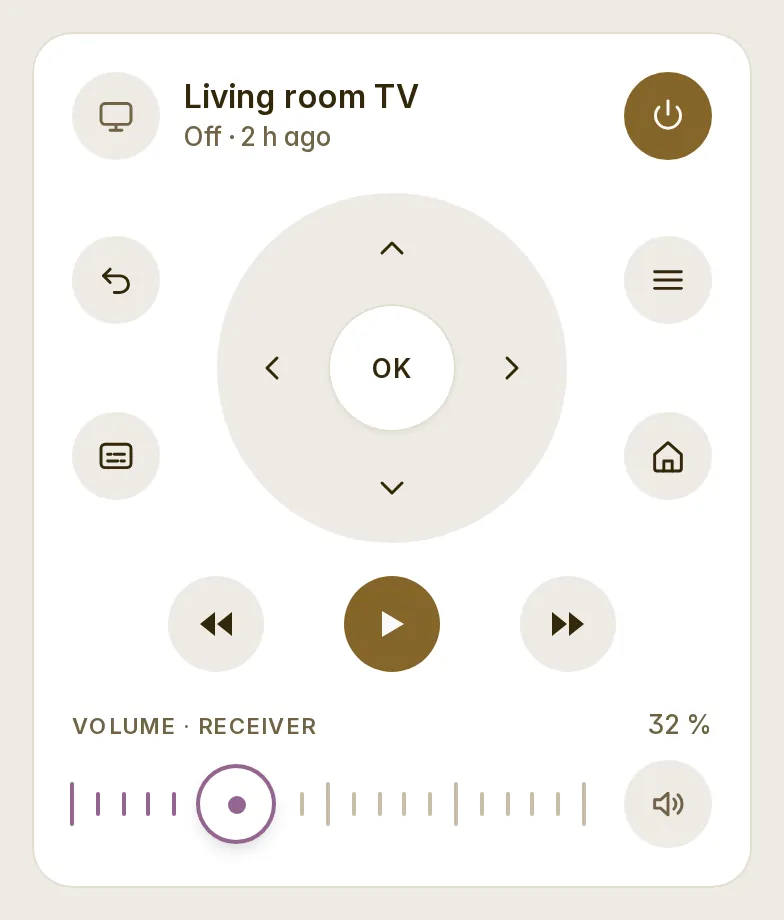

<!-- Generated by `pnpm docs:cards` from the card’s editor and its example in tools/docs/src/gallery.ts: change those, not this page. -->

# Remote

`custom:fluvy-remote-card` · [All cards](../cards.md#everyday) · [Try it live](https://acosta290.github.io/fluvy/?card=remote)

A TV remote in Fluvy’s hand: power, sources, a D-pad with OK, playback, volume routed where you like, channels, the apps with their logos, keys of your own.

<picture><source media="(prefers-color-scheme: dark)" srcset="../images/cards/remote-dark.webp"></picture>

```yaml
type: custom:fluvy-remote-card
entity: media_player.rm_tv
remote: remote.rm_tv
volume_entity: media_player.rm_receiver
```

The picture is this configuration on the demo house, whose names and figures are made up: put your own entities in place of its. [Try it in the live demo](https://acosta290.github.io/fluvy/?card=remote), where it answers a tap as it would at home, with each of its layouts and the YAML of each.

More about it in the guide: [TV remote](../cards.md#tv-remote).

## Layouts

`variant` chooses the layout. The picture is `full`, the one the card has when the key is left out; each of the others is the example plus these lines.

| `variant` | Add to the example | Live |
| --- | --- | --- |
| `compact` | `variant: compact` | [Try it](https://acosta290.github.io/fluvy/?card=remote&layout=compact) |
| `pad` | `variant: pad` | [Try it](https://acosta290.github.io/fluvy/?card=remote&layout=pad) |
| `row` | `variant: row` | [Try it](https://acosta290.github.io/fluvy/?card=remote&layout=row) |

## Options

Every key the card’s editor shows: the editor’s word for it in italics, then what it does. *Default* is what the card does when the key is left out, as the editor shows it on a new card; the editor never writes a default into the configuration.

| Key | What it does | Type | Default | Values |
| --- | --- | --- | --- | --- |
| `entity` | *Entity*. The media player the remote controls. | entity (media_player) |  |  |
| `remote` | *Remote entity*. Sends the keys through this remote entity. The remote that takes the keys; left out, the player takes what it can. | entity (remote) |  |  |
| `volume_entity` | *Volume device*. Sends the volume to another device than the player. A receiver or a soundbar the volume goes to. | entity (media_player) |  |  |
| `name` | *Name*. The name the card shows, in place of the entity’s own. | name |  |  |
| `icon` | *Icon*. The card’s icon, in place of the entity’s own. | icon |  |  |
| `show_icon` | *Show the icon*. Shows the icon, hides it, or lets the card decide. | choice | `auto` | `auto` (Automatic), `always`, `never` |
| `name_lines` | *Lines for the name*. Lets the name in the card’s head take two balanced lines where one would cut it; the head is a line taller whatever the name. | choice | `1` | `1`, `2` |
| `variant` | *Style*. The card’s layout. | choice | `full` | `full`, `compact`, `pad`, `row` |
| `off_keys` | *While the device is off*. Keeps every key alive while the device is off, or only the power key. Every key alive: the integrations that wake on any key do; only power: the rest faded. | choice | `live` | `live`, `power` (Only power) |
| `groups` | *Groups, in order*. The groups of keys the remote shows, in this order. | choices | `source`, `dpad`, `transport`, `volume`, `apps` | `source` (Sources), `dpad` (Direction pad), `transport` (Playback), `volume`, `channel`, `apps`, `custom` (Custom keys) |
| `dpad` | *D-pad*. Draws the arrow keys round a ring, or in a grid. | choice | `ring` | `ring`, `grid` |
| `ok_label` | *OK key*. Writes "OK" on the middle key, or leaves it plain. | choice | `word` | `word` (With the word), `plain` |
| `side_keys` | *Keys round the pad*. Where the keys round the pad stand. Automatic: beside the pad where the column holds them, in a row under it where not. | choice | `auto` | `auto` (Automatic), `sides` (Beside the pad), `row` |
| `nav` | *The four keys round the pad*. Which keys stand round the arrow pad, in this order. | choices | `back`, `menu`, `captions`, `home` | `power`, `up`, `down`, `left`, `right`, `ok`, `back`, `home`, `menu`, `info`, `guide`, `captions` (Subtitles), `settings`, `input`, `assistant`, `exit`, `play_pause` (Play or pause), `play`, `pause`, `stop`, `rewind`, `forward` (Fast forward), `previous`, `next`, `record`, `volume_up`, `volume_down`, `mute`, `channel_up`, `channel_down` |
| `transport` | *Playback keys*. The playback keys, in this order. | choices | `rewind`, `play_pause`, `forward` | `power`, `up`, `down`, `left`, `right`, `ok`, `back`, `home`, `menu`, `info`, `guide`, `captions` (Subtitles), `settings`, `input`, `assistant`, `exit`, `play_pause` (Play or pause), `play`, `pause`, `stop`, `rewind`, `forward` (Fast forward), `previous`, `next`, `record`, `volume_up`, `volume_down`, `mute`, `channel_up`, `channel_down` |
| `volume` | *Volume control*. How the volume is set: a ruler, keys, or − and +. Automatic: the ruler where the device reports a level it can set, keys where not. | choice | `auto` | `auto` (Automatic), `ruler`, `keys`, `stepper` |
| `apps_style` | *Apps as*. Draws the apps as rounds with their logos, or as chips. | choice | `circles` | `circles`, `chips` |
| `apps_tint` | *Apps in their colours*. Paints each app in its own colour while it is open, or always. | choice | `open` | `open` (The open app), `always` |
| `keys` | *Keys of the compact row*. The keys the compact remote shows in its row, in this order. | choices | `back`, `home`, `play_pause`, `volume_down`, `volume_up` | `power`, `up`, `down`, `left`, `right`, `ok`, `back`, `home`, `menu`, `info`, `guide`, `captions` (Subtitles), `settings`, `input`, `assistant`, `exit`, `play_pause` (Play or pause), `play`, `pause`, `stop`, `rewind`, `forward` (Fast forward), `previous`, `next`, `record`, `volume_up`, `volume_down`, `mute`, `channel_up`, `channel_down` |
| `controls` | *Rounds of the row*. The rounds of the row layout, in this order. | choices | `back`, `home`, `power` | `power`, `up`, `down`, `left`, `right`, `ok`, `back`, `home`, `menu`, `info`, `guide`, `captions` (Subtitles), `settings`, `input`, `assistant`, `exit`, `play_pause` (Play or pause), `play`, `pause`, `stop`, `rewind`, `forward` (Fast forward), `previous`, `next`, `record`, `volume_up`, `volume_down`, `mute`, `channel_up`, `channel_down` |
| `commands` | *Commands of this device*. The command this device takes for a key, where it is not the one Fluvy knows. A key and the command the device takes for it, over the table’s (back: KEY_RETURN) | object |  |  |
| `tone` | *Tone*. The card’s colour from the palette’s tones; left out, the tone of what it shows. | choice | the card’s own | `accent`, `light`, `heat`, `cool`, `dry`, `fan`, `water`, `solar`, `grid`, `media`, `presence`, `armed`, `battery`, `house`, `gas`, `vehicle` (Car), `neutral`, `ok` (Good), `warning`, `danger` |
| `color` | *Colour*. The card’s colour: its circle, its accents and its tints wear it. Left out, the colour of what it shows. | colour |  |  |
| `card_color` | *Card colour*. Paints the card’s surface in a colour of your own. | colour |  |  |
| `card_opacity` | *Card opacity*. How see-through the card’s surface is, in percent. Untouched: every card’s, from Fluvy’s settings. | number | `100` | 0 % to 100 %, in steps of 5 |
| `card_border` | *Card border*. Draws the card’s hairline border, or leaves it out. Untouched: every card’s, from Fluvy’s settings. | boolean | `true` |  |
| `unavailable` | *When unavailable*. How the card looks while its entity is unavailable: dashed, or quiet. Untouched: every card’s, from Fluvy’s settings. | choice | `dashed` | `dashed`, `quiet` (As when off) |
| `apps` | *Apps*. The apps the remote opens, as rounds or chips. A platform brings its logo; left empty, the player’s sources that name a platform are shown. | list ([its items](#apps)) |  |  |
| `custom` | *Custom keys*. Keys of your own, each a command the device takes or any action. A key the device takes, or any action of your own. | list ([its items](#custom)) |  |  |

**Interactions**

| Key | What it does | Type | Default | Values |
| --- | --- | --- | --- | --- |
| `tap_action` | *Tap action*. What a tap on the card does. | action | `more-info` |  |
| `hold_action` | *Hold action*. What a long press on the card does. | action | `more-info` |  |
| `double_tap_action` | *Double tap action*. What two taps on the card do. A tap waits a moment to tell it from a double tap. | action | `none` |  |
| `icon_tap_action` | *Icon tap action*. What a tap on the icon does. | action | `none` |  |
| `icon_hold_action` | *Icon hold action*. What a long press on the icon does. | action | `none` |  |
| `icon_double_tap_action` | *Icon double tap action*. What two taps on the icon do. A tap waits a moment to tell it from a double tap. | action | `none` |  |

## Lists

### `apps`

*Apps*. The apps the remote opens, as rounds or chips. A platform brings its logo; left empty, the player’s sources that name a platform are shown. An item is a map with `app` and any of these keys.

| Key | What it does | Type | Values |
| --- | --- | --- | --- |
| `app` | *Platform*. The streaming app it is: its logo, its colour and how the player opens it. | choice or text | `netflix`, `disneyplus` (Disney+), `movistarplus` (Movistar Plus+), `primevideo`, `appletv`, `rakutentv`, `youtube`, `youtubemusic`, `youtubetv`, `youtubekids`, `hbomax`, `max`, `hulu`, `paramountplus` (Paramount+), `peacock`, `dazn`, `filmin`, `skyshowtime`, `crunchyroll`, `plutotv`, `tubi`, `twitch`, `plex`, `jellyfin`, `emby`, `kodi`, `spotify`, `applemusic`, `applepodcasts`, `amazonmusic`, `deezer`, `tidal`, `soundcloud`, `audible`, `pocketcasts`, `steam`, `xbox`, `playstation`, `nintendoswitch`, `atresplayer`, `rtveplay`, `mitele`, `mubi`, `vimeo`, `dailymotion`, `viaplay`, `googletv`, `googleplay`, `channel4`, `itvx`, `zdf`, `starz`, `showtime`, `now`, `nebula`, `fubo`, `tiktok`, `roku`, `bilibili` |
| `name` | *Name*. The item’s own name, in place of the one the card would give it. | text |  |
| `icon` | *Icon*. The item’s own icon, in place of the one the card would give it. | icon |  |
| `image` | *Picture*. A picture of your own for the app. Your own logo in place of the platform’s: a path such as /local/logo.svg, or a web address. | text |  |
| `color` | *Colour*. The item’s colour, in place of the one the card gives it. Empty: the colour the card gives it. | colour |  |
| `source` | *Source of the player*. The player’s source the app is. | text |  |
| `key` | *Key*. A key that opens the app. | choice | `power`, `up`, `down`, `left`, `right`, `ok`, `back`, `home`, `menu`, `info`, `guide`, `captions` (Subtitles), `settings`, `input`, `assistant`, `exit`, `play_pause` (Play or pause), `play`, `pause`, `stop`, `rewind`, `forward` (Fast forward), `previous`, `next`, `record`, `volume_up`, `volume_down`, `mute`, `channel_up`, `channel_down` |
| `activity` | *Android TV link*. How an Android TV opens the app. What Android TV Remote opens the app by: a deep link such as netflix:// (the reliable way) or an application ID. | text |  |

**Interactions**

| Key | What it does | Type | Values |
| --- | --- | --- | --- |
| `tap_action` | *Tap action*. What a tap on the item does. | action |  |
| `hold_action` | *Hold action*. What a long press on the item does. | action |  |
| `double_tap_action` | *Double tap action*. What two taps on the item do. A tap waits a moment to tell it from a double tap. | action |  |

### `custom`

*Custom keys*. Keys of your own, each a command the device takes or any action. A key the device takes, or any action of your own. An item is a map with `name` and any of these keys.

| Key | What it does | Type | Values |
| --- | --- | --- | --- |
| `name` | *Name*. The item’s own name, in place of the one the card would give it. | text |  |
| `icon` | *Icon*. The item’s own icon, in place of the one the card would give it. | icon |  |
| `key` | *Key*. The key it stands in for. | choice | `power`, `up`, `down`, `left`, `right`, `ok`, `back`, `home`, `menu`, `info`, `guide`, `captions` (Subtitles), `settings`, `input`, `assistant`, `exit`, `play_pause` (Play or pause), `play`, `pause`, `stop`, `rewind`, `forward` (Fast forward), `previous`, `next`, `record`, `volume_up`, `volume_down`, `mute`, `channel_up`, `channel_down` |

**Interactions**

| Key | What it does | Type | Values |
| --- | --- | --- | --- |
| `tap_action` | *Tap action*. What a tap on the item does. | action |  |
| `hold_action` | *Hold action*. What a long press on the item does. | action |  |
| `double_tap_action` | *Double tap action*. What two taps on the item do. A tap waits a moment to tell it from a double tap. | action |  |

## Older names

Names the card still reads, so a dashboard written before keeps working. They are read, never written back.

| Older name | Read as |
| --- | --- |
| `layout` | `variant` |
| `view` | `variant` |
| `accent` | `color` |
