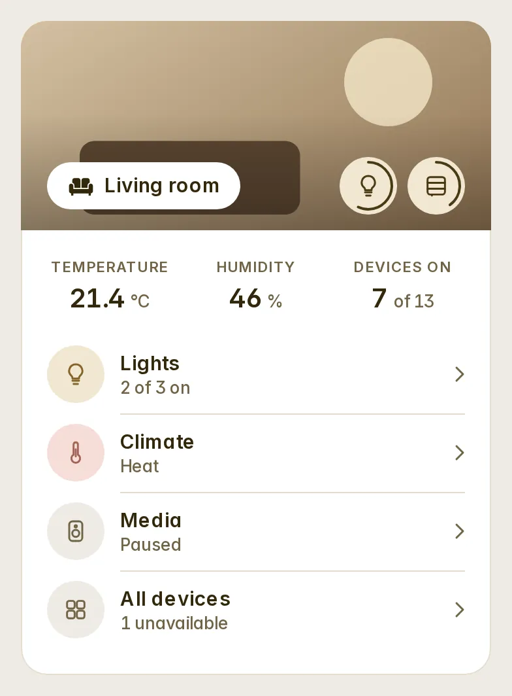

<!-- Generated by `pnpm docs:cards` from the card’s editor and its example in tools/docs/src/gallery.ts: change those, not this page. -->

# Room

`custom:fluvy-room-card` · [All cards](../cards.md#rooms-and-the-map) · [Try it live](https://acosta290.github.io/fluvy/?card=room)

A room of the house from its area: its picture, its climate, what is on, and its controls.

<picture><source media="(prefers-color-scheme: dark)" srcset="../images/cards/room-dark.webp"></picture>

```yaml
type: custom:fluvy-room-card
area: rm_living
path: /fluvy-auto/room-rm_living
```

The picture is this configuration on the demo house, whose names and figures are made up: put your own entities in place of its. [Try it in the live demo](https://acosta290.github.io/fluvy/?card=room), where it answers a tap as it would at home, with each of its layouts and the YAML of each.

More about it in the guide: [Rooms](../cards.md#rooms).

## Layouts

`variant` chooses the layout. The picture is `photo`, the one the card takes by itself for this example; each of the others is the example plus these lines.

| `variant` | Add to the example | Live |
| --- | --- | --- |
| `tile` | `variant: tile` | [Try it](https://acosta290.github.io/fluvy/?card=room&layout=tile) |
| `row` | `variant: row` | [Try it](https://acosta290.github.io/fluvy/?card=room&layout=row) |

## Options

Every key the card’s editor shows: the editor’s word for it in italics, then what it does. *Default* is what the card does when the key is left out, as the editor shows it on a new card; the editor never writes a default into the configuration.

| Key | What it does | Type | Default | Values |
| --- | --- | --- | --- | --- |
| `area` | *Area*. Limits the card to the entities of this area. | area | required |  |
| `name` | *Name*. The name the card shows, in place of the entity’s own. | text |  |  |
| `icon` | *Icon*. The card’s icon, in place of the entity’s own. | icon |  |  |
| `show_icon` | *Show the icon*. Shows the icon, hides it, or lets the card decide. | choice | `auto` | `auto` (Automatic), `always`, `never` |
| `variant` | *Style*. The card’s layout. | choice | `tile` | `photo`, `tile`, `row` |
| `controls` | *Controls*. Draws the room’s controls as rows, as tiles, or not at all. | choice | `rows` | `rows`, `tiles`, `none` |
| `name_position` | *Name on the photo*. Where the photo carries the room’s name: at its foot, or at its top. | choice | `bottom` | `bottom` (At the bottom), `top` (At the top) |
| `show_climate` | *Show the climate*. Shows the room’s temperature and humidity. | boolean | `true` |  |
| `show_count` | *Show how many are on*. Says how many of the room’s devices are on. | boolean | `true` |  |
| `readout_style` | *Readouts as*. Keeps the readouts on one row, or lets them wrap. | choice | `row` | `row` (One row), `wrap` (Several rows) |
| `readout_labels` | *Readout labels*. How the readouts are labelled: words, icons, or nothing. | choice | `auto` | `auto` (Automatic), `words`, `icons`, `none` |
| `show_quick_actions` | *Show the quick actions*. Shows the quick actions at the end of the room’s head, its row or its photo. | boolean | `true` |  |
| `show_arrow` | *Show the arrow*. Shows the arrows that say the room opens. | boolean | `true` |  |
| `show_quick_states` | *Show their states*. Shows every quick action’s state in its round, unless the action says otherwise. Under or beside each icon: a reading with its unit, a door open or closed, a light’s brightness. | boolean | `false` |  |
| `quick_state_position` | *Their states*. Where the quick actions’ states stand: under their icons, the head a line taller, or beside them, the rounds wider. | choice | `under` | `under` (Under the icon), `beside` (Beside the icon) |
| `show_action` | *Show what it is doing*. Says on its line what a climate is doing and what it is set to. | boolean | `false` |  |
| `picture` | *Picture*. A picture of the room, as an address; left out, the area’s own. | text |  |  |
| `path` | *Opens (path)*. Where a tap on the room goes. | text |  |  |
| `lights` | *Lights*. The lights the room counts and its lights action switches; a lamp on a plug may be one of them. What its Lights row counts and its quick action switches. A lamp on a plug added here comes on and goes off with them. | entities (light, switch) | none |  |
| `temperature_entity` | *Temperature*. The room’s temperature sensor, or a thermostat; left out, the area’s. | entity | none |  |
| `humidity_entity` | *Humidity*. The humidity sensor the card reads, where it is not the one found by itself. | entity | none |  |
| `include` | *Also count*. Counts these entities, devices or domains as the room’s too. Entities, devices or domains, or a pattern of ids such as switch.dishwasher_*. | choices or text | nothing more |  |
| `exclude` | *Leave out*. Leaves these entities, devices or domains out of what the card counts. Entities, devices or domains, or a pattern of ids such as switch.dishwasher_*. | choices or text | nothing |  |
| `tone` | *Tone*. The card’s colour from the palette’s tones; left out, the tone of what it shows. | choice | the card’s own | `accent`, `light`, `heat`, `cool`, `dry`, `fan`, `water`, `solar`, `grid`, `media`, `presence`, `armed`, `battery`, `house`, `gas`, `vehicle` (Car), `neutral`, `ok` (Good), `warning`, `danger` |
| `color` | *Colour*. The card’s colour: its circle, its accents and its tints wear it. Left out, the colour of what it shows. | colour |  |  |
| `card_color` | *Card colour*. Paints the card’s surface in a colour of your own. | colour |  |  |
| `card_opacity` | *Card opacity*. How see-through the card’s surface is, in percent. Untouched: every card’s, from Fluvy’s settings. | number | `100` | 0 % to 100 %, in steps of 5 |
| `card_border` | *Card border*. Draws the card’s hairline border, or leaves it out. Untouched: every card’s, from Fluvy’s settings. | boolean | `true` |  |
| `unavailable` | *When unavailable*. How the card looks while its entity is unavailable: dashed, or quiet. Untouched: every card’s, from Fluvy’s settings. | choice | `dashed` | `dashed`, `quiet` (As when off) |
| `tint` | *Show its colour*. When the card shows its colour beyond its circle: never, while it is on or active, or at rest too. | choice | `on` | `on` (When on), `always` |
| `name_lines` | *Lines for the name*. Lets the names of the room’s tiles take two lines where one would cut them, every tile a line taller. | choice | `1` | `1`, `2` |
| `switch_style` | *Switch style*. Draws the switch as a toggle, or as a wall rocker that only switches. Wall rocker: on and off alone, no slider and no level. | choice | `toggle` | `toggle`, `rocker` (Wall rocker) |
| `readouts_layout` | *Readouts layout*. Where a compact tile’s readouts stand: on its line, or as columns at its end. Columns: each under its label, as many as the tile holds; the rest on the line. | choice | `line` | `line` (On the line), `end` (Columns at the end) |
| `line_readouts` | *Readouts on the line*. How many readouts the tile’s line says: the first, or every one that can be read. | choice | `first` | `first` (The first), `all` (All of them) |
| `light_colors` | *Each light on in its bulb’s colour*. Shows each light that is on in its bulb’s own colour. | boolean | `false` |  |
| `light_whites` | *Whites*. Draws a lit white by its colour temperature, or as the palette’s light. | choice | `temperature` | `palette` (The theme’s light), `temperature` (The bulb’s white) |
| `tiles` | *Tiles*. Tiles of the room’s entities, in this order. | list ([its items](#tiles)) |  |  |
| `quick_actions` | *Quick actions*. The quick actions in the room’s head, each on a group of its devices or on one entity. | list ([its items](#quick_actions)) |  |  |

**Interactions**

| Key | What it does | Type | Default | Values |
| --- | --- | --- | --- | --- |
| `tap_action` | *Tap action*. What a tap on the card does. | action | the card’s own |  |
| `hold_action` | *Hold action*. What a long press on the card does. | action | `more-info` |  |
| `double_tap_action` | *Double tap action*. What two taps on the card do. A tap waits a moment to tell it from a double tap. | action | `none` |  |
| `icon_tap_action` | *Icon tap action*. What a tap on the icon does. | action | `none` |  |
| `icon_hold_action` | *Icon hold action*. What a long press on the icon does. | action | `none` |  |
| `icon_double_tap_action` | *Icon double tap action*. What two taps on the icon do. A tap waits a moment to tell it from a double tap. | action | `none` |  |

## Lists

### `tiles`

*Tiles*. Tiles of the room’s entities, in this order. An item is an entity id, or a map with `entity` and any of these keys.

| Key | What it does | Type | Values |
| --- | --- | --- | --- |
| `entity` | *Entity*. The entity the item shows. | entity |  |
| `name` | *Name*. The item’s own name, in place of the one the card would give it. | name |  |
| `icon` | *Icon*. The item’s own icon, in place of the one the card would give it. | icon |  |
| `tone` | *Tone*. The item’s colour from the palette’s tones. | choice | `accent`, `light`, `heat`, `cool`, `dry`, `fan`, `water`, `solar`, `grid`, `media`, `presence`, `armed`, `battery`, `house`, `gas`, `vehicle` (Car), `neutral`, `ok` (Good), `warning`, `danger` |
| `color` | *Colour*. The item’s colour, in place of the one the card gives it. Empty: the light’s bulb colour where the card shows bulbs’ colours, else the card’s. | colour |  |
| `readouts` | *Readouts*. Sensors shown as readouts on the tile. | object |  |
| `since` | *Last change from*. Where the time of the last change is read from. A timestamp sensor, or attribute:name. | choice or text |  |
| `switch_style` | *Switch style*. Draws the tile’s switch as a toggle, or as a wall rocker. Empty: the card’s. | choice | `toggle`, `rocker` (Wall rocker) |
| `show_action` | *Show what it is doing*. Says what a climate is doing on the tile’s line. Empty: the card’s. | choice | `true` (On), `false` (Off) |

**Interactions**

| Key | What it does | Type | Values |
| --- | --- | --- | --- |
| `tap_action` | *Tap action*. What a tap on the item does. | action |  |
| `hold_action` | *Hold action*. What a long press on the item does. | action |  |
| `double_tap_action` | *Double tap action*. What two taps on the item do. A tap waits a moment to tell it from a double tap. | action |  |
| `icon_tap_action` | *Icon tap action*. What a tap on the tile’s icon does. | action |  |
| `icon_hold_action` | *Icon hold action*. What a long press on the tile’s icon does. | action |  |
| `icon_double_tap_action` | *Icon double tap action*. What two taps on the tile’s icon do. A tap waits a moment to tell it from a double tap. | action |  |

### `quick_actions`

*Quick actions*. The quick actions in the room’s head, each on a group of its devices or on one entity. An item is a map with `group` and any of these keys.

| Key | What it does | Type | Values |
| --- | --- | --- | --- |
| `group` | *Acts on*. What the quick action acts on: the room’s lights, covers, fans or media, or one entity. | choice | `lights`, `covers` (Blinds), `fans`, `media`, `entity` |
| `entity` | *Entity*. The entity the item shows. | entity |  |
| `name` | *Name*. The item’s own name, in place of the one the card would give it. | name |  |
| `icon` | *Icon*. The item’s own icon, in place of the one the card would give it. | icon |  |
| `tone` | *Tone*. The item’s colour from the palette’s tones. | choice | `accent`, `light`, `heat`, `cool`, `dry`, `fan`, `water`, `solar`, `grid`, `media`, `presence`, `armed`, `battery`, `house`, `gas`, `vehicle` (Car), `neutral`, `ok` (Good), `warning`, `danger` |
| `color` | *Colour*. The item’s colour, in place of the one the card gives it. Empty: the light’s bulb colour where the card shows bulbs’ colours, else the card’s. | colour |  |
| `show_state` | *Show its state*. Shows this quick action’s state in its round, or hides it, whatever the card says. Empty: the card’s. | choice | `true` (On), `false` (Off) |

**Interactions**

| Key | What it does | Type | Values |
| --- | --- | --- | --- |
| `tap_action` | *Tap action*. What a tap on the item does. | action |  |
| `hold_action` | *Hold action*. What a long press on the item does. | action |  |
| `double_tap_action` | *Double tap action*. What two taps on the item do. A tap waits a moment to tell it from a double tap. | action |  |

## Older names

Names the card still reads, so a dashboard written before keeps working. They are read, never written back.

| Older name | Read as |
| --- | --- |
| `tiles[].label` | `tiles[].name` |
| `tiles[].sub` | `tiles[].secondary` |
| `tiles[].meta` | `tiles[].subtitle` |
| `layout` | `variant` |
| `view` | `variant` |
| `accent` | `color` |
