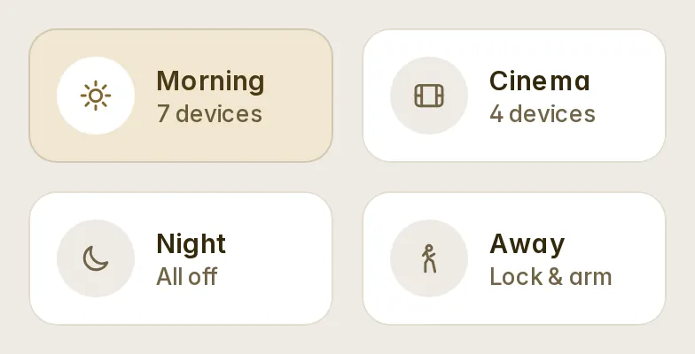

<!-- Generated by `pnpm docs:cards` from the card’s editor and its example in tools/docs/src/gallery.ts: change those, not this page. -->

# Scenes

`custom:fluvy-scenes-card` · [All cards](../cards.md#scenes-actions-and-helpers) · [Try it live](https://acosta290.github.io/fluvy/?card=scenes)

A grid of scenes and scripts.

<picture><source media="(prefers-color-scheme: dark)" srcset="../images/cards/scenes-dark.webp"></picture>

```yaml
type: custom:fluvy-scenes-card
scenes:
  - entity: scene.am_morning
    icon: sun
  - entity: scene.am_cinema
    icon: film
  - entity: scene.am_night
    icon: moon
    subtitle: All off
  - entity: scene.am_away
    icon: away
    subtitle: Lock & arm
```

The picture is this configuration on the demo house, whose names and figures are made up: put your own entities in place of its. [Try it in the live demo](https://acosta290.github.io/fluvy/?card=scenes), where it answers a tap as it would at home, with each of its layouts and the YAML of each.

## Layouts

`variant` chooses the layout. The picture is `tiles`, the one the card has when the key is left out; each of the others is the example plus these lines.

| `variant` | Add to the example | Live |
| --- | --- | --- |
| `chips` | `variant: chips` | [Try it](https://acosta290.github.io/fluvy/?card=scenes&layout=chips) |

## Options

Every key the card’s editor shows: the editor’s word for it in italics, then what it does. *Default* is what the card does when the key is left out, as the editor shows it on a new card; the editor never writes a default into the configuration.

| Key | What it does | Type | Default | Values |
| --- | --- | --- | --- | --- |
| `title` | *Title*. The title at the top of the card. | text |  |  |
| `variant` | *Style*. The card’s layout. | choice | `tiles` | `tiles`, `chips` |
| `columns` | *Columns*. How many scenes stand in a row. | choice | `auto` | `auto` (Automatic), `1`, `2` |
| `names` | *Names*. How a row is named where it has no name of its own: the entity’s full name, its own, or its device’s. Where no name of its own is set. | choice | `full` | `full` (Full name), `entity` (Entity name), `device` (Device name) |
| `group_by` | *Group by*. Groups the items under the name of their room or their floor. | choice | `none` | `none`, `area`, `floor` |
| `group_order` | *Groups in order*. The order of the groups: the house’s order of its rooms, or by name. Automatic: the order of the rooms in Fluvy’s settings. | choice | `auto` | `auto` (Automatic), `name` |
| `short_names` | *Short names in a group*. Shortens a name inside a group by the group’s own name. | boolean | `true` |  |
| `color` | *Colour*. The card’s colour: its circle, its accents and its tints wear it. Left out, the colour of what it shows. | colour |  |  |
| `card_color` | *Card colour*. Paints the card’s surface in a colour of your own. | colour |  |  |
| `card_opacity` | *Card opacity*. How see-through the card’s surface is, in percent. Untouched: every card’s, from Fluvy’s settings. | number | `100` | 0 % to 100 %, in steps of 5 |
| `card_border` | *Card border*. Draws the card’s hairline border, or leaves it out. Untouched: every card’s, from Fluvy’s settings. | boolean | `true` |  |
| `unavailable` | *When unavailable*. How the card looks while its entity is unavailable: dashed, or quiet. Untouched: every card’s, from Fluvy’s settings. | choice | `dashed` | `dashed`, `quiet` (As when off) |
| `tint` | *Show its colour*. When each scene’s tile shows its colour. | choice | `on` | `on` (When on), `always` |
| `empty_text` | *Text when empty*. What the card says while it has nothing to show. | text |  |  |
| `hide_empty` | *Hide when empty*. Hides the whole card while it has nothing to show. | boolean | `false` |  |
| `scenes` | *Scenes*. The scenes, in the order they are drawn. | list ([its items](#scenes)) |  |  |

**Interactions**

| Key | What it does | Type | Default | Values |
| --- | --- | --- | --- | --- |
| `hold_action` | *Hold action*. What a long press on the card does. | action | `more-info` |  |
| `double_tap_action` | *Double tap action*. What two taps on the card do. A tap waits a moment to tell it from a double tap. | action | `none` |  |

## Lists

### `scenes`

*Scenes*. The scenes, in the order they are drawn. An item is an entity id, or a map with `entity` and any of these keys. Between its items, `type: section` with a `label` heads a group.

| Key | What it does | Type | Values |
| --- | --- | --- | --- |
| `entity` | *Entity*. The entity the item shows. | entity (scene, script, button, input_button, automation) |  |
| `name` | *Name*. The item’s own name, in place of the one the card would give it. | name |  |
| `icon` | *Icon*. The item’s own icon, in place of the one the card would give it. | icon |  |
| `subtitle` | *Subtitle*. The line under the scene’s name. | text |  |
| `color` | *Colour*. The item’s colour, in place of the one the card gives it. Empty: the card’s colour. | colour |  |

**Interactions**

| Key | What it does | Type | Values |
| --- | --- | --- | --- |
| `tap_action` | *Tap action*. What a tap on the item does. | action |  |
| `hold_action` | *Hold action*. What a long press on the item does. | action |  |
| `double_tap_action` | *Double tap action*. What two taps on the item do. A tap waits a moment to tell it from a double tap. | action |  |

## Older names

Names the card still reads, so a dashboard written before keeps working. They are read, never written back.

| Older name | Read as |
| --- | --- |
| `entities` | `scenes` |
| `scenes[].label` | `scenes[].name` |
| `scenes[].sub` | `scenes[].secondary` |
| `scenes[].meta` | `scenes[].subtitle` |
| `layout` | `variant` |
| `view` | `variant` |
| `accent` | `color` |
