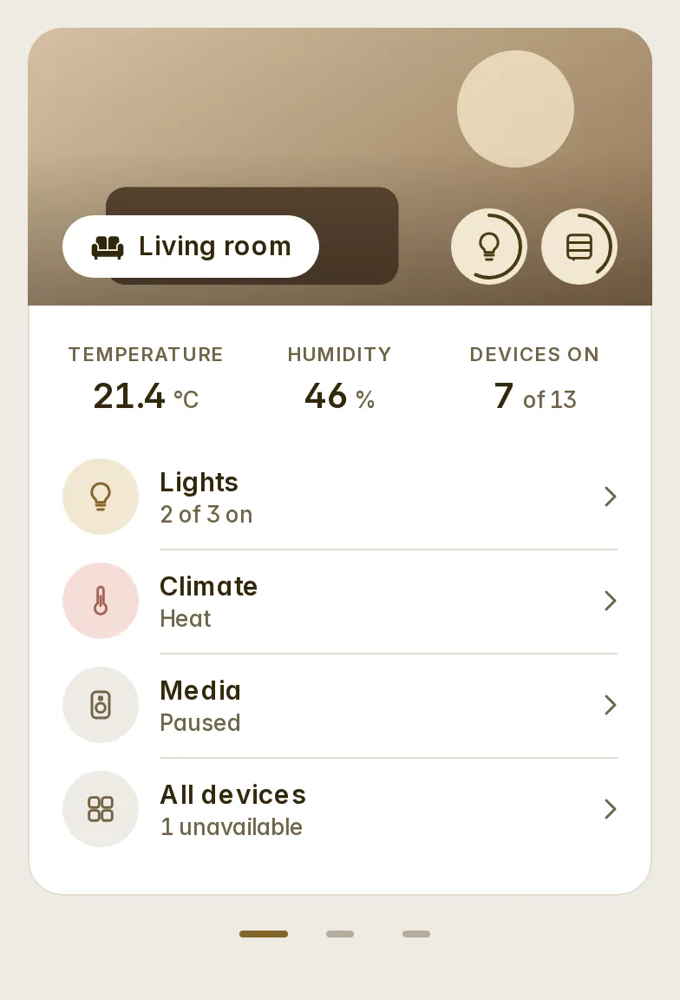

<!-- Generated by `pnpm docs:cards` from the card’s editor, its example in tools/docs/src/gallery.ts and its guide in tools/docs/guides/: change those, not this page. -->

# Swipe

Any cards, one a page, turned by a swipe or the page marks under them: side by side on a wide screen, round from the last to the first.

`custom:fluvy-swipe-card` · [Try it live](https://acosta290.github.io/fluvy/?card=swipe) · [All cards](../cards.md#structure-and-navigation)

<picture><source media="(prefers-color-scheme: dark)" srcset="../images/cards/swipe-dark.webp"></picture>

## Example

```yaml
type: custom:fluvy-swipe-card
cards:
  - type: custom:fluvy-room-card
    area: rm_living
    path: /fluvy-auto/room-rm_living
  - type: custom:fluvy-room-card
    area: rm_kitchen
  - type: custom:fluvy-room-card
    area: rm_bedroom
```

The picture above, on the demo house: put your own entities in place of its.

## Layouts

`style` chooses the layout. The picture above is `card`, the default; each of the others is the example plus the line over it, and opens in the live demo.

<table>
<tbody><tr>
<td align="center" valign="top" width="50%"><code>style: plain</code><br><a href="https://acosta290.github.io/fluvy/?card=swipe&amp;layout=plain"><picture><source media="(prefers-color-scheme: dark)" srcset="../images/cards/swipe.plain-dark.webp"></picture></a></td>
<td align="center" valign="top" width="50%"></td>
</tr></tbody>
</table>

## All options

```yaml
type: custom:fluvy-swipe-card
cards:
  - type: custom:fluvy-room-card
    area: rm_living
    path: /fluvy-auto/room-rm_living
  - type: custom:fluvy-room-card
    area: rm_kitchen
  - type: custom:fluvy-room-card
    area: rm_bedroom
```

## Options

| Option | Default | What it does |
| --- | --- | --- |
| `style` | `card` | Draws the card on its own surface, or plain on the page. `card` (One card) · `plain`. |
| `columns` | `1` | How many of its cards stand side by side, as many as the width holds. `1` · `2` · `3` · `4`. |
| `gap` | `40` | The room between the cards it holds, in pixels. 0 to 40, in steps of 4. |
| `start` | `1` | The page the card opens on, counted from 1. 1 or more. |
| `show_indicators` | `true` | Shows the page marks under the cards, each a button to its page. |
| `loop` | `false` | Goes round from the last page to the first, and back. |
| `remember` | `session` | Where the page it was left on is kept: this tab while it is open, or nowhere. `session` (While the tab is open) · `off`. |
| `autoplay` | `0` | Turns to the next page by itself every this many seconds; 0, only a person turns it. 0 to 3600. |
| `cards` |  | The cards it holds, one a page: any card, Fluvy’s or not. |

<details>
<summary>Its look and its actions, as on every card</summary>

| Option | Default | What it does |
| --- | --- | --- |
| `color` |  | The card’s colour: its circle, its accents and its tints wear it. Left out, the colour of what it shows. |
| `card_color` |  | Paints the card’s surface in a colour of your own. |
| `card_opacity` | `100` | How solid the card’s surface is, in percent: under 100 the view’s background shows through. Left out, the house’s. 0 % to 100 %, in steps of 5. |
| `card_border` | `true` | Whether the card draws its hairline border. Left out, the house’s. |

More about them in [Options every card takes](../customising.md#options-every-card-takes).

</details>

<details>
<summary>Older names the card still reads</summary>

| Older name | Read as |
| --- | --- |
| `slides_per_view` | `columns` |
| `accent` | `color` |

</details>
