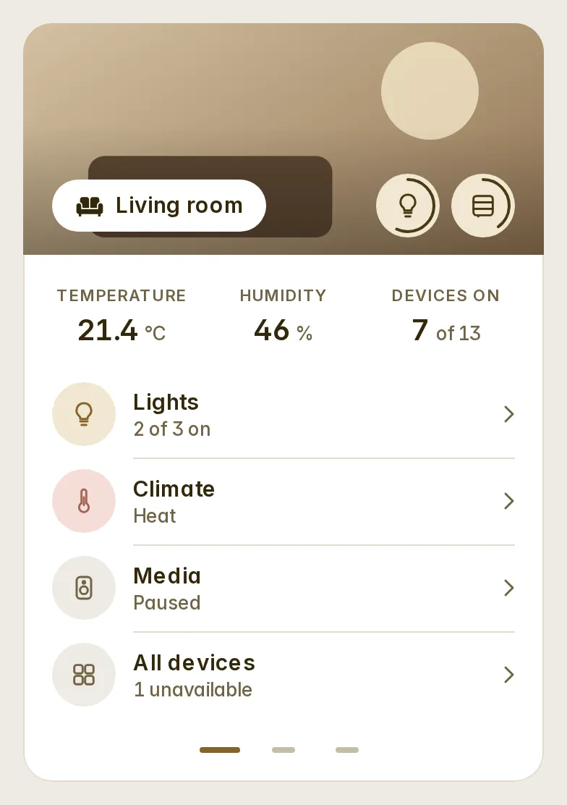

<!-- Generated by `pnpm docs:cards` from the card’s editor and its example in tools/docs/src/gallery.ts: change those, not this page. -->

# Swipe

`custom:fluvy-swipe-card` · [All cards](../cards.md#structure-and-navigation) · [Try it live](https://acosta290.github.io/fluvy/?card=swipe)

Any cards, one a page, turned by a swipe or the page marks under them: side by side on a wide screen, round from the last to the first.

<picture><source media="(prefers-color-scheme: dark)" srcset="../images/cards/swipe-dark.webp"></picture>

```yaml
type: custom:fluvy-swipe-card
cards:
  - type: custom:fluvy-room-card
    area: rm_living
    path: /fluvy-auto/room-rm_living
  - type: custom:fluvy-room-card
    area: rm_kitchen
  - type: custom:fluvy-room-card
    area: rm_bedroom
```

The picture is this configuration on the demo house, whose names and figures are made up: put your own entities in place of its. [Try it in the live demo](https://acosta290.github.io/fluvy/?card=swipe), where it answers a tap as it would at home, with each of its layouts and the YAML of each.

## Layouts

`style` chooses the layout. The picture is `card`, the one the card has when the key is left out; each of the others is the example plus these lines.

| `style` | Add to the example | Live |
| --- | --- | --- |
| `plain` | `style: plain` | [Try it](https://acosta290.github.io/fluvy/?card=swipe&layout=plain) |

## Options

Every key the card’s editor shows: the editor’s word for it in italics, then what it does. *Default* is what the card does when the key is left out, as the editor shows it on a new card; the editor never writes a default into the configuration.

| Key | What it does | Type | Default | Values |
| --- | --- | --- | --- | --- |
| `style` | *Style*. Draws the card on its own surface, or plain on the page. | choice | `card` | `card` (One card), `plain` |
| `columns` | *Cards side by side*. How many of its cards stand side by side, as many as the width holds. | choice | `1` | `1`, `2`, `3`, `4` |
| `gap` | *Room between cards (px)*. The room between the cards it holds, in pixels. | number | `40` | 0 to 40, in steps of 4 |
| `start` | *Page shown first*. The page the card opens on, counted from 1. | number | `1` | 1 or more |
| `show_indicators` | *Show the page marks*. Shows the page marks under the cards, each a button to its page. | boolean | `true` |  |
| `loop` | *Go round from the last page*. Goes round from the last page to the first, and back. | boolean | `false` |  |
| `remember` | *Remember the page*. Where the page it was left on is kept: this tab while it is open, or nowhere. | choice | `session` | `session` (While the tab is open), `off` |
| `autoplay` | *Turn by itself every (seconds)*. Turns to the next page by itself every this many seconds; 0, only a person turns it. 0: only a person turns it. It waits while a finger, the pointer or the focus is on it. | number | `0` | 0 to 3600 |
| `color` | *Colour*. The card’s colour: its circle, its accents and its tints wear it. Left out, the colour of what it shows. | colour |  |  |
| `card_color` | *Card colour*. Paints the card’s surface in a colour of your own. | colour |  |  |
| `card_opacity` | *Card opacity*. How see-through the card’s surface is, in percent. Untouched: every card’s, from Fluvy’s settings. | number | `100` | 0 % to 100 %, in steps of 5 |
| `card_border` | *Card border*. Draws the card’s hairline border, or leaves it out. Untouched: every card’s, from Fluvy’s settings. | boolean | `true` |  |
| `cards` | *Cards*. The cards it holds, one a page: any card, Fluvy’s or not. | object |  |  |

## Older names

Names the card still reads, so a dashboard written before keeps working. They are read, never written back.

| Older name | Read as |
| --- | --- |
| `slides_per_view` | `columns` |
| `accent` | `color` |
