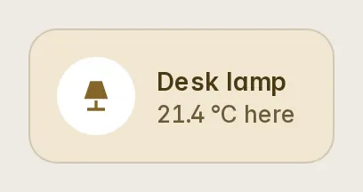

<!-- Generated by `pnpm docs:cards` from the card’s editor and its example in tools/docs/src/gallery.ts: change those, not this page. -->

# Template

`custom:fluvy-template-card` · [All cards](../cards.md#everyday) · [Try it live](https://acosta290.github.io/fluvy/?card=template)

A tile whose name, line, icon, colour and fill are templates, with or without an entity; a Mushroom template card pastes in.

<picture><source media="(prefers-color-scheme: dark)" srcset="../images/cards/template-dark.webp"></picture>

```yaml
type: custom:fluvy-template-card
entity: light.tp_desk
icon: '{{ ''mdi:lamp'' if is_state(entity, ''on'') else ''mdi:lamp-outline'' }}'
secondary: '{{ states(''sensor.tp_temperature'') }} °C here'
```

The picture is this configuration on the demo house, whose names and figures are made up: put your own entities in place of its. [Try it in the live demo](https://acosta290.github.io/fluvy/?card=template), where it answers a tap as it would at home, with each of its layouts and the YAML of each.

More about it in the guide: [Template](../cards.md#template).

## Layouts

`variant` chooses the layout. The picture is `compact`, the one the card has when the key is left out; each of the others is the example plus these lines.

| `variant` | Add to the example | Live |
| --- | --- | --- |
| `mini` | `variant: mini` | [Try it](https://acosta290.github.io/fluvy/?card=template&layout=mini) |
| `large` | `variant: large` | [Try it](https://acosta290.github.io/fluvy/?card=template&layout=large) |

## Options

Every key the card’s editor shows: the editor’s word for it in italics, then what it does. *Default* is what the card does when the key is left out, as the editor shows it on a new card; the editor never writes a default into the configuration.

| Key | What it does | Type | Default | Values |
| --- | --- | --- | --- | --- |
| `entity` | *Entity*. The entity the card is about: what it shows, and what its controls act on. | entity |  |  |
| `name` | *Name*. The name the card shows, in place of the entity’s own. Your own words, or a template such as {{ states('sensor.x') }}. | text |  |  |
| `icon` | *Icon*. The card’s icon, in place of the entity’s own. An icon such as mdi:lightbulb, or a template that gives one. | icon |  |  |
| `secondary` | *Secondary text*. The line under the name: a keyword, your own words, or a template. A keyword, or a template such as {{ states('sensor.x') }}. | choice or text | `none` | `state`, `area`, `last-changed`, `none` |
| `since` | *Last change from*. Where the time of the last change is read from, in place of Home Assistant’s own. A timestamp sensor, or attribute:name. | choice or text | none |  |
| `variant` | *Style*. The card’s layout. | choice | `compact` | `compact`, `mini`, `large` |
| `active` | *Shows as on*. Decides when the card looks on: its colour and its switch follow it. Automatic follows the entity. A template is on unless it gives off, false, no or 0. | choice or text | `auto` | `auto` (Automatic), `always`, `never` |
| `name_lines` | *Lines for the name*. Lets the tile’s name take two lines where one would cut it, the tile a line taller. | choice | `1` | `1`, `2` |
| `show_switch` | *Switch*. Shows the switch. Hidden: its icon turns it on and off. | choice | `true` | `true` (Shown), `false` (Hidden), `value` (Its value instead) |
| `switch_style` | *Switch style*. Draws the switch as a toggle, or as a wall rocker that only switches. Wall rocker: on and off alone, no slider and no level. | choice | `toggle` | `toggle`, `rocker` (Wall rocker) |
| `tone` | *Tone*. The card’s colour from the palette’s tones; left out, the tone of what it shows. | choice | the card’s own | `accent`, `light`, `heat`, `cool`, `dry`, `fan`, `water`, `solar`, `grid`, `media`, `presence`, `armed`, `battery`, `house`, `gas`, `vehicle` (Car), `neutral`, `ok` (Good), `warning`, `danger` |
| `color` | *Colour*. The card’s colour: its circle, its accents and its tints wear it. Left out, the colour of what it shows. In YAML, a template may give a colour or a tone. | colour |  |  |
| `card_color` | *Card colour*. Paints the card’s surface in a colour of your own. | colour |  |  |
| `card_opacity` | *Card opacity*. How see-through the card’s surface is, in percent. Untouched: every card’s, from Fluvy’s settings. | number | `100` | 0 % to 100 %, in steps of 5 |
| `card_border` | *Card border*. Draws the card’s hairline border, or leaves it out. Untouched: every card’s, from Fluvy’s settings. | boolean | `true` |  |
| `unavailable` | *When unavailable*. How the card looks while its entity is unavailable: dashed, or quiet. Untouched: every card’s, from Fluvy’s settings. | choice | `dashed` | `dashed`, `quiet` (As when off) |
| `tint` | *Show its colour*. When the card shows its colour beyond its circle: never, while it is on or active, or at rest too. | choice | `on` | `on` (When on), `always` |
| `readouts` | *Readouts*. Sensors shown as readouts on the tile, in this order. | list ([its items](#readouts)) |  |  |

**Interactions**

| Key | What it does | Type | Default | Values |
| --- | --- | --- | --- | --- |
| `tap_action` | *Tap action*. What a tap on the card does. | action | the card’s own |  |
| `hold_action` | *Hold action*. What a long press on the card does. | action | `more-info` |  |
| `double_tap_action` | *Double tap action*. What two taps on the card do. A tap waits a moment to tell it from a double tap. | action | `none` |  |
| `icon_tap_action` | *Icon tap action*. What a tap on the icon does. | action | the card’s own |  |
| `icon_hold_action` | *Icon hold action*. What a long press on the icon does. | action | `none` |  |
| `icon_double_tap_action` | *Icon double tap action*. What two taps on the icon do. A tap waits a moment to tell it from a double tap. | action | `none` |  |

## Lists

### `readouts`

*Readouts*. Sensors shown as readouts on the tile, in this order. An item is an entity id, or a map with `entity` and any of these keys.

| Key | What it does | Type | Values |
| --- | --- | --- | --- |
| `entity` | *Entity*. The entity the item shows. | entity (sensor) |  |
| `name` | *Name*. The item’s own name, in place of the one the card would give it. Your own words, or a template such as {{ states('sensor.x') }}. | name |  |
| `unit` | *Unit*. The unit the figure is written in. | choice or text | `auto` (Automatic), `W`, `kW`, `MW`, `Wh`, `kWh`, `MWh`, `L`, `m³`, `gal`, `ft³` |
| `decimals` | *Decimals*. How many decimals the figure has. | choice | `auto` (Automatic), `0`, `1`, `2`, `3` |

## Older names

Names the card still reads, so a dashboard written before keeps working. They are read, never written back.

| Older name | Read as |
| --- | --- |
| `primary` | `name` |
| `icon_color` | `color` |
| `layout` | `variant` (some of its values) |
| `vertical` | `variant` (some of its values) |
| `view` | `variant` |
| `accent` | `color` |
