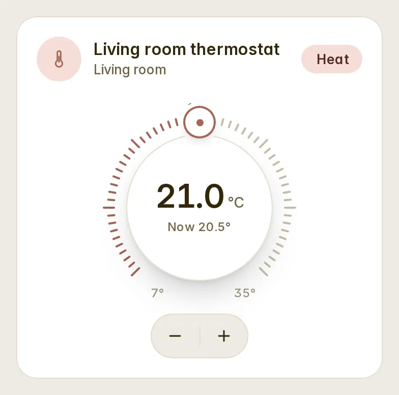

<!-- Generated by `pnpm docs:cards` from the card’s editor and its example in tools/docs/src/gallery.ts: change those, not this page. -->

# Thermostat

`custom:fluvy-thermostat-card` · [All cards](../cards.md#everyday) · [Try it live](https://acosta290.github.io/fluvy/?card=thermostat)

Climate, water heater or humidifier on a dial, with modes, presets and fan speeds.

<picture><source media="(prefers-color-scheme: dark)" srcset="../images/cards/thermostat-dark.webp"></picture>

```yaml
type: custom:fluvy-thermostat-card
entity: climate.living
```

The picture is this configuration on the demo house, whose names and figures are made up: put your own entities in place of its. [Try it in the live demo](https://acosta290.github.io/fluvy/?card=thermostat), where it answers a tap as it would at home, with each of its layouts and the YAML of each.

More about it in the guide: [Thermostat](../cards.md#thermostat).

## Layouts

`variant` chooses the layout. The picture is `dial`, the one the card has when the key is left out; each of the others is the example plus these lines.

| `variant` | Add to the example | Live |
| --- | --- | --- |
| `compact` | `variant: compact` | [Try it](https://acosta290.github.io/fluvy/?card=thermostat&layout=compact) |
| `ruler` | `variant: ruler` | [Try it](https://acosta290.github.io/fluvy/?card=thermostat&layout=ruler) |

## Options

Every key the card’s editor shows: the editor’s word for it in italics, then what it does. *Default* is what the card does when the key is left out, as the editor shows it on a new card; the editor never writes a default into the configuration.

| Key | What it does | Type | Default | Values |
| --- | --- | --- | --- | --- |
| `entity` | *Entity*. The entity the card is about: what it shows, and what its controls act on. | entity (climate, water_heater, humidifier) | required |  |
| `name` | *Name*. The name the card shows, in place of the entity’s own. | name |  |  |
| `icon` | *Icon*. The card’s icon, in place of the entity’s own. | icon |  |  |
| `image` | *Own picture (address or entity)*. A picture of your own in the dial’s circle: an address, or an entity whose picture it is. | text |  |  |
| `subtitle` | *Subtitle*. The line under the title. Your own words, an entity (its state), or a template such as {{ states('sensor.x') }}. | text |  |  |
| `show_icon` | *Show the icon*. Shows the icon, hides it, or lets the card decide. | choice | `auto` | `auto` (Automatic), `always`, `never` |
| `show_badge` | *Show the badge*. Shows the badge at the end of the head, such as the card’s state or a count. | boolean | `true` |  |
| `name_lines` | *Lines for the name*. Lets the name in the card’s head take two balanced lines where one would cut it; the head is a line taller whatever the name. | choice | `1` | `1`, `2` |
| `variant` | *Style*. The card’s layout. | choice | `dial` | `dial`, `compact`, `ruler` |
| `show_stepper` | *Show the − and + buttons*. Shows the − and + buttons. | boolean | `true` |  |
| `show_modes` | *Show the modes*. Shows the modes to choose from. | boolean | `true` |  |
| `modes_style` | *Modes as*. How the modes are drawn. | choice | `tiles` | `tiles`, `chips`, `full` |
| `modes` | *Modes shown*. The modes the card offers, in this order; left out, every mode the device has. | choices | what the device offers | `off`, `heat`, `cool`, `heat_cool` (Auto), `auto`, `dry`, `fan_only` (Fan) |
| `show_current` | *Show the current value*. Shows the room’s temperature beside the target. | boolean | `true` |  |
| `show_presets` | *Preset*. Shows the presets. | boolean | `true` |  |
| `preset_style` | *Presets as*. Draws the presets as chips that fill the row, or as content-sized chips. | choice | `full` | `full`, `chips` |
| `show_fan` | *Fan*. Shows the fan speeds. | boolean | `true` |  |
| `fan_style` | *Fan speeds as*. Draws the fan speeds as chips that fill the row, or as content-sized chips. | choice | `full` | `full`, `chips` |
| `when_off` | *When off*. What the card shows while the device is off: everything, or only what turns it on. | choice | `all` | `all`, `essentials` (The essentials) |
| `tone` | *Tone*. The card’s colour from the palette’s tones; left out, the tone of what it shows. | choice | the card’s own | `accent`, `light`, `heat`, `cool`, `dry`, `fan`, `water`, `solar`, `grid`, `media`, `presence`, `armed`, `battery`, `house`, `gas`, `vehicle` (Car), `neutral`, `ok` (Good), `warning`, `danger` |
| `color` | *Colour*. The card’s colour: its circle, its accents and its tints wear it. Left out, the colour of what it shows. | colour |  |  |
| `card_color` | *Card colour*. Paints the card’s surface in a colour of your own. | colour |  |  |
| `card_opacity` | *Card opacity*. How see-through the card’s surface is, in percent. Untouched: every card’s, from Fluvy’s settings. | number | `100` | 0 % to 100 %, in steps of 5 |
| `card_border` | *Card border*. Draws the card’s hairline border, or leaves it out. Untouched: every card’s, from Fluvy’s settings. | boolean | `true` |  |
| `unavailable` | *When unavailable*. How the card looks while its entity is unavailable: dashed, or quiet. Untouched: every card’s, from Fluvy’s settings. | choice | `dashed` | `dashed`, `quiet` (As when off) |
| `tint` | *Show its colour*. When the card shows its colour beyond its circle: never, while it is on or active, or at rest too. | choice | `off` | `off` (Never), `on` (When active), `always` |
| `tint_style` | *Shown as*. How the colour is shown: a wash over the card, the card’s edge, or the control alone. | choice | `wash` | `wash`, `edge`, `control` |
| `state_colors` | *Colours by state*. A colour for each of the device’s states, held under this key: a tone, none, or a colour of your own. Empty: the colour the card gives it. | map |  | `heating`, `cooling`, `drying`, `fan`, `humidifying`, `idle`, `off` |

**What it is doing**

| Key | What it does | Type | Default | Values |
| --- | --- | --- | --- | --- |
| `state_entity` | *Action read from*. Another entity whose state says what the thermostat is doing. For a thermostat that says no action: a sensor or a switch that does. | entity (sensor, binary_sensor, switch, input_boolean) |  |  |
| `show_valve` | *Show the valve’s opening*. Shows how far the valve is open beside what it is doing. | boolean | `false` |  |
| `valve_entity` | *Valve*. A sensor of the valve’s opening. Empty: found on its device. | entity (sensor, number) |  |  |
| `valve_attribute` | *Valve attribute*. The climate’s attribute that holds the valve’s opening. | text |  |  |
| `show_window` | *Show an open window*. Says "Window open" while a window of the room is. | boolean | `false` |  |
| `window_entity` | *Window*. The window sensor the card reads. Empty: found on its device. | entity (binary_sensor) |  |  |
| `show_battery` | *Warn of a low battery*. Warns of a low battery on the head’s line. | boolean | `false` |  |
| `battery_entity` | *Battery*. The battery sensor the card reads its charge from. Empty: found on its device. | entity (sensor) |  |  |
| `humidity_entity` | *Humidity*. The humidity sensor the card reads, where it is not the one found by itself. | entity |  |  |

**Interactions**

| Key | What it does | Type | Default | Values |
| --- | --- | --- | --- | --- |
| `tap_action` | *Tap action*. What a tap on the card does. | action | `more-info` |  |
| `hold_action` | *Hold action*. What a long press on the card does. | action | `more-info` |  |
| `double_tap_action` | *Double tap action*. What two taps on the card do. A tap waits a moment to tell it from a double tap. | action | `none` |  |
| `icon_tap_action` | *Icon tap action*. What a tap on the icon does. | action | `none` |  |
| `icon_hold_action` | *Icon hold action*. What a long press on the icon does. | action | `none` |  |
| `icon_double_tap_action` | *Icon double tap action*. What two taps on the icon do. A tap waits a moment to tell it from a double tap. | action | `none` |  |

## Older names

Names the card still reads, so a dashboard written before keeps working. They are read, never written back.

| Older name | Read as |
| --- | --- |
| `show_state` | `show_badge` |
| `sub` | `subtitle` |
| `meta` | `subtitle` |
| `layout` | `variant` |
| `view` | `variant` |
| `accent` | `color` |
