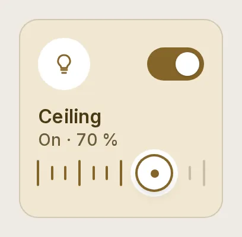

<!-- Generated by `pnpm docs:cards` from the card’s editor and its example in tools/docs/src/gallery.ts: change those, not this page. -->

# Tile

`custom:fluvy-tile-card` · [All cards](../cards.md#everyday) · [Try it live](https://acosta290.github.io/fluvy/?card=tile)

A light, switch, cover, fan, player, number or sensor as a tile: large with a precision ruler or two readouts, compact row, or mini.

<picture><source media="(prefers-color-scheme: dark)" srcset="../images/cards/tile-dark.webp"></picture>

```yaml
type: custom:fluvy-tile-card
entity: light.ceiling
```

The picture is this configuration on the demo house, whose names and figures are made up: put your own entities in place of its. [Try it in the live demo](https://acosta290.github.io/fluvy/?card=tile), where it answers a tap as it would at home, with each of its layouts and the YAML of each.

## Layouts

`size` chooses the layout. The picture is `large`, the one the card has when the key is left out; each of the others is the example plus these lines.

| `size` | Add to the example | Live |
| --- | --- | --- |
| `compact` | `size: compact` | [Try it](https://acosta290.github.io/fluvy/?card=tile&layout=compact) |
| `mini` | `size: mini` | [Try it](https://acosta290.github.io/fluvy/?card=tile&layout=mini) |

## Options

Every key the card’s editor shows: the editor’s word for it in italics, then what it does. *Default* is what the card does when the key is left out, as the editor shows it on a new card; the editor never writes a default into the configuration.

| Key | What it does | Type | Default | Values |
| --- | --- | --- | --- | --- |
| `entity` | *Entity*. The entity the card is about: what it shows, and what its controls act on. | entity | required |  |
| `name` | *Name*. The name the card shows, in place of the entity’s own. | name |  |  |
| `icon` | *Icon*. The card’s icon, in place of the entity’s own. | icon |  |  |
| `size` | *Size*. The tile’s size. | choice | `large` | `large`, `compact`, `mini` |
| `name_lines` | *Lines for the name*. Lets the tile’s name take two lines where one would cut it, the tile a line taller. | choice | `1` | `1`, `2` |
| `show_switch` | *Switch*. Shows the switch. Hidden: its icon turns it on and off. | choice | `true` | `true` (Shown), `false` (Hidden), `value` (Its value instead) |
| `switch_style` | *Switch style*. Draws the switch as a toggle, or as a wall rocker that only switches. Wall rocker: on and off alone, no slider and no level. | choice | `toggle` | `toggle`, `rocker` (Wall rocker) |
| `show_action` | *Show what it is doing*. Says on its line what a climate is doing and what it is set to. | boolean | `false` |  |
| `since` | *Last change from*. Where the time of the last change is read from, in place of Home Assistant’s own. A timestamp sensor, or attribute:name. | choice or text | none |  |
| `tone` | *Tone*. The card’s colour from the palette’s tones; left out, the tone of what it shows. | choice | the card’s own | `accent`, `light`, `heat`, `cool`, `dry`, `fan`, `water`, `solar`, `grid`, `media`, `presence`, `armed`, `battery`, `house`, `gas`, `vehicle` (Car), `neutral`, `ok` (Good), `warning`, `danger` |
| `color` | *Colour*. The card’s colour: its circle, its accents and its tints wear it. Left out, the colour of what it shows. | colour |  |  |
| `card_color` | *Card colour*. Paints the card’s surface in a colour of your own. | colour |  |  |
| `card_opacity` | *Card opacity*. How see-through the card’s surface is, in percent. Untouched: every card’s, from Fluvy’s settings. | number | `100` | 0 % to 100 %, in steps of 5 |
| `card_border` | *Card border*. Draws the card’s hairline border, or leaves it out. Untouched: every card’s, from Fluvy’s settings. | boolean | `true` |  |
| `unavailable` | *When unavailable*. How the card looks while its entity is unavailable: dashed, or quiet. Untouched: every card’s, from Fluvy’s settings. | choice | `dashed` | `dashed`, `quiet` (As when off) |
| `tint` | *Show its colour*. When the card shows its colour beyond its circle: never, while it is on or active, or at rest too. | choice | `on` | `on` (When on), `always` |
| `light_colors` | *Each light on in its bulb’s colour*. Shows each light that is on in its bulb’s own colour. | boolean | `false` |  |
| `light_whites` | *Whites*. Draws a lit white by its colour temperature, or as the palette’s light. | choice | `temperature` | `palette` (The theme’s light), `temperature` (The bulb’s white) |
| `slider_style` | *Slider style*. The slider’s style; left out, the style set for every slider. Untouched: every slider’s, from Fluvy’s settings. | choice | `house` | `house` (House (Ruler)), `ruler`, `bar`, `liquid`, `fill` |
| `slider_words` | *Words under it*. Writes the words at the slider’s ends, or none. | choice | `ends` | `ends` (Ends and middle), `none` |
| `readouts_layout` | *Readouts layout*. Where a compact tile’s readouts stand: on its line, or as columns at its end. Columns: each under its label, as many as the tile holds; the rest on the line. | choice | `line` | `line` (On the line), `end` (Columns at the end) |
| `line_readouts` | *Readouts on the line*. How many readouts the tile’s line says: the first, or every one that can be read. | choice | `first` | `first` (The first), `all` (All of them) |
| `readouts` | *Readouts*. Sensors shown as readouts on the tile, in this order. | list ([its items](#readouts)) |  |  |
| `thresholds` | *Thresholds*. Values past which the reading takes a colour, each with its tone, and a label and an icon of its own. A reading takes the colour of the nearest threshold it is past. | list ([its items](#thresholds)) |  |  |

**Interactions**

| Key | What it does | Type | Default | Values |
| --- | --- | --- | --- | --- |
| `tap_action` | *Tap action*. What a tap on the card does. | action | the card’s own |  |
| `hold_action` | *Hold action*. What a long press on the card does. | action | `more-info` |  |
| `double_tap_action` | *Double tap action*. What two taps on the card do. A tap waits a moment to tell it from a double tap. | action | `none` |  |
| `icon_tap_action` | *Icon tap action*. What a tap on the icon does. | action | the card’s own |  |
| `icon_hold_action` | *Icon hold action*. What a long press on the icon does. | action | `none` |  |
| `icon_double_tap_action` | *Icon double tap action*. What two taps on the icon do. A tap waits a moment to tell it from a double tap. | action | `none` |  |

## Lists

### `readouts`

*Readouts*. Sensors shown as readouts on the tile, in this order. An item is an entity id, or a map with `entity` and any of these keys.

| Key | What it does | Type | Values |
| --- | --- | --- | --- |
| `entity` | *Entity*. The entity the item shows. | entity (sensor) |  |
| `name` | *Name*. The item’s own name, in place of the one the card would give it. | name |  |
| `unit` | *Unit*. The unit the figure is written in. | choice or text | `auto` (Automatic), `W`, `kW`, `MW`, `Wh`, `kWh`, `MWh`, `L`, `m³`, `gal`, `ft³` |
| `decimals` | *Decimals*. How many decimals the figure has. | choice | `auto` (Automatic), `0`, `1`, `2`, `3` |

### `thresholds`

*Thresholds*. Values past which the reading takes a colour, each with its tone, and a label and an icon of its own. A reading takes the colour of the nearest threshold it is past. An item is a map with `tone` and any of these keys.

| Key | What it does | Type | Values |
| --- | --- | --- | --- |
| `tone` | *Tone*. The item’s colour from the palette’s tones. | choice | `none`, `accent`, `light`, `heat`, `cool`, `dry`, `fan`, `water`, `solar`, `grid`, `media`, `presence`, `armed`, `battery`, `house`, `gas`, `vehicle` (Car), `neutral`, `ok` (Good), `warning`, `danger` |
| `value` | *Value*. Where the threshold starts: a figure, an entity’s reading or a template’s answer, in the reading’s unit. A figure, an entity or a template. | text |  |
| `below` | *Under the value*. The threshold claims what is under its value. Off: from the value up. | boolean |  |
| `color` | *Colour*. The item’s colour, in place of the one the card gives it. Empty: the colour the card gives it. | colour |  |
| `label` | *Label*. What the band is called, said beside the reading so that colour is never all that says it. | text |  |
| `icon` | *Icon*. The item’s own icon, in place of the one the card would give it. | icon |  |

## Older names

Names the card still reads, so a dashboard written before keeps working. They are read, never written back.

| Older name | Read as |
| --- | --- |
| `accent` | `color` |
