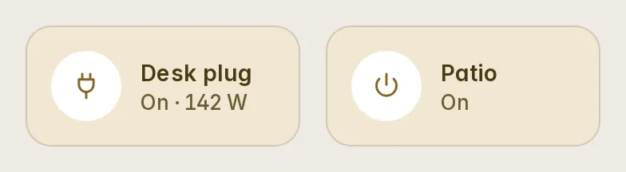

<!-- Generated by `pnpm docs:cards` from the card’s editor and its example in tools/docs/src/gallery.ts: change those, not this page. -->

# Tiles

`custom:fluvy-tiles-card` · [All cards](../cards.md#everyday) · [Try it live](https://acosta290.github.io/fluvy/?card=tiles)

A group of compact or mini tiles, two to four per row, 8 px apart.

<picture><source media="(prefers-color-scheme: dark)" srcset="../images/cards/tiles-dark.webp"></picture>

```yaml
type: custom:fluvy-tiles-card
tiles:
  - entity: switch.desk_plug
    readouts:
      - sensor.desk_plug_power
  - entity: switch.patio
```

The picture is this configuration on the demo house, whose names and figures are made up: put your own entities in place of its. [Try it in the live demo](https://acosta290.github.io/fluvy/?card=tiles), where it answers a tap as it would at home, with each of its layouts and the YAML of each.

## Layouts

`size` chooses the layout. The picture is `compact`, the one the card has when the key is left out; each of the others is the example plus these lines.

| `size` | Add to the example | Live |
| --- | --- | --- |
| `mini` | `size: mini` | [Try it](https://acosta290.github.io/fluvy/?card=tiles&layout=mini) |
| `large` | `size: large` | [Try it](https://acosta290.github.io/fluvy/?card=tiles&layout=large) |

## Options

Every key the card’s editor shows: the editor’s word for it in italics, then what it does. *Default* is what the card does when the key is left out, as the editor shows it on a new card; the editor never writes a default into the configuration.

| Key | What it does | Type | Default | Values |
| --- | --- | --- | --- | --- |
| `names` | *Names*. How a row is named where it has no name of its own: the entity’s full name, its own, or its device’s. Where no name of its own is set. | choice | `full` | `full` (Full name), `entity` (Entity name), `device` (Device name) |
| `size` | *Size*. The tiles’ size. | choice | `compact` | `compact`, `mini`, `large` |
| `columns` | *Columns*. How many items stand side by side in a row. | choice | `2` | `1`, `2`, `3`, `4`, `auto` (Automatic) |
| `group_by` | *Group by*. Groups the items under the name of their room or their floor. | choice | `none` | `none`, `area`, `floor` |
| `group_order` | *Groups in order*. The order of the groups: the house’s order of its rooms, or by name. Automatic: the order of the rooms in Fluvy’s settings. | choice | `auto` | `auto` (Automatic), `name` |
| `short_names` | *Short names in a group*. Shortens a name inside a group by the group’s own name. | boolean | `true` |  |
| `name_lines` | *Lines for the name*. Lets each tile’s name take two lines where one would cut it, every tile a line taller. | choice | `1` | `1`, `2` |
| `show_switch` | *Switch*. Shows the switch. Hidden: its icon turns it on and off. | choice | `true` | `true` (Shown), `false` (Hidden), `value` (Its value instead) |
| `switch_style` | *Switch style*. Draws the switch as a toggle, or as a wall rocker that only switches. Wall rocker: on and off alone, no slider and no level. | choice | `toggle` | `toggle`, `rocker` (Wall rocker) |
| `show_action` | *Show what it is doing*. Says on its line what a climate is doing and what it is set to. | boolean | `false` |  |
| `tone` | *Tone*. The card’s colour from the palette’s tones; left out, the tone of what it shows. | choice | the card’s own | `accent`, `light`, `heat`, `cool`, `dry`, `fan`, `water`, `solar`, `grid`, `media`, `presence`, `armed`, `battery`, `house`, `gas`, `vehicle` (Car), `neutral`, `ok` (Good), `warning`, `danger` |
| `color` | *Colour*. The card’s colour: its circle, its accents and its tints wear it. Left out, the colour of what it shows. | colour |  |  |
| `card_color` | *Card colour*. Paints the card’s surface in a colour of your own. | colour |  |  |
| `card_opacity` | *Card opacity*. How see-through the card’s surface is, in percent. Untouched: every card’s, from Fluvy’s settings. | number | `100` | 0 % to 100 %, in steps of 5 |
| `card_border` | *Card border*. Draws the card’s hairline border, or leaves it out. Untouched: every card’s, from Fluvy’s settings. | boolean | `true` |  |
| `unavailable` | *When unavailable*. How the card looks while its entity is unavailable: dashed, or quiet. Untouched: every card’s, from Fluvy’s settings. | choice | `dashed` | `dashed`, `quiet` (As when off) |
| `tint` | *Show its colour*. When the card shows its colour beyond its circle: never, while it is on or active, or at rest too. | choice | `on` | `on` (When on), `always` |
| `light_colors` | *Each light on in its bulb’s colour*. Shows each light that is on in its bulb’s own colour. | boolean | `false` |  |
| `light_whites` | *Whites*. Draws a lit white by its colour temperature, or as the palette’s light. | choice | `temperature` | `palette` (The theme’s light), `temperature` (The bulb’s white) |
| `slider_style` | *Slider style*. The slider’s style; left out, the style set for every slider. Untouched: every slider’s, from Fluvy’s settings. | choice | `house` | `house` (House (Ruler)), `ruler`, `bar`, `liquid`, `fill` |
| `slider_words` | *Words under it*. Writes the words at the slider’s ends, or none. | choice | `ends` | `ends` (Ends and middle), `none` |
| `readouts_layout` | *Readouts layout*. Where a compact tile’s readouts stand: on its line, or as columns at its end. Columns: each under its label, as many as the tile holds; the rest on the line. | choice | `line` | `line` (On the line), `end` (Columns at the end) |
| `line_readouts` | *Readouts on the line*. How many readouts the tile’s line says: the first, or every one that can be read. | choice | `first` | `first` (The first), `all` (All of them) |
| `empty_text` | *Text when empty*. What the card says while it has nothing to show. | text |  |  |
| `hide_empty` | *Hide when empty*. Hides the whole card while it has nothing to show. | boolean | `false` |  |
| `tiles` | *Tiles*. The tiles, in the order they are drawn. | list ([its items](#tiles)) |  |  |

## Lists

### `tiles`

*Tiles*. The tiles, in the order they are drawn. An item is an entity id, or a map with `entity` and any of these keys. Between its items, `type: section` with a `label` heads a group.

| Key | What it does | Type | Values |
| --- | --- | --- | --- |
| `entity` | *Entity*. The entity the item shows. | entity |  |
| `name` | *Name*. The item’s own name, in place of the one the card would give it. | name |  |
| `icon` | *Icon*. The item’s own icon, in place of the one the card would give it. | icon |  |
| `tone` | *Tone*. The item’s colour from the palette’s tones. | choice | `accent`, `light`, `heat`, `cool`, `dry`, `fan`, `water`, `solar`, `grid`, `media`, `presence`, `armed`, `battery`, `house`, `gas`, `vehicle` (Car), `neutral`, `ok` (Good), `warning`, `danger` |
| `color` | *Colour*. The item’s colour, in place of the one the card gives it. Empty: the light’s bulb colour where the card shows bulbs’ colours, else the card’s. | colour |  |
| `readouts` | *Readouts*. Sensors shown as readouts on the tile. | object |  |
| `thresholds` | *Thresholds*. | object |  |
| `since` | *Last change from*. Where the time of the last change is read from. A timestamp sensor, or attribute:name. | choice or text |  |
| `unavailable` | *When unavailable*. How the tile looks while its entity is unavailable. Empty: the card’s. | choice | `dashed`, `quiet` (As when off) |
| `show_switch` | *Switch*. Shows the tile’s switch, hides it, or shows its level in its place. Empty: the card’s. | choice | `true` (Shown), `false` (Hidden), `value` (Its value instead) |
| `switch_style` | *Switch style*. Draws the tile’s switch as a toggle, or as a wall rocker. Empty: the card’s. | choice | `toggle`, `rocker` (Wall rocker) |
| `show_action` | *Show what it is doing*. Says what a climate is doing on the tile’s line. Empty: the card’s. | choice | `true` (On), `false` (Off) |

**Interactions**

| Key | What it does | Type | Values |
| --- | --- | --- | --- |
| `tap_action` | *Tap action*. What a tap on the item does. | action |  |
| `hold_action` | *Hold action*. What a long press on the item does. | action |  |
| `double_tap_action` | *Double tap action*. What two taps on the item do. A tap waits a moment to tell it from a double tap. | action |  |
| `icon_tap_action` | *Icon tap action*. What a tap on the tile’s icon does. | action |  |
| `icon_hold_action` | *Icon hold action*. What a long press on the tile’s icon does. | action |  |
| `icon_double_tap_action` | *Icon double tap action*. What two taps on the tile’s icon do. A tap waits a moment to tell it from a double tap. | action |  |

## Older names

Names the card still reads, so a dashboard written before keeps working. They are read, never written back.

| Older name | Read as |
| --- | --- |
| `entities` | `tiles` |
| `tiles[].label` | `tiles[].name` |
| `tiles[].sub` | `tiles[].secondary` |
| `tiles[].meta` | `tiles[].subtitle` |
| `accent` | `color` |
