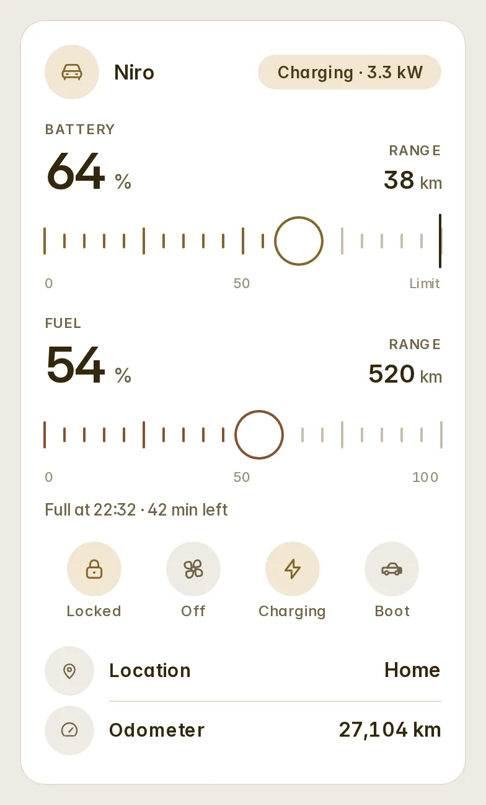

<!-- Generated by `pnpm docs:cards` from the card’s editor and its example in tools/docs/src/gallery.ts: change those, not this page. -->

# Vehicle

`custom:fluvy-vehicle-card` · [All cards](../cards.md#everyday) · [Try it live](https://acosta290.github.io/fluvy/?card=vehicle)

An electric car: its battery, range and charge limit, when it is full, where it is, and its lock, climate, charging, boot and windows in one row. Tesla, BMW, Renault, Volvo, Kia, Hyundai, Volkswagen, Škoda, Polestar, MG and more.

<picture><source media="(prefers-color-scheme: dark)" srcset="../images/cards/vehicle-dark.webp"></picture>

```yaml
type: custom:fluvy-vehicle-card
device: d-model-y
```

The picture is this configuration on the demo house, whose names and figures are made up: put your own entities in place of its. [Try it in the live demo](https://acosta290.github.io/fluvy/?card=vehicle), where it answers a tap as it would at home, with each of its layouts and the YAML of each.

More about it in the guide: [Vehicle](../cards.md#vehicle).

## Layouts

`variant` chooses the layout. The picture is `full`, the one the card has when the key is left out; each of the others is the example plus these lines.

| `variant` | Add to the example | Live |
| --- | --- | --- |
| `compact` | `variant: compact` | [Try it](https://acosta290.github.io/fluvy/?card=vehicle&layout=compact) |
| `mini` | `variant: mini` | [Try it](https://acosta290.github.io/fluvy/?card=vehicle&layout=mini) |

## Options

Every key the card’s editor shows: the editor’s word for it in italics, then what it does. *Default* is what the card does when the key is left out, as the editor shows it on a new card; the editor never writes a default into the configuration.

| Key | What it does | Type | Default | Values |
| --- | --- | --- | --- | --- |
| `device` | *Car*. The device the card reads: every entity it has is found on it. | device |  |  |
| `entity` | *Entity*. An entity of the car, where its device is not named: the device is found from it. | entity |  |  |
| `scan` | *Find its entities*. Searches the device for the rest of its entities; off, the card reads only those named. Off: only the entities named below. | boolean | `true` |  |
| `name` | *Name*. The name the card shows, in place of the entity’s own. | name |  |  |
| `icon` | *Icon*. The card’s icon, in place of the entity’s own. | icon |  |  |
| `show_icon` | *Show the icon*. Shows the icon, hides it, or lets the card decide. | choice | `auto` | `auto` (Automatic), `always`, `never` |
| `name_lines` | *Lines for the name*. Lets the name in the card’s head take two balanced lines where one would cut it; the head is a line taller whatever the name. | choice | `1` | `1`, `2` |
| `variant` | *Style*. The card’s layout. | choice | `full` | `full`, `compact`, `mini` |
| `energy` | *Energy*. | choice | `auto` | `auto` (Automatic), `electric`, `fuel`, `hybrid` (Plug-in hybrid) |
| `tank_size` | *Tank size*. In the unit of what is in it (L, gal): its level, where the car says only what is in it. | number |  | 0 to 500 |
| `hero` | *Battery as*. Draws the battery on a ruler, or as a ring. | choice | `ruler` | `ruler`, `ring` |
| `image` | *Picture*. A picture of the car: an address, an entity whose picture it is, or the integration’s own. An address, an image or camera entity, or “auto” for the car’s own. | text |  |  |
| `image_position` | *Picture in*. Where the car’s picture stands: beside the battery, or in the head. | choice | `hero` | `hero` (Over the battery), `head` (The head) |
| `show_range` | *Show the range*. Shows the range. | boolean | `true` |  |
| `show_limit` | *Mark the charge limit*. Marks the charge limit on the battery’s ruler. | boolean | `true` |  |
| `show_status` | *Show the line under the battery*. Shows the line under the battery: when it is full, why it is not charging, a low range. | boolean | `true` |  |
| `show_controls` | *Show the buttons*. Shows the buttons. | boolean | `true` |  |
| `show_rows` | *Show the rows*. Shows the rows under the main control. | boolean | `true` |  |
| `show_tyres` | *Show the tyres*. Shows the tyres’ pressures. | boolean | `false` |  |
| `low_range` | *Low range under*. The range below which the car reads low; left out, a charge of 20 % or less does. | number |  | 0 to 1000 |
| `stale_after` | *Say it is not up to date after (min)*. Says when the car last reported, once it has said nothing for this many minutes. | number | `30` | 0 to 1440 |
| `range_unit` | *Range in*. The unit the range is written in. | choice | `auto` | `auto` (Automatic), `km`, `mi` |
| `range_decimals` | *Range decimals*. How many decimals the range has. | choice | `auto` | `auto` (Automatic), `0`, `1`, `2` |
| `power_unit` | *Power in*. The unit the charging power is written in. | choice | `auto` | `auto` (Automatic), `W`, `kW` |
| `power_decimals` | *Power decimals*. How many decimals the charging power has. | choice | `auto` | `auto` (Automatic), `0`, `1`, `2` |
| `tone` | *Tone*. The card’s colour from the palette’s tones; left out, the tone of what it shows. | choice | the card’s own | `accent`, `light`, `heat`, `cool`, `dry`, `fan`, `water`, `solar`, `grid`, `media`, `presence`, `armed`, `battery`, `house`, `gas`, `vehicle` (Car), `neutral`, `ok` (Good), `warning`, `danger` |
| `color` | *Colour*. The card’s colour: its circle, its accents and its tints wear it. Left out, the colour of what it shows. | colour |  |  |
| `card_color` | *Card colour*. Paints the card’s surface in a colour of your own. | colour |  |  |
| `card_opacity` | *Card opacity*. How see-through the card’s surface is, in percent. Untouched: every card’s, from Fluvy’s settings. | number | `100` | 0 % to 100 %, in steps of 5 |
| `card_border` | *Card border*. Draws the card’s hairline border, or leaves it out. Untouched: every card’s, from Fluvy’s settings. | boolean | `true` |  |
| `unavailable` | *When unavailable*. How the card looks while its entity is unavailable: dashed, or quiet. Untouched: every card’s, from Fluvy’s settings. | choice | `dashed` | `dashed`, `quiet` (As when off) |
| `hero_tap_action` | *Battery tap*. What a tap on the battery does. | action | the card’s own |  |
| `hero_hold_action` | *Battery hold*. What a long press on the battery does. | action | the card’s own |  |
| `hero_double_tap_action` | *Battery double tap*. What two taps on the battery do. A tap waits a moment to tell it from a double tap. | action | `none` |  |
| `controls` | *Controls*. The car’s controls, each a round that acts on it. | list ([its items](#controls)) |  |  |
| `rows` | *Rows*. The rows of readings under the battery, in this order. | list ([its items](#rows)) |  |  |
| `roles` | *Entities by hand*. Entities named by hand for a part the card does not find on the device, or should read otherwise. | list ([its items](#roles)) |  |  |

**Interactions**

| Key | What it does | Type | Default | Values |
| --- | --- | --- | --- | --- |
| `tap_action` | *Tap action*. What a tap on the card does. | action | `more-info` |  |
| `hold_action` | *Hold action*. What a long press on the card does. | action | `more-info` |  |
| `double_tap_action` | *Double tap action*. What two taps on the card do. A tap waits a moment to tell it from a double tap. | action | `none` |  |
| `icon_tap_action` | *Icon tap action*. What a tap on the icon does. | action | `none` |  |
| `icon_hold_action` | *Icon hold action*. What a long press on the icon does. | action | `none` |  |
| `icon_double_tap_action` | *Icon double tap action*. What two taps on the icon do. A tap waits a moment to tell it from a double tap. | action | `none` |  |

## Lists

### `controls`

*Controls*. The car’s controls, each a round that acts on it. An item is a map with `control` and any of these keys.

| Key | What it does | Type | Values |
| --- | --- | --- | --- |
| `control` | *Control*. What the control switches. | choice | `lock`, `climate`, `charging`, `charge_port`, `trunk` (Boot), `frunk` (Front boot), `windows`, `doors`, `sentry` |
| `name` | *Name*. The item’s own name, in place of the one the card would give it. | text |  |
| `icon` | *Icon*. The item’s own icon, in place of the one the card would give it. | icon |  |
| `color` | *Colour*. The item’s colour, in place of the one the card gives it. Empty: the card’s colour. | colour |  |
| `confirm` | *Ask first*. Asks before the control acts. | boolean |  |

**Interactions**

| Key | What it does | Type | Values |
| --- | --- | --- | --- |
| `tap_action` | *Tap action*. What a tap on the item does. | action |  |
| `hold_action` | *Hold action*. What a long press on the item does. | action |  |
| `double_tap_action` | *Double tap action*. What two taps on the item do. A tap waits a moment to tell it from a double tap. | action |  |

### `rows`

*Rows*. The rows of readings under the battery, in this order. An item is a map with `row` and any of these keys.

| Key | What it does | Type | Values |
| --- | --- | --- | --- |
| `row` | *Row*. Which reading the row shows. | choice | `location`, `odometer`, `inside`, `outside`, `charge_power` (Charging power), `charge_rate`, `charge_limit`, `time_to_full`, `software`, `speed`, `fuel`, `fuel_range`, `fuel_volume` (In the tank), `adblue`, `oil`, `service` (Next service) |
| `entity` | *Entity*. The entity the item shows. | entity |  |
| `name` | *Name*. The item’s own name, in place of the one the card would give it. | name |  |
| `icon` | *Icon*. The item’s own icon, in place of the one the card would give it. | icon |  |
| `color` | *Colour*. The item’s colour, in place of the one the card gives it. Empty: the card’s colour. | colour |  |

**Interactions**

| Key | What it does | Type | Values |
| --- | --- | --- | --- |
| `tap_action` | *Tap action*. What a tap on the item does. | action |  |
| `hold_action` | *Hold action*. What a long press on the item does. | action |  |
| `double_tap_action` | *Double tap action*. What two taps on the item do. A tap waits a moment to tell it from a double tap. | action |  |

### `roles`

*Entities by hand*. Entities named by hand for a part the card does not find on the device, or should read otherwise. An item is a map with `role` and any of these keys.

| Key | What it does | Type | Values |
| --- | --- | --- | --- |
| `role` | *Part*. What the entity is to the car. | choice | `battery`, `range`, `charging` (Charging state), `plugged` (Cable plugged in), `charge_power` (Charging power), `charge_rate`, `time_to_full`, `charge_limit`, `charge_switch` (Charging switch), `charge_start` (Start charging), `charge_stop` (Stop charging), `charge_port`, `climate`, `climate_switch`, `climate_start` (Start the climate), `climate_stop` (Stop the climate), `climate_running`, `inside`, `outside`, `lock`, `trunk` (Boot), `frunk` (Front boot), `windows`, `sentry`, `odometer`, `location`, `address`, `software`, `state` (Car state), `shift` (Gear), `speed`, `moving`, `updated` (Last update), `fuel`, `fuel_range`, `fuel_volume` (In the tank), `fuel_low` (Low fuel warning), `adblue`, `oil`, `service` (Next service), `service_time` (Time to service), `tyre_fl` (Front left), `tyre_fr` (Front right), `tyre_rl` (Rear left), `tyre_rr` (Rear right) |
| `entity` | *Entity*. The entity the item shows. | entity |  |

## Older names

Names the card still reads, so a dashboard written before keeps working. They are read, never written back.

| Older name | Read as |
| --- | --- |
| `layout` | `variant` |
| `view` | `variant` |
| `accent` | `color` |
