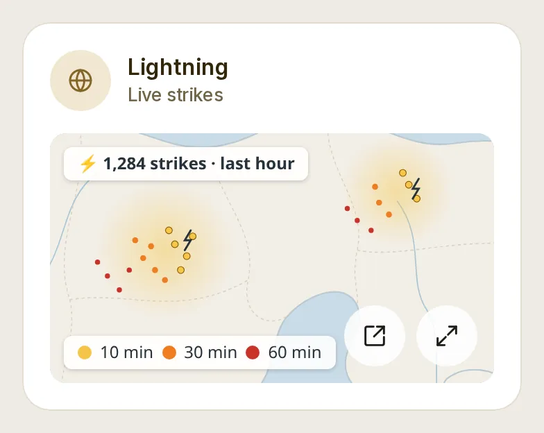

<!-- Generated by `pnpm docs:cards` from the card’s editor and its example in tools/docs/src/gallery.ts: change those, not this page. -->

# Web page

`custom:fluvy-web-card` · [All cards](../cards.md#structure-and-navigation) · [Try it live](https://acosta290.github.io/fluvy/?card=web)

A web page on a plate — a map, a chart, a site of your own — under a head, in a frame or bare; sandboxed as Home Assistant’s iframe card is.

<picture><source media="(prefers-color-scheme: dark)" srcset="../images/cards/web-dark.webp"></picture>

```yaml
type: custom:fluvy-web-card
url: /web/radar.html
title: Lightning
subtitle: Live strikes
```

The picture is this configuration on the demo house, whose names and figures are made up: put your own entities in place of its. [Try it in the live demo](https://acosta290.github.io/fluvy/?card=web), where it answers a tap as it would at home, with each of its layouts and the YAML of each.

More about it in the guide: [Web page](../cards.md#web-page).

## Layouts

`variant` chooses the layout. The picture is `plate`, the one the card has when the key is left out; each of the others is the example plus these lines.

| `variant` | Add to the example | Live |
| --- | --- | --- |
| `frame` | `variant: frame` | [Try it](https://acosta290.github.io/fluvy/?card=web&layout=frame) |
| `bare` | `variant: bare` | [Try it](https://acosta290.github.io/fluvy/?card=web&layout=bare) |

## Options

Every key the card’s editor shows: the editor’s word for it in italics, then what it does. *Default* is what the card does when the key is left out, as the editor shows it on a new card; the editor never writes a default into the configuration.

| Key | What it does | Type | Default | Values |
| --- | --- | --- | --- | --- |
| `url` | *Address*. The address of the page the card embeds. | text | required |  |
| `variant` | *Style*. The card’s layout. | choice | `plate` | `plate` (Head and page), `frame` (Page in a frame), `bare` (Page alone) |
| `title` | *Title*. The title over the page. | text |  |  |
| `icon` | *Icon*. The card’s icon, in place of the entity’s own. | icon |  |  |
| `show_icon` | *Show the icon*. Shows the icon, hides it, or lets the card decide. | choice | `auto` | `auto` (Automatic), `always`, `never` |
| `name_lines` | *Lines for the name*. Lets the name in the card’s head take two balanced lines where one would cut it; the head is a line taller whatever the name. | choice | `1` | `1`, `2` |
| `subtitle` | *Subtitle*. The line under the title. | text |  |  |
| `aspect_ratio` | *Shape*. The page’s shape inside the card. | choice or text | `16:9` | `16:9`, `4:3`, `3:2`, `1:1`, `2:1`, `21:9`, `fill` (Fill the view) |
| `height` | *Height (px)*. The page’s height in pixels: it wins over the shape. | number |  | 68 to 2000, in steps of 4 |
| `scale` | *Scale*. How large the page is drawn inside the card, as a factor. | number | `1` | 0.5 to 1, in steps of 0.05 |
| `refresh` | *Reload every (minutes)*. Loads the page again every this many minutes; 0 never does. | number | `0` | 0 to 1440 |
| `look` | *Look*. Shows the page as it is, inverted to dark, or following the card’s mode. Dark inverts the page, pictures too. Automatic follows the card. | choice | `page` | `page` (The page’s own), `dark`, `auto` (Automatic) |
| `sandbox` | *Sandbox*. How much the embedded page is allowed to do. Standard is Home Assistant’s own. Strict keeps the page from its cookies, pop-ups and downloads. | choice | `standard` | `standard`, `strict`, `off` |
| `allow_open_top_navigation` | *Let a tap in the page send this tab elsewhere*. Lets a link in the page send the whole browser tab elsewhere. | boolean | `false` |  |
| `allow` | *Permissions (allow)*. What the embedded page is allowed, as an iframe’s permissions policy (fullscreen by default). | text | `fullscreen` |  |
| `show_open` | *Show the open button*. Shows the button that opens the page in a new tab. | boolean | `true` |  |
| `show_fullscreen` | *Show the full-screen button*. Shows the button that opens it full screen. | boolean | `true` |  |
| `show_reload` | *Show the reload button*. Shows the button that loads the page again. | boolean | `false` |  |
| `tone` | *Tone*. The card’s colour from the palette’s tones; left out, the tone of what it shows. | choice | the card’s own | `accent`, `light`, `heat`, `cool`, `dry`, `fan`, `water`, `solar`, `grid`, `media`, `presence`, `armed`, `battery`, `house`, `gas`, `vehicle` (Car), `neutral`, `ok` (Good), `warning`, `danger` |
| `color` | *Colour*. The card’s colour: its circle, its accents and its tints wear it. Left out, the colour of what it shows. | colour |  |  |
| `card_color` | *Card colour*. Paints the card’s surface in a colour of your own. | colour |  |  |
| `card_opacity` | *Card opacity*. How see-through the card’s surface is, in percent. Untouched: every card’s, from Fluvy’s settings. | number | `100` | 0 % to 100 %, in steps of 5 |
| `card_border` | *Card border*. Draws the card’s hairline border, or leaves it out. Untouched: every card’s, from Fluvy’s settings. | boolean | `true` |  |

**Interactions**

| Key | What it does | Type | Default | Values |
| --- | --- | --- | --- | --- |
| `tap_action` | *Tap action*. What a tap on the card does. | action | `none` |  |
| `hold_action` | *Hold action*. What a long press on the card does. | action | `none` |  |
| `double_tap_action` | *Double tap action*. What two taps on the card do. A tap waits a moment to tell it from a double tap. | action | `none` |  |
| `icon_tap_action` | *Icon tap action*. What a tap on the icon does. | action | `none` |  |
| `icon_hold_action` | *Icon hold action*. What a long press on the icon does. | action | `none` |  |
| `icon_double_tap_action` | *Icon double tap action*. What two taps on the icon do. A tap waits a moment to tell it from a double tap. | action | `none` |  |

## Older names

Names the card still reads, so a dashboard written before keeps working. They are read, never written back.

| Older name | Read as |
| --- | --- |
| `hide_background` | `variant` (some of its values) |
| `disable_sandbox` | `sandbox` (some of its values) |
| `sub` | `subtitle` |
| `meta` | `subtitle` |
| `layout` | `variant` |
| `view` | `variant` |
| `accent` | `color` |
